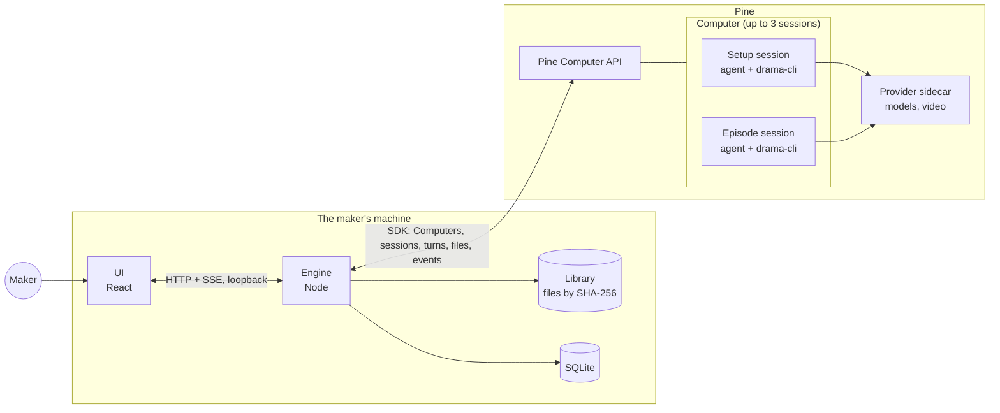
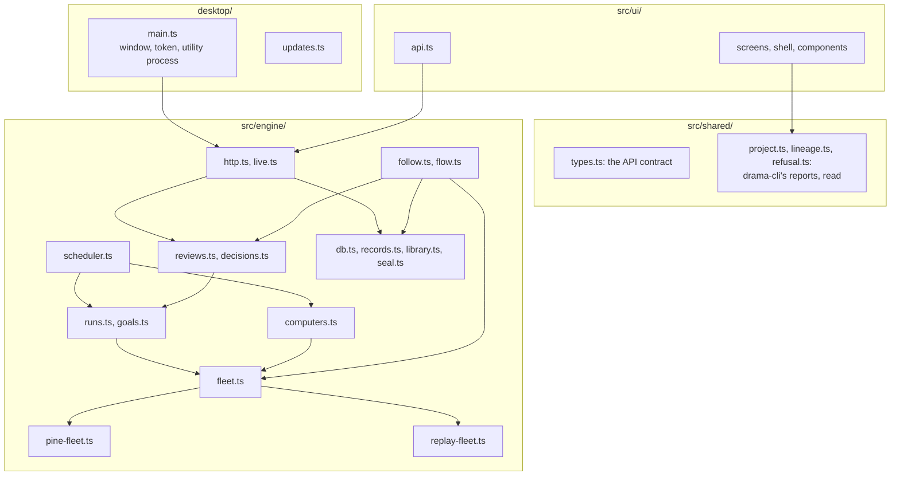
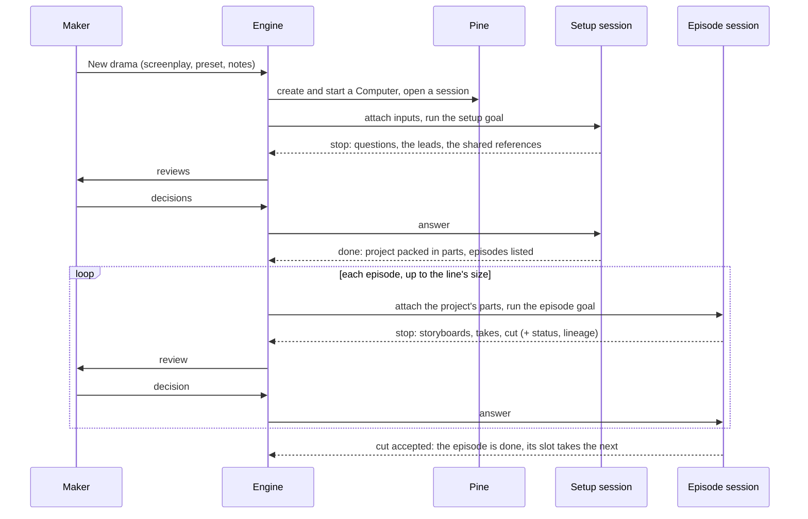
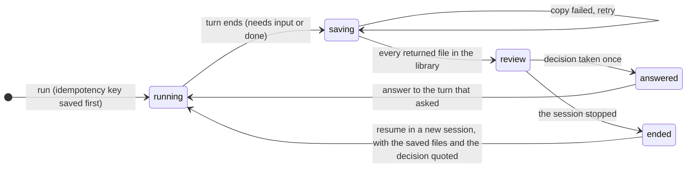

# Architecture

How the studio is built and how it drives drama-cli on Pine Computers, for anyone who changes the
engine, the desktop shell or the contract with the agent. Sections follow arc42
[1](#ref-1); the screens are in `docs/studio/`, the terms in the
[glossary](glossary.md), the decisions in [decisions.md](decisions.md).

## 1. Introduction and goals

Pine's drama skill (drama-cli, run by Pine's agent on a Computer) makes an episode from a finished
screenplay: a bible; character looks, location plates and key props; a breakdown into segments with
shot lists; blocking and storyboards per segment; takes; an edited cut. It stops for a person at
fixed points: every take, every cut, the photoreal storyboard, red lines, caps and questions
(short_drama `skills/drama-workflow/SKILL.md`; [D17](decisions.md#d17-2026-10-30--the-maker-watches-every-take-and-every-cut)).

**The problem.** Without the studio, a maker talks to an agent in text, opens files by path and
answers in a text box. There is no overview of 24 to 80 episodes at different stages; the evidence
for a decision (a storyboard's shot list, a take's planned lines) is scattered; one session works
one episode at a time.

**The goals,** in order:

1. **The maker decides; the agent makes.** Every item is a file a turn returned; every decision
   goes back to the agent as an answer ([D2](decisions.md#d2-2026-10-22--pines-agent-does-all-processing-the-studio-never-runs-drama-cli)).
2. **Nothing is lost or paid for twice.** A returned file is saved before the next turn can change
   it; a decision is taken once; an unknown paid outcome is reconciled, never resubmitted.
3. **Many episodes at once,** on several Computers, without one overwriting another.
4. **The state is drama-cli's.** The studio reads drama-cli's status and lineage and adds no state
   of its own ([design principles](design-principles.md#8-design-states-not-screens)).

## 2. Constraints

| Constraint | Source |
|---|---|
| Only Pine's public SDK: `@pinesandbox/computer` 0.3 on the server, `@pinesandbox/computer-web` 0.3 for the live desktop | `package.json` |
| One secret, the maker's Pine project key; the UI never receives anything that can drive a Computer | [D3](decisions.md#d3-2026-10-22--one-secret-the-makers-pine-project-key) |
| The studio never runs drama-cli or reads its internal records; it reads only what a turn returns | [D2](decisions.md#d2-2026-10-22--pines-agent-does-all-processing-the-studio-never-runs-drama-cli) |
| Sessions on a Computer share no files; a Computer runs up to three; a turn runs up to 60 minutes | Pine Computer's limits |
| A question waiting for an answer does not keep a Computer running; a stopped Computer loses its sessions' working files | Pine Computer's lifecycle; [D6](decisions.md#d6-2026-10-24--idle-timeouts-follow-the-work-1-h-working-3-h-waiting-on-the-maker) |
| No cost in a goal: spending is authorized with no cap | [D7](decisions.md#d7-2026-10-24--spend-is-shown-never-put-in-a-goal) |
| AGPLv3, a public repository | `NOTICES`, `CONTRIBUTING.md` |

## 3. Context and scope

**In scope:** starting dramas and their Computers, handing each session its files and goal,
following turns, saving what they return, turning stops into reviews, sending the maker's decisions
back, showing drama-cli's state, lineage and spend. **Out of scope:** generating, encoding or judging
anything ([D2](decisions.md#d2-2026-10-22--pines-agent-does-all-processing-the-studio-never-runs-drama-cli)),
drama-cli's own rules, and Pine's billing.

## 4. Solution strategy

**How others solve it.** Pine's reference apps (pine-computer-starter, amongminds) keep the project
key and Computer credentials on the server and give the page only a short-lived desktop token,
rebuild a Computer's handle from saved records, start each `run` with an idempotency key saved
first, follow turns with `wait` in a background worker, stream one resumable event feed to the page,
and copy each turn's files into the app so history outlives the Computer. AI production tools we
studied (BigBanana, LocalMiniDrama, FastMovieAI) run on one machine and have the person press
generate on every item; none drives many remote agents.

**Ours** takes the reference apps' patterns as they are and adds what a series needs:

| Strategy | Why |
|---|---|
| An engine process owns Pine and the records; the UI only talks to it | one secret, one place that spends ([D3](decisions.md#d3-2026-10-22--one-secret-the-makers-pine-project-key)) |
| Plain-language goals, not a protocol: the skill on the Computer knows the work | the agent drives, drama-cli provides, the skill teaches ([D2](decisions.md#d2-2026-10-22--pines-agent-does-all-processing-the-studio-never-runs-drama-cli)) |
| Each stop also returns drama-cli's status, lineage and refusals, in `handoff/` | the state is drama-cli's, read as it states it (section 8.2) |
| Pre-production in one session, episodes on copies of its project | drama-cli binds acceptances to exact files ([D5](decisions.md#d5-2026-10-23--pre-production-in-one-session-episodes-on-copies-of-its-project)) |
| Electron around the same engine and UI, which also runs as a local web app | Pine's SDK runs in Electron's main process; one Chromium plays video the same way everywhere ([D1](decisions.md#d1-2026-10-22--a-desktop-app-on-electron)) |
| Replay: recorded turns through the same calls, no key, no spend | development, tests and demos ([D12](decisions.md#d12-2026-10-30--replays-samples-are-real-drama-cli-runs-in-git-lfs)) |

## 5. Building blocks

**Engine** (`src/engine/`, Node 24):

| Module | Does |
|---|---|
| `fleet.ts` | The Pine Computer calls the studio makes, in one place: `pine-fleet.ts` on Pine's SDK, `replay-fleet.ts` on recorded turns |
| `computers.ts` | A drama's Computers and sessions: create, start, stop, open, close, with the records saved around each call; a failed Create or Start is retried with the same credentials |
| `scheduler.ts` | The production line's clock: starts each drama's setup, fills free slots from the episode queue (episodes at once, episodes per Computer, the cap on episodes waiting for the maker), keeps idle timeouts |
| `runs.ts`, `goals.ts` | Hands a session its files, then sends the goal with an idempotency key saved first; the goals in plain language |
| `follow.ts`, `flow.ts` | Follows each turn to its end and each session's events; copies the returned files into the library before anything else; decides what a finished turn means |
| `reviews.ts`, `decisions.ts` | A stop becomes a review, answerable once its files are saved; the maker's decision goes back as one answer, taken once by its submission id ([D13](decisions.md#d13-2026-10-30--a-review-decision-is-taken-once-by-its-submission-id)) |
| `status.ts`, `lineage.ts`, `refusals.ts` | drama-cli's status, lineage and refusals as each stop returns them, kept per turn |
| `library.ts`, `classify.ts`, `zip.ts` | Every returned file, stored once by SHA-256, tagged from its path as a hint; streamed ZIP64 downloads |
| `db.ts`, `records.ts`, `seal.ts`, `keychain.ts` | One SQLite file; secrets sealed with AES-256-GCM, the sealing key in the system's credential store |
| `http.ts`, `live.ts` | The HTTP API, library files with range requests, one event stream saying what changed |
| `views.ts`, `browse.ts` | What the pages show, built from the records |

**Shared** (`src/shared/`): the API's types, and pure readers of drama-cli's reports
(`project.ts` for status, `lineage.ts` and `layout.ts` for the export, `refusal.ts`, `names.ts`
for the bible's names, `spec.ts`). **UI** (`src/ui/`): React 19 screens, the shell and components
(`CONTRIBUTING.md`, "Where things live"). **Desktop** (`desktop/`): Electron's main process and
updates.

## 6. Runtime

### 6.1 A drama, from screenplay to cut

1. **Setup.** One session does everything episodes share, in one drama-cli project: it reads the
   screenplay and asks what is missing, writes the bible, draws the leads, writes every breakdown
   and draws every shared reference, which the maker approves. It then packs the project in parts
   of at most 60 MB (`handoff/project.tar.part-*`) and lists the episodes
   ([D5](decisions.md#d5-2026-10-23--pre-production-in-one-session-episodes-on-copies-of-its-project)).
2. **Episodes.** Each episode session gets the parts as attachments, restores them, points the
   config at its own folder with `drama-cli init`, registers its references again in its own
   session (Pine scopes asset-library registrations to the session that made them), and works only
   inside `episodes/EPxxx`. At each stop it packs its own folder, so a new session can carry on.
3. **Stops.** Every stop also returns `handoff/status.json` (`drama-cli status`),
   `handoff/lineage.json` and `handoff/infinite-canvas.zip` (`drama-cli export`), each version's
   `spec.json` and `request.json`, and `handoff/refusals.jsonl` when it asks about a refusal
   (`src/engine/goals.ts`, `RETURN_*`).

### 6.2 A stop, saved before it is answerable

The rules the flow depends on, checked against Pine's docs in Codex's plan review (23 October 2026):

1. **Save before continuing.** A turn's returned files are paths the next turn can change, so they
   are copied into the library before the question can be answered.
2. **One answer per question.** Pine takes an answer only for the latest turn; the maker's
   per-item decisions go as one combined answer.
3. **No silent stale approvals.** If the question no longer waits, the decision is never resent on
   its own; the review says the session ended and offers a new one.
4. **Reconcile on start and after downtime.** The engine checks every saved Computer and session,
   follows running turns from their saved ids, marks episodes whose Computer stopped, and never
   claims a stopped session's files survive.
5. **Path labels are hints.** Pine guarantees a returned file's path, size, hash and type, not what
   it shows; the state comes from drama-cli's reports.

### 6.3 Keeping Computers alive

A Computer's idle timeout is 1 hour while it works and 3 hours while any of its sessions waits on the
maker (`src/engine/config.ts:39-40`;
[D6](decisions.md#d6-2026-10-24--idle-timeouts-follow-the-work-1-h-working-3-h-waiting-on-the-maker)).
Near the end of a start's running time a Computer takes no new session and stops once its sessions
close. A turn that breaks off carries on in the same session, within a bounded number of "continue"
runs.

## 7. Deployment

| Host | How it runs |
|---|---|
| Desktop | Electron 44 (`desktop/main.ts`): the engine in a `utilityProcess` on a free port, with a token made for this launch; the window opens through the engine's own link; one copy runs at a time. macOS builds are signed and notarized; updates come from the app's GitHub releases (`desktop/updates.ts`). |
| Local web | `npm run dev`: the engine on 127.0.0.1 serving the same UI; the API answers only its own pages. |
| Data | Where each system keeps app data, one engine per data folder (`src/engine/config.ts`, `DATA_DIR`): the SQLite file, the library and the logs. |

## 8. Crosscutting concepts

### 8.1 Security

The project key, Computer credentials, bindings and session tokens are sealed with AES-256-GCM; the
sealing key lives in the Keychain, the Secret Service or Electron's safeStorage
(`src/engine/seal.ts`, `keychain.ts`). The API needs this launch's token and the studio's own origin
for changes; returned files never run scripts in the studio's origin.

### 8.2 The state is drama-cli's

The studio reads where the work stands from drama-cli's status report (`src/shared/project.ts`),
where each version came from from its lineage export (`src/shared/lineage.ts`), and which kind of
stop it is from the refusal's code (`src/shared/refusal.ts`;
[D14](decisions.md#d14-2026-10-30--missing-credentials-are-their-own-stop-a-budget-refusal-is-the-generic-card)).
A session's project stands where its newest turn's report says, ordered as Pine started the turns,
so a late report never replaces a newer one. Across sessions, the engine accepts results by owner:
an episode's files from its own session, shared assets by version and hash
([D5](decisions.md#d5-2026-10-23--pre-production-in-one-session-episodes-on-copies-of-its-project)).

### 8.3 Idempotency

Every `run` carries an idempotency key saved before it is sent (`src/engine/runs.ts`); every review
decision and every Apply carries a submission id, claimed before anything is awaited
([D13](decisions.md#d13-2026-10-30--a-review-decision-is-taken-once-by-its-submission-id);
[design principles](design-principles.md#9-design-for-failure)).

### 8.4 Spend

Pine bills agent turns and, separately, video by the minute on the turn that made it; the video
charge can settle after the turn ends. The studio keeps each turn's highest reading, reads a
Computer's last turns again before stopping it, and shows what each drama and episode spent. Goals
say spending is authorized with no cap
([D7](decisions.md#d7-2026-10-24--spend-is-shown-never-put-in-a-goal)).

### 8.5 Languages

The UI is in English and Chinese, every key in both (`src/ui/i18n.ts`). The agent writes to the
maker in the studio's language. What a person reads from the drama (names, places, titles) comes
from the bible in the screenplay's own script (`src/shared/names.ts`).

## 9. Decisions

Logged once, in [decisions.md](decisions.md).

## 10. Risks

| Risk | Mitigation |
|---|---|
| A Computer stops while the maker takes longer than its idle timeout | 3 h while waiting; each stop's pack lets a new session continue |
| Episode sessions drift from the approved references | every episode restores the same accepted project and never makes a new version of anything shared |
| The maker becomes the bottleneck | one queue of reviews, a cap on episodes waiting for the maker (`WAITING_CAP`, `src/engine/config.ts:43`) |
| The project's limit on Computers | the queue fills slots as Computers free up |

**Not yet verified:** parallel episodes on the real skill (rehearsals ran up to 20 at once on stand-ins);
recording real turns as the replay; a Computer reaching its running-time limit; updates on an Intel
Mac, on Windows and on Linux.

## 11. Before release

- Replay's samples reconstruct aired dramas in their screenplays, bibles and media: a legal review, then
  they are replaced or removed before the repository is public
  ([D45](decisions.md#d45-2026-10-30--replay-samples-carry-their-own-screenplays-legal-review-before-release)).
- A generated public sample set replaces replay's samples from our own test runs
  (`fixtures/replay/`), on a budget merecdesperez44323-lab sets
  ([D12](decisions.md#d12-2026-10-30--replays-samples-are-real-drama-cli-runs-in-git-lfs)).
- The full CI and e2e come back on every pull request
  ([D10](decisions.md#d10-2026-10-30--during-the-sprint-tsc-is-the-gate-and-ci-is-paused-on-redesignstudio)).
- The gallery's screenshot baselines (`e2e/screenshots.spec.ts-snapshots/`) are made again on
  GitHub's runners: they were made on the pine-dev box, and GitHub's ubuntu-latest renders about 1%
  of their pixels differently, over the spec's 0.2%.
- The third-party screenshots in `docs/references/` are removed before the repository is public.
- The documents name other products (the AI drama and production tools studied in
  [information architecture](studio/information-architecture.md#how-others-solve-it) and the
  [design principles](design-principles.md#how-others-solve-it)); they are checked against
  `CONTRIBUTING.md`'s rule of no competitors' names before the repository is public.

## References

[1] G. Starke, P. Hruschka. *arc42*, the template for architecture
documentation. https://docs.arc42.org
