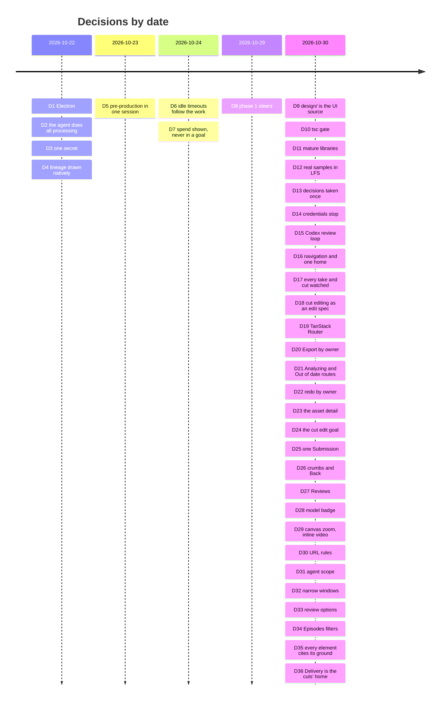

# Decisions

The studio's decisions, logged once, by date (arc42, section 9: an architecture decision record
captures one decision and its rationale, and a project's records together are its decision log
[1](#ref-1), [2](#ref-2)). Each entry gives the context, the decision, the alternatives
the record names, its grounds, its consequences, the words it rests on, and where it is recorded.
Nothing is added that the record does not contain: "none recorded" says so. Words in quotation
marks are verbatim, and a Chinese quote is followed by our English gloss in italics;
merecdesperez44323-lab is named by that GitHub id. Other documents cite an entry by its number.

The entries up to D7 come from the first proposal and build plan (22–24 October 2026); D8 onward
from the redesign. Those plans, `PROPOSAL.md`, `IMPLEMENTATION_PLAN.md` and `REDESIGN_PLAN.md`, were
folded into these documents on 30 October 2026; an entry that cites them cites their text in Git
history, in `docs/` at commit 07ea708.

## D1. 2026-10-22 · A desktop app on Electron
- **Context.** The studio needs Pine's server SDK, local video that plays and seeks the same on
  every system, and a local web mode.
- **Decision.** Electron, with the engine in a utility process and one React UI that also runs as
  a local web app on 127.0.0.1.
- **Alternatives.** Tauri 2.12, the runner-up: its three system webviews had open local-video bugs
  on Linux and macOS, and the SDK would need a separate 58–112 MB sidecar. Electrobun 2 (too
  young), Flutter and React Native desktop (no DOM).
- **Grounds.** Pine's SDK names Electron's main process as a supported runtime; one bundled
  Chromium plays video the same way on every system.
- **Consequences.** Built on 23 October 2026 on Electron 44 (`package.json`), the engine in a
  `utilityProcess`, signed and notarized macOS builds with self-update.
- **Words.** None recorded.
- **Recorded in.** `PROPOSAL.md`, section 7 and its appendix; `IMPLEMENTATION_PLAN.md`, "Desktop
  app, 23 October 2026"; `desktop/`.

## D2. 2026-10-22 · Pine's agent does all processing; the studio never runs drama-cli
- **Context.** Who reads the screenplay and makes the bible, cast, storyboards, takes and cut.
- **Decision.** Pine's agent, with Pine's drama skill (drama-cli) on the Computer, does all
  processing. The studio is UI, UX and flow: it never runs drama-cli and never generates or
  encodes anything itself.
- **Alternatives.** None recorded.
- **Grounds.** drama-cli's own design rule 1: an agent drives, drama-cli provides, the skill
  teaches (short_drama `AGENTS.md`).
- **Consequences.** Every item the studio shows is a file a turn returned; the maker's decisions
  go back to the agent as answers. Cut editing keeps this boundary (D18).
- **Words.** None recorded.
- **Recorded in.** `IMPLEMENTATION_PLAN.md`, "Decisions carried in".

## D3. 2026-10-22 · One secret: the maker's Pine project key
- **Context.** What the studio must hold to drive Computers.
- **Decision.** The only secret is the Pine project API key. The engine keeps it sealed, with the
  sealing key in the system's credential store; the interface never receives anything that can
  drive a Computer.
- **Alternatives.** None recorded.
- **Grounds.** Pine's starter keeps the project key and Computer credentials on the server and
  gives the page only a short-lived desktop token (`PROPOSAL.md`, section 3.5).
- **Consequences.** No `.env` for the maker to edit; Settings changes or forgets the key, and
  forgetting it first stops the project's running Computers (README, "Run it").
- **Words.** None recorded.
- **Recorded in.** `PROPOSAL.md`, section 5.5; `IMPLEMENTATION_PLAN.md`, "Decisions carried in"
  and "Onboarding and look"; `src/engine/seal.ts`, `src/engine/keychain.ts`.

## D4. 2026-10-22 · The lineage is drawn natively; ComfyUI runs nowhere
- **Context.** drama-cli exports a drama's lineage as a ComfyUI workflow; its live preview installs
  a local ComfyUI of about 1.6 GB, with PyTorch, only to show that graph.
- **Decision.** The agent exports the workflow and returns the file; the studio draws the graph
  itself and offers the file as a download.
- **Alternatives.** The ComfyUI preview on the maker's machine; ComfyUI in the Computer, viewed
  over the remote desktop.
- **Grounds.** A 1.6 GB PyTorch app is the wrong tool to draw a read-only graph on a laptop, and
  the remote desktop is slow and outside the app.
- **Consequences.** The Canvas and Lineage read `drama-cli export comfyui` (`src/engine/lineage.ts`);
  Export offers the workflow file (D20).
- **Words.** None recorded.
- **Recorded in.** `PROPOSAL.md`, section 6.

## D5. 2026-10-23 · Pre-production in one session; episodes on copies of its project
- **Context.** drama-cli keeps a drama in one project whose acceptances are bound to their exact
  files; Pine's sessions share no files.
- **Decision.** The setup session does everything episodes share, in one project: the bible, the
  leads, every breakdown and every shared reference, which the maker approves. It packs the project
  in parts; each episode session restores the parts and works only inside its own episode folder,
  never making a new version of anything shared.
- **Alternatives.** Episodes drawn in parallel from loose copies, which drama-cli would refuse or
  which would draw the same look twice.
- **Grounds.** drama-cli's records hold project-relative paths and hashes, so a copy keeps its
  acceptances.
- **Consequences.** The engine accepts a session's results by owner (an episode's files from its
  own session, shared assets by version and hash), so a late snapshot never overwrites a newer one
  (D16).
- **Words.** None recorded.
- **Recorded in.** `IMPLEMENTATION_PLAN.md`, "Where episodes run" and "Pre-production, 23 October
  2026"; `src/engine/runs.ts`.

## D6. 2026-10-24 · Idle timeouts follow the work: 1 h working, 3 h waiting on the maker
- **Context.** A question waiting for an answer does not keep a Pine Computer running; a Computer
  that stops loses its session's working files.
- **Decision.** Each Computer's idle timeout is 1 hour while it works and 3 hours while any of its
  sessions waits on the maker; on a project whose timeout can't change while running, its
  Computers start with 3 hours.
- **Alternatives.** None recorded.
- **Grounds.** The 1 h base matters because a question can arrive while the app is closed, when
  nothing can raise the timeout.
- **Consequences.** `IDLE_WORKING_S` and `IDLE_WAITING_S` in `src/engine/config.ts:39-40`.
- **Words.** None recorded.
- **Recorded in.** `PROPOSAL.md`, section 5.3; `IMPLEMENTATION_PLAN.md`, "Where episodes run" and
  "With lifecycle control".

## D7. 2026-10-24 · Spend is shown, never put in a goal
- **Context.** drama-cli used to require a budget, and the skill asked the maker for one, then to
  confirm each paid take.
- **Decision.** The studio records each turn's highest spend reading and shows what each drama and
  episode spent. Agents are told nothing of cost except that spending is authorized and has no cap.
- **Alternatives.** A budget stated in every goal (`PROPOSAL.md`, section 3.4).
- **Grounds.** Pine bills video on the turn that made it, and the charge can settle after the turn
  ends; a budget in the goal stalled real runs on questions about cost.
- **Consequences.** `NO_CAP` in `src/engine/goals.ts:136`; a budget is never a refusal the studio
  stops for (`src/shared/refusal.ts`).
- **Words.** None recorded.
- **Recorded in.** `IMPLEMENTATION_PLAN.md`, "Rules the flow depends on", rule 6.

## D8. 2026-10-29 · Phase 1 steers
- **Context.** The redesign's scope.
- **Decision.** In phase 1 the maker steers: Accept, Send back with a reason, Note, Lineage, and a
  decision on every take and cut. Nothing is generated or edited by hand, and no prompt is edited.
  Amended on 30 October 2026, twice: phase 1 also edits the cut's spec (D18); and the canvas draws
  each node's hand actions (Generate, Upload) disabled, each saying "Phase 2", on a typed interface
  whose phase-1 handlers do nothing, so phase 2 fills the handlers in rather than adding the
  feature.
- **Alternatives.** None recorded.
- **Grounds.** merecdesperez44323-lab's decision.
- **Consequences.** `CONTRIBUTING.md`, "Before you start"; `NodeActions` and `PHASE_ONE` in
  `src/ui/screens/Canvas.tsx`; a test that the hand actions are disabled, say why, do nothing and
  send nothing (`src/ui/screens/SteerBar.test.tsx`, "offers the hand actions disabled, saying why,
  and they do nothing").
- **Words.** "第一期可以只引导" (*phase 1 can just steer*); "就是read only" (*that is, read only*).
  For the hand actions, 30 October 2026: "这个画布没有 infinite canvas"…"就是每个节点还能单独控制啥的，
  我们上次说这个可以暂时做成比如 点击了没有效果， 但是这个feature是要能支持的，而且这个应该业内都是通用解决方案，
  咱们没有是不行的" (*this canvas is not an infinite canvas… that is, each node can also be controlled
  on its own; we said last time this could for now be made so that clicking it has no effect, but
  the feature must be supported, and this should be the industry's common solution; not having it
  won't do*).
- **Recorded in.** `REDESIGN_PLAN.md`, "Direction"; `CONTRIBUTING.md`.

## D9. 2026-10-30 · design/ is the one source of the UI
- **Context.** The lanes had changed the UI directly in code, each against its own reference
  screenshots, and the integrated studio drifted far from the prototype merecdesperez44323-lab had
  approved.
- **Decision.** `design/` (the approved prototype's markup and stylesheets) is the one source of the
  studio's UI. A UI change is made there first, published, approved, then ported with the same DOM
  and class names. No pull request adds UI that `design/` doesn't have; one that only brings a
  screen in line with `design/` needs no design step.
- **Alternatives.** Matching the prototype by eye, screen by screen.
- **Grounds.** merecdesperez44323-lab's decision; the prototype is the one place the UI is reviewed.
- **Consequences.** The app imports `design/`'s three stylesheets as they are; `npm run design`
  serves it; `npm run design:diff` compares the two side by side (`design/SCREENS.md`).
- **Words.** "你如果后边要修改ui， 你先修改设计稿和设计组件啥的啊！！！" (*if you change the UI from
  now on, change the design drafts and design components first!!!*); "要系统性！！" (*be
  systematic!!*); "要专业" (*be professional*).
- **Recorded in.** Commit 715900c; `CONTRIBUTING.md`, "The design comes first";
  [design principles](design-principles.md#11-design-first).

## D10. 2026-10-30 · During the sprint, tsc is the gate and CI is paused on redesign/studio
- **Context.** Every landing took about 8 minutes of CI, with turn queues and full suites, and pull
  requests lost rebase races again and again.
- **Decision.** CI is paused for pull requests into `redesign/studio`; `main` keeps it. A change
  lands by rebasing onto the branch's head, running `npx tsc --noEmit`, and pushing as a fast
  forward. The full suite and e2e run on head about once an hour (box-ci), and a break is fixed
  forward.
- **Alternatives.** The full CI on every pull request.
- **Grounds.** At the start of a product, iteration speed matters more than a gate on every change.
- **Consequences.** `.github/workflows/ci.yml:9` (`branches-ignore`). Full CI and e2e come back
  before release and when the work moves to `main`.
- **Words.** "为什么一次 ci 要8 min， 暂时把 ci停掉可以吗？最多 20秒就应该搞定的" (*why does one CI run
  take 8 min? Can CI be paused for now? It should be done in 20 seconds at most*); "现在刚开始
  为什么要做这么重！！！！！" (*we are only starting, why make it this heavy!!!!!*); for the tsc gate,
  "你就参考那个 drama-cli 最多跑一个 什么 py 的什么语法检查啥的" (*follow drama-cli: at most run some
  syntax check, like its Python one*).
- **Recorded in.** Commit f4c701e; [design principles](design-principles.md#13-light-process-early).

## D11. 2026-10-30 · Mature libraries; hand-writing what one covers needs approval
- **Context.** The Canvas and Graph were being built with hand-written pan, zoom, layout and
  minimap, to avoid new dependencies.
- **Decision.** Every job a mature, widely used library covers uses that library, pinned exactly,
  with a one-line reason; only the glue is ours (drama-cli's data, the steering actions, our
  tokens). Adding such a library needs no approval; hand-writing what one covers needs
  merecdesperez44323-lab's approval first. When a library replaces our code, ours is deleted in
  the same change.
- **Alternatives.** No new dependencies, with the infrastructure written by hand.
- **Grounds.** merecdesperez44323-lab's decision, relayed by master.
- **Consequences.** React Flow for the Canvas (commit fc1f459, which deleted the hand-written
  camera, zoom, minimap and their tests), shadcn/ui on Radix, media-chrome, WaveSurfer and the
  rest of `CONTRIBUTING.md`, "Building blocks"; TanStack Router (D19).
- **Words.** "坚决不要自己 ad hoc！！！坚决不要！！！！必须用业内通用的、标准的、流行的、有权威参考的！！！"
  (*absolutely nothing ad hoc of our own!!! absolutely not!!!! it must be what the industry
  commonly uses: standard, popular, with an authoritative reference!!!*); "不是 新加依赖要我同意，
  是你手写乱七八糟的组件反而是要我同意！！！" (*it is not a new dependency that needs my approval; it
  is your hand-written, messy components that do!!!*); "你要用最少的代码， 用最多的 成熟组件和接口！！！"
  (*use the least code, and the most mature components and interfaces!!!*).
- **Recorded in.** `CONTRIBUTING.md`, "Components to use";
  [design principles](design-principles.md#12-mature-libraries-least-code-of-our-own).

## D12. 2026-10-30 · Replay's samples are real drama-cli runs, in Git LFS
- **Context.** Replay showed hand-made placeholders, so no screen could be judged on real work.
- **Decision.** Replay's sample dramas carry five of our own drama-cli productions, with drama-cli's
  own ids, paths, versions, lineage, asset records and cuts made by `drama-cli edit`. Their pictures
  and clips go through Git LFS; a checkout without LFS reads them as no sample.
- **Alternatives.** None recorded.
- **Grounds.** merecdesperez44323-lab's decision: the samples belong in the repository, so that
  whoever develops the studio sees what it looks like with real work.
- **Consequences.** A generated public sample set replaces them before release
  ([architecture](architecture.md#11-before-release)). No test needs the samples (`TESTING.md`).
- **Words.** "肯定要进仓库， 这样别人开发时候也知道什么样子啊" (*they must go in the repository, so
  others know what it looks like when they develop*); "效果图里的你就直接放在样例数据里啊！！！" (*put
  what is in the mock-ups straight into the sample data!!!*).
- **Recorded in.** Commits 42182d9, a81cee6 to 5edb51d; `REUSED.md`, "Replay's sample media".

## D13. 2026-10-30 · A review decision is taken once, by its submission id
- **Context.** Two bugs had sent one review's decision twice; Codex's re-review asked for
  idempotency in the engine, not only a disabled button.
- **Decision.** Each sending of a draft carries a submission id, made once by the studio and kept
  for a retry. The engine claims it on the review before awaiting anything: the same id again
  returns the review as the first sending left it; another id for a decided review is refused
  (`review-decided`, 409); a failed send clears the claim. An edited draft is a new submission.
- **Alternatives.** The disabled button alone, which stops only the double click.
- **Grounds.** Stripe's idempotent requests are the established pattern
  ([design principles](design-principles.md#9-design-for-failure)); the IA proposal, section 14.6.
- **Consequences.** `src/engine/reviews.ts:138-141`; `flow.test` covers a retry after a failed
  send, the same id after success, two windows racing and a second press in flight. One build per
  Apply follows the same rule (D18).
- **Words.** None recorded.
- **Recorded in.** Commit 71ab3d8.

## D14. 2026-10-30 · Missing credentials are their own stop; a budget refusal is the generic card
- **Context.** The StopCard chooses its kind from drama-cli's refusal code.
- **Decision.** `InvalidParameter.env` (drama-cli's missing credentials, action `fix_input`) has
  its own kind, `env`, drawn as `design/`'s credentials stop. A budget refusal stays the generic
  card, since it has no code of its own. `RedLine` is a red line; `SetLimitExceeded.<key>` is a
  cap.
- **Alternatives.** A budget card of its own.
- **Grounds.** Master's decision; drama-cli's own codes (`drama_cli/errors.py`, `describe`).
- **Consequences.** `stopKind` in `src/shared/refusal.ts`. Under Pine's managed execution the
  credentials live outside the session, so the card must point at Pine's recovery, not a `.env`
  (Codex's re-review, C2).
- **Words.** None recorded.
- **Recorded in.** Commit b9f3c18.

## D15. 2026-10-30 · Codex reviews the IA and interaction; master adopts or argues each finding
- **Context.** The navigation and interaction were redesigned in a day.
- **Decision.** Codex reviews each draft read-only, against the running studio and `design/`;
  master records each finding as adopted or argued, with the reasons, before
  merecdesperez44323-lab decides.
- **Alternatives.** None recorded.
- **Grounds.** None recorded beyond the context.
- **Consequences.** Two reviews and two rounds of the draft; B1–B6 fixed with behaviour tests
  (commits 01193f0, 0d8f75c, 6d07955); the IA proposal's sections 10, 12 and 14.
- **Words.** None recorded.
- **Recorded in.** The IA proposal, sections 10–15 [3](#ref-3); Codex's review and
  re-review [4](#ref-4), [5](#ref-5).

## D16. 2026-10-30 · The navigation: a studio-wide rail, the drama's tree, one home per object
- **Context.** The rail, the sidebar and the top bar each offered the drama's places, and Canvas
  and Graph were peers of the guided flow, so one object had several independent pages (Codex's
  review, sections 3 and 5).
- **Decision.**
  - The rail is studio-wide only: Dramas, Reviews, Settings.
  - The drama's tree is Script · Story · Assets (Characters, Locations, Props) · Episodes ·
    Delivery, with the drama's Reviews and an "Out of date" filter; it stops at episodes.
  - An episode has two views, List and Canvas; any item has Lineage, a view, not a home.
  - Every object has one home, one page and one URL; other places only link to it.
  - A drama is one logical drama-cli project; sessions work on copies of it and return its state,
    accepted by owner (D5).
- **Alternatives.** Codex's "no new router, fix the helpers" (master argued for TanStack Router,
  D19); a drama as several working copies (master argued for one logical project).
- **Grounds.** The IA proposal and Codex's two reviews [3](#ref-3), [4](#ref-4),
  [5](#ref-5); VS Code's activity bar, sidebar and editor
  ([design principles](design-principles.md#1-one-home-per-object)).
- **Consequences.** `design/`'s IA draft (published for review); the port moves routes, e2e specs and
  the samples' links in one change, with no compatibility shims.
- **Words.** "ia & ixa 还是非常重要的" (*IA and IxA are still very important*); "是不是要先把
  IA方案定下来， 然后才是后续？不然可能修bug也白修？" (*shouldn't the IA plan be settled first, and the
  rest after it? Otherwise fixing bugs may be wasted*); "找到一个东西是不是最好就是只能从一个地方找到，
  而且是符合用户心智 的， 否则到处都要能找， 用户晕了？" (*isn't it best that a thing can be found in
  only one place, one that fits the user's mental model? Otherwise it must be findable everywhere,
  and users get lost*), then "可以的" (*that works*); "包括 每个东西只有一个家 啥的这种 都是 design
  principle" (*including "every thing has only one home" and the like: these are all design
  principles*).
- **Recorded in.** The IA proposal, sections 2–5, 10–12 and 16–17 [3](#ref-3);
  [design principles](design-principles.md).

## D17. 2026-10-30 · The maker watches every take and every cut
- **Context.** Upload's "Your reviews" let the engine approve takes and the cut on the maker's
  behalf (`approveUnreviewed`), while the screens promised the maker watches every take (Codex's
  review, B6).
- **Decision.** No setting approves a video version (take) or a cut for the maker, and none
  approves a photoreal storyboard. "Your reviews" may skip only looks, shared references and
  line-art storyboards.
- **Alternatives.** Keep the option as a setting.
- **Grounds.** drama-cli's rule that the person watches every take and cut and alone accepts the
  photoreal storyboard (short_drama D76, D141; `doc/architecture.md`, section 7.1, item 7; `AGENTS.md`,
  design rule 10), and its architecture, section 7.1, item 7: the person approves "every take and
  cut" (`doc/architecture.md:222` at short_drama ade90c55); Codex's review, B6 [4](#ref-4).
  Auto-approval was a bug against that rule, not a setting.
- **Consequences.** `LEFT` in `src/engine/reviews.ts:160-164`; `flow.test` keeps EP001's takes,
  photoreal storyboards and cut open under every setting.
- **Words.** None recorded.
- **Recorded in.** Commits 0d8f75c and 2cceb2b; the IA proposal, sections 11.1, 12.4 and 14.4
  [3](#ref-3).

## D18. 2026-10-30 · Cut editing edits a draft of drama-cli's edit spec
- **Context.** merecdesperez44323-lab asked for cut editing in phase 1; Codex warned against local
  edit state competing with drama-cli (review, section 7.4).
- **Decision.** The studio edits only a draft of drama-cli's own edit spec (each clip's path,
  sha256, in, out and audio). Apply hands it to the agent, which runs `drama-cli edit build` and
  `edit validate`; the result returns as a new cut version for review. A draft is bound to its base
  cut and every clip's sha256; if upstream changed, Apply refuses until the maker compares,
  re-checks or discards. Edits (take, order, in and out, audio) are counted apart from notes.
- **Alternatives.** A read-only timeline (Codex's first review); editing in the studio's own state.
- **Grounds.** drama-cli stays the single producer (D2): nothing is encoded or stored as truth in
  the studio.
- **Consequences.** The phase-1 scope reads "steering, plus editing the cut's spec" (D8). One build
  per Apply, keyed by a submission id (D13).
- **Words.** "你先同步把 cut 放上去？因为这个不涉及到 IA" (*put the cut up first, in parallel? It does
  not involve the IA*), 30 October 2026. merecdesperez44323-lab's approval of the edit-spec design:
  counted within the IA draft, as master relayed (D24).
- **Recorded in.** The IA proposal, sections 12.2, 14.2 and 15 (round 2, D1–D3) [3](#ref-3).

## D19. 2026-10-30 · TanStack Router for typed routes
- **Context.** The studio's hand-written router used one untyped `item` for both an episode and an
  artifact; Graph sent a character's id as an episode and the studio fell back to Home (Codex's
  review, B1).
- **Decision.** The IA port moves to TanStack Router, with distinct typed params: an episode code
  (`EP\d{3}`) and an artifact id are separate validated types, an artifact must belong to its drama
  (and episode, where it is episode-scoped), and there is no untyped `item`. Lineage is a search
  parameter on the item's home (`?item=<drama-cli stage id>&view=lineage`), confirmed by master on
  30 October 2026. The router is pinned at 1.170.44, with a code-based route tree in
  `src/ui/routes.tsx`. B1's interim fix stays small: typed helpers in the current router.
- **Alternatives.** Codex: no new router, fix the helpers.
- **Grounds.** D11 (mature libraries over hand-written infrastructure), and type-safe routes are
  what prevents B1. The first proposal had already chosen TanStack Router (`PROPOSAL.md`,
  section 7).
- **Consequences.** Landed in commit b6e234d: the hand-written `src/ui/router.tsx` is deleted; the
  route tree is `src/ui/routes.tsx`, the current object is read by `usePlace` and built by
  `placeLink` (`src/ui/place.ts`), and tests render at a URL with `renderAt`
  (`src/ui/test/router.tsx`). The e2e specs, `design/SCREENS.md`'s routes and
  `scripts/design-diff.spec.ts`'s URLs moved in the same change.
- **Words.** None recorded.
- **Recorded in.** The IA proposal, sections 12.1 and 14.1 [3](#ref-3); commit 01193f0
  (the interim fix); commit b6e234d (the port: `src/ui/routes.tsx`, `src/ui/place.ts`,
  `src/ui/test/router.tsx`).

## D20. 2026-10-30 · Export belongs to its owner
- **Context.** Export offered the drama's workflow on every page, the global Reviews included, so
  on a Cut it read as a video download (Codex's review, section 6; re-review, A).
- **Decision.** Export is scoped to the object it exports: on an episode's List, Canvas, Cut and
  Lineage from an item, that episode's session; elsewhere the shared project. It is labelled with
  the session and its stop time. The global Reviews has none.
- **Alternatives.** One drama-wide Export everywhere.
- **Grounds.** One home per object ([design principles](design-principles.md#1-one-home-per-object)).
- **Consequences.** The menu offers the ComfyUI workflow and the infinite-canvas project, downloaded
  under the drama's name (commits d64f5dc, c246944).
- **Words.** None recorded.
- **Recorded in.** `design/` commits c18443e and 721ab7f.

## D21. 2026-10-30 · Analyzing and Out of date have drama-level routes of their own
- **Context.** The route tree gives each object one home (D16); two drama-level pages are not
  views of an object's home.
- **Decision.**
  - `/d/$dramaId/analyzing` stays a top-level drama route. Analyzing and the Fountain review are
    setup steps, a process like the review room, not views of Script, the accepted screenplay's
    home.
  - Out of date is `/d/$dramaId/out-of-date`: a drama-level list beside Reviews, of the items that
    are out of date across Assets and episodes, whose rows link to each item's home (D22).
- **Alternatives.** Analyzing as a view of Script; Out of date as a filter on the Episodes board
  (the IA proposal, section 8.4).
- **Grounds.** work-02's calls, agreed by master on 30 October 2026; Codex's re-review, G6 (Script
  is not the setup review) [5](#ref-5).
- **Consequences.** The router port (D19) carries both routes.
- **Words.** None recorded.
- **Recorded in.** work-05's routing brief, relayed to the docs on 30 October 2026.

## D22. 2026-10-30 · Out of date is redone by its owner's session, one row or the whole group
- **Context.** Out of date lists items from Assets and from episodes; each was made by a different
  session. The dry run of the IA draft (QA journey 3) found the redo only per group: the maker could
  not ask for one exact version.
- **Decision.**
  - Rows are grouped by the session that owns them: the setup's agent for shared assets, each
    episode's agent for its own items. Each group has "Redo all"; each row has "Redo this". Either
    is one submission to that session (D25), after a one-line impact.
  - A row's reason is drama-cli's `problems`, verbatim, shown as "An input changed: <kind>
    <version>" only where the engine knows the file, with the exact words under details. "Made from
    X, which is out of date" for an item made from a stale one is our own wording.
  - Leaving Out of date marks the row in the URL (`?item=`, replacing the history entry), so Back
    returns to it.
- **Alternatives.** One redo button for the whole drama; a redo per group only (the IA draft).
- **Grounds.** The agent panel speaks to one session (the IA proposal, section 9) [3](#ref-3);
  confirm only when spend grows or done work is affected
  ([design principles](design-principles.md#5-confirm-only-when-spend-grows-or-done-work-is-affected));
  one home per object, rule 2 ([design principles](design-principles.md#1-one-home-per-object));
  drama-cli's own reasons (short_drama `drama_cli/artifacts.py`).
- **Consequences.** The set is the drama tree's count: drama-cli's stale items plus what was made
  from them (`outOfDate`, `src/shared/lineage.ts`). Per-row "Redo this" is being built.
- **Words.** None recorded.
- **Recorded in.** Commits e3e05a9 and c72fad6 (the list), 420a21d (one submission per owner);
  work-02's, work-05's and master's notes to the docs, 30 October 2026.

## D23. 2026-10-30 · An asset's one home is its detail in Assets
- **Context.** The dry run of the IA draft (QA journey 1) found a character's versions reachable
  nowhere: an Assets card did nothing when clicked, and the canvas panel said its versions "are in
  Assets".
- **Decision.** `/d/$dramaId/assets/<shelf>/<asset>` is the asset's home. Clicking a card, or its
  name, opens the detail beside the grid, in place of the agent panel: the versions (in view,
  current, accepted), where it stands and why it is out of date, its review, the episodes it is in,
  its files, and Lineage. The canvas panel's "in Assets" links there.
- **Alternatives.** A second copy of the versions in the canvas panel.
- **Grounds.** One home per object ([design principles](design-principles.md#1-one-home-per-object));
  Lineage's inspector, which sits beside its graph the same way.
- **Consequences.** Journey 1 (find a character, inspect its versions) completes on its home.
- **Words.** None recorded.
- **Recorded in.** Design 55b0da3; product 0742f8b.

## D24. 2026-10-30 · A cut edit is built by drama-cli, after the engine checks its base
- **Context.** D18 lets the maker edit a draft of the cut's edit spec; this is how the edit reaches
  drama-cli.
- **Decision.**
  - The edit is a draft of drama-cli edit's cut plan: an accepted take per segment, the order, in
    and out, and source sound or silence. The review's notes are never counted as edits.
  - Apply sends it as the cut review's decision under one submission id (D25). The engine first
    refuses, sending nothing, unless the base is the cut under review and still the episode's newest
    (`edit-base-changed`) and each clip's take file has the sha256 chosen (`edit-inputs-changed`).
  - The agent's goal: write the plan, run `drama-cli edit build` (with `--encode` only if drama-cli
    says stream copy can't join the clips), then `drama-cli edit validate`; on a refusal it stops
    with drama-cli's message. The result returns as a new cut version for review.
  - A newer cut is never re-based inside the old review: Edit offers Compare and Discard, and the
    newer cut is edited in its own review (ours, untested).
  - The cost line says what is true: drama-cli's edit calls no paid model, and Pine bills the
    agent's turns.
- **Alternatives.** Re-basing a draft onto the newest cut silently.
- **Grounds.** [D18](#d18-2026-10-30--cut-editing-edits-a-draft-of-drama-clis-edit-spec); Codex's
  re-review, D1, G1 and G7 [5](#ref-5); drama-cli's review guide, "Build and inspect a
  cut", and design, "The cut's encoding" (short_drama `doc/drama-cli/`); master's rule, relayed: a
  draft whose inputs changed is re-checked, never sent.
- **Consequences.** `src/engine/goals.ts` (the edit goal), `src/engine/reviews.ts` (the checks);
  master relayed that the cut-editing design counts as approved within the IA draft, which answers
  D18's pending approval.
- **Words.** None recorded.
- **Recorded in.** Commits 0f283df and 3107cf7; #71; work-07's notes, 30 October 2026.

## D36. 2026-10-30 · Delivery is the one home of the accepted cuts
- **Context.** Delivery could play a cut, making a second copy of the cut's home.
- **Decision.** Delivery lists the accepted cuts; each row links to EPxxx › Cut and to the cut's
  Lineage. The page has no player. In the cut room, the design's own space under the send bar keeps
  the agent's ball clear of it.
- **Alternatives.** A player on Delivery.
- **Grounds.** One home per object ([design principles](design-principles.md#1-one-home-per-object));
  WCAG 2.2, 2.4.11 Focus Not Obscured and 2.5.8 Target Size, for the ball.
- **Consequences.** None beyond Delivery and the cut room.
- **Words.** None recorded.
- **Recorded in.** work-07's notes, 30 October 2026; commit 7e51b8e.

## D25. 2026-10-30 · One Submission state for every send
- **Context.** A review's send, a cut's Apply and a redo each go to an agent and can time out.
  Codex's third round asked that an unknown outcome be checked, never sent again.
- **Decision.** Every send is a Submission with one state: sending; sent; unknown (no answer:
  offline or a 5xx), which is checked with the engine (`GET /api/submissions/:id`); failed (a 4xx
  refusal, or a check that finds nothing taken), which may be sent again under the same submission
  id. "Sent" says no more than that. Where the maker still has something (a draft), the state says
  what is kept; a redo keeps nothing. A redo is `POST /api/sessions/:id/redo`, once per submission id.
- **Alternatives.** A disabled button alone; resending on a timeout.
- **Grounds.** [D13](#d13-2026-10-30--a-review-decision-is-taken-once-by-its-submission-id); Codex's
  round 3, fix 1; Stripe's idempotent requests
  ([design principles](design-principles.md#9-design-for-failure)).
- **Consequences.** Reviews, Cut and Out of date show the same states.
- **Words.** None recorded.
- **Recorded in.** Design e379653 and 3b5e851; engine 420a21d.

## D26. 2026-10-30 · Crumbs say where a thing belongs; Back says where you came from
- **Context.** The prototype's own controls sat in a bar that looked like the app, and the top
  bar's chevron Back went Home from Lineage (QA journey 2).
- **Decision.**
  - The prototype's controls (screen, state, outcome, theme) are folded behind a "Prototype
    controls" button, closed by default; they are not the app.
  - The crumbs ("Where this belongs") name where the page belongs, drama first, each ancestor a
    link, ending at the picked stage and its version as drama-cli's status names it.
  - "Back to …" is the only came-from control. Its label travels in the history entry's state,
    never in the URL; Back is the browser's. There is no chevron.
  - The review room links each item to its home; Lineage's "Open in …" leads to the item's home;
    Lineage's episode is read from its item, so the crumbs, Export and the agent agree; Lineage
    opens with its focus and its direct neighbours in view, at full size.
- **Alternatives.** One Back that sometimes means history and sometimes the parent.
- **Grounds.** Codex's walkthroughs; one home per object, rule 2
  ([design principles](design-principles.md#1-one-home-per-object)); a URL that carries a label
  would have to be validated (Codex's rebuttal, the IA proposal, section 14.1) [3](#ref-3).
- **Consequences.** design:diff and the QA journeys open the prototype controls first.
- **Words.** None recorded.
- **Recorded in.** Design 2f2a07b, 2bba5b3, e29f172; product a07d9fa, 49e0801.

## D27. 2026-10-30 · Reviews replaces Inbox and To review everywhere
- **Context.** The queue had three names (IA proposal, section 4).
- **Decision.** Reviews / 待审 in the UI, `GET /api/reviews`, the live scope `reviews`,
  `Reviews.tsx` and the `reviews.*` strings; Inbox and To review are retired. The Chinese strings
  follow the [glossary](glossary.md): 视频版本 for a take, 剪辑成片 for a cut, 地点, 素材, 交付, 已过期.
- **Alternatives.** None recorded.
- **Grounds.** One name per thing (the IA proposal, section 4) [3](#ref-3); the glossary.
- **Consequences.** No compatibility route; open-qa.mjs and design:diff moved in the same minute.
- **Words.** None recorded.
- **Recorded in.** Commit a07d9fa.

## D28. 2026-10-30 · The model badge stays on canvas nodes
- **Context.** The IA proposal's first draft of section 15 put everything but the work and what
  needs the maker behind progressive disclosure, which would hide a node's model (`sd25`).
- **Decision.** A canvas node keeps its model badge beside its name.
- **Alternatives.** The model in the inspector only.
- **Grounds.** merecdesperez44323-lab approved the node labels earlier, model included (master's
  note, 30 October 2026).
- **Consequences.** `design/app.js`, the canvas node's `.model`.
- **Words.** None recorded.
- **Recorded in.** Master's note to the docs, 30 October 2026.

## D29. 2026-10-30 · Picking a canvas node zooms it to a readable size; video plays inline
- **Context.** A canvas node is small at the board's zoom; a take could only be watched in its
  review.
- **Decision.** Picking a node zooms the canvas so the node is readable on screen. A take or cut
  plays inline with play, a time slider, sound and full screen, on media-chrome.
- **Alternatives.** None recorded.
- **Grounds.** merecdesperez44323-lab's request; React Flow's zoom to a node and media-chrome's
  controls (D11).
- **Consequences.** Being built.
- **Words.** "do you think it's possible when we click the nodes on canvas , the node zoom in on the
  screen to be human friendly to view. and also do you think we can add something like this:"…"play,
  time slider, sound, full screen" (relayed by master; not in a transcript the docs can read).
- **Recorded in.** Master's note to the docs, 30 October 2026.

## D30. 2026-10-30 · URLs are validated against the drama; the current object comes from the route
- **Context.** D19 types the routes; these are the rules the port keeps.
- **Decision.**
  - An episode code matches drama-cli's `^EP[0-9]{3}$`; an item is a drama-cli stage folder; an
    episode, item or asset the drama doesn't have shows "This drama has no …" with a way back.
  - In the review room an item is `?key=` (the review item's key), so `item` means only a drama-cli
    stage id.
  - `/d/$dramaId` opens `/episodes`, `/e/$code` opens `/list`; `/d/$dramaId/canvas` is a temporary
    picker that opens the episode it picks.
  - The current object is read from the innermost route match (`usePlace`), never by parsing paths.
  - The Episode List lands on the stage `?item` names; a row's click picks its newest version; On
    Canvas and Lineage keep the stage.
- **Alternatives.** None recorded.
- **Grounds.** drama-cli's episode code (short_drama `drama_cli/schemas/bible.py:197`); one name per
  thing and one current-object contract (the IA proposal, sections 4 and 10); Codex's rebuttal,
  section 14.1 [3](#ref-3).
- **Consequences.** `src/ui/routes.tsx`, `src/ui/place.ts`.
- **Words.** None recorded.
- **Recorded in.** Commit b6e234d; work-04's and work-05's notes, 30 October 2026.

## D31. 2026-10-30 · The agent panel speaks to the pinned session, else the episode in view
- **Context.** The agent panel showed another episode than the canvas (Codex's review, B3).
- **Decision.** The panel speaks to the pinned session, else the episode in view, else none; it
  never guesses. Follow and Unpin sit in a scope bar; any open session can be pinned, working or
  waiting; a pin keeps its name after its session ends.
- **Alternatives.** None recorded.
- **Grounds.** Always clear what you act on
  ([design principles](design-principles.md#3-always-clear-what-you-act-on)); Codex's re-review, E.
- **Consequences.** None beyond the panel.
- **Words.** None recorded.
- **Recorded in.** Commit a07d9fa.

## D32. 2026-10-30 · Narrow windows: the sidebar is a drawer, the agent is the ball
- **Context.** Codex's re-review found the agent lost at 1280 px (F, H).
- **Decision.** Below 1100 px the sidebar opens as a drawer; at 1280 px and below the agent panel
  is the ball. Media queries go through usehooks-ts 3.1.1, pinned.
- **Alternatives.** Hand-written media queries.
- **Grounds.** The IA proposal, round 2, F [3](#ref-3); D11.
- **Consequences.** The smallest supported window is still pending
  ([information architecture](studio/information-architecture.md#narrow-windows)).
- **Words.** None recorded.
- **Recorded in.** Commit a07d9fa.

## D33. 2026-10-30 · The review options name what the maker watches
- **Context.** "Your reviews" named its options by policy, not by what the maker would see.
- **Decision.** The options read "Looks, photoreal storyboards, takes and cuts" and "Photoreal
  storyboards, takes and cuts" (写实分镜), as three radio rows on Radix's RadioGroup, the same
  control as the preset cards.
- **Alternatives.** None recorded.
- **Grounds.** [D17](#d17-2026-10-30--the-maker-watches-every-take-and-every-cut); the WAI-ARIA radio
  group pattern.
- **Consequences.** None beyond New drama.
- **Words.** Master's: "The labels say what you watch".
- **Recorded in.** Product 36c6d18; design 126de62 and 70f30d2.

## D34. 2026-10-30 · The Episodes board filters by the maker's states
- **Context.** The board's filters named internal states.
- **Decision.** All, Needs you, Working, Done; Working holds the episodes in line too, their place in
  line in the card's detail, with no chip of its own. The drama tree's counts come from the resource
  each page shows.
- **Alternatives.** None recorded.
- **Grounds.** [Five maker-facing states](design-principles.md#4-five-maker-facing-states).
- **Consequences.** None beyond the board.
- **Words.** None recorded.
- **Recorded in.** Design 2f2a07b (`design/app.js`, Episodes).

## D35. 2026-10-30 · Every UI element and behaviour cites its ground
- **Context.** Elements, buttons and styles had been added as each lane saw fit, without a source.
- **Decision.** Every UI element and behaviour cites its ground, in order of strength: a platform
  or standards guideline (Apple's HIG, the WAI-ARIA Authoring Practices, WCAG 2.2, Nielsen's
  heuristics); an established tool doing the same job; one of our design principles; or "ours,
  untested", checked in the next Codex walkthrough. Every design change carries a checklist: what
  changes, its ground, what it reuses from `design/`, and its D-entry.
- **Alternatives.** None recorded.
- **Grounds.** merecdesperez44323-lab's rule, after drama-cli's practice of citing a source for
  every name and rule (short_drama `AGENTS.md`).
- **Consequences.** [Design principle 14](design-principles.md#14-every-element-cites-its-ground);
  `CONTRIBUTING.md`, "The design comes first"; a "Ground" column in `design/SPEC.md`.
- **Words.** "never ad-hoc, randomly puting things here and there, randomly add some elements ,some buttons, some styles on the fly  i think , we need to be professiona"; "it's way much better to find some reference to do someting. just like drama-cli."; and, as master relayed it, "follow the design rule & dev rule in
  doc. follow the decisions .md just like drama-cli".
- **Recorded in.** Master's notes to the docs and the lanes, 30 October 2026.

## References

[1] G. Starke, P. Hruschka. *arc42*, section 9, "Architecture decisions".
https://docs.arc42.org/section-9/

[2] M. Nygard. *Documenting Architecture Decisions*, 2011.
https://cognitect.com/blog/2011/11/15/documenting-architecture-decisions

[3] master. *Studio information architecture: master's proposal*, 30 October 2026.
Internal working note, not in the repository; its content moves into `docs/studio/` as those
documents land.

[4] Codex. *Pine Drama Studio: information architecture and interaction review*,
30 October 2026. Internal, not in the repository.

[5] Codex. *Pine Drama Studio: IA and interaction draft re-review*, 30 October
2026. Internal, not in the repository.
