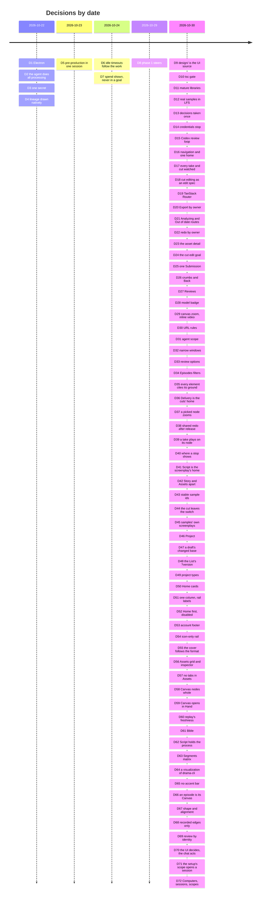

# Decisions

The studio's decisions, logged once, by date (arc42, section 9: an architecture decision record
captures one decision and its rationale, and a project's records together are its decision log
[1](#ref-1), [2](#ref-2)). Each entry gives the context, the decision, the alternatives
the record names, its grounds, its consequences, the words it rests on, and where it is recorded.
Nothing is added that the record does not contain: "none recorded" says so. Words in quotation
marks are verbatim, and a Chinese quote is followed by our English gloss in italics;
merecdesperez44323-lab is named by that GitHub id. Other documents cite an entry by its number.
One keeper numbers the entries, in order (work-03); others send their decision with its grounds and
words, never a number of their own, so no two entries share one.

The entries up to D7 come from the first proposal and build plan (22–24 October 2026); D8 onward
from the redesign. Those plans, `PROPOSAL.md`, `IMPLEMENTATION_PLAN.md` and `REDESIGN_PLAN.md`, were
folded into these documents on 30 October 2026; an entry that cites them cites their text in Git
history, in `docs/` at commit 07ea708.

## D1. 2026-10-22 · A desktop app on Electron
- **Context.** The studio needs Pine's server SDK, local video that plays and seeks the same on
  every system, and a local web mode.
- **Decision.** Electron, with the engine in a utility process and one React UI that also runs as
  a local web app on 127.0.0.1.
- **Alternatives.** Tauri 2.12, the runner-up: its three system webviews had open local-video bugs
  on Linux and macOS, and the SDK would need a separate 58–112 MB sidecar. Electrobun 2 (too
  young), Flutter and React Native desktop (no DOM).
- **Grounds.** Pine's SDK names Electron's main process as a supported runtime; one bundled
  Chromium plays video the same way on every system.
- **Consequences.** Built on 23 October 2026 on Electron 44 (`package.json`), the engine in a
  `utilityProcess`, signed and notarized macOS builds with self-update.
- **Words.** None recorded.
- **Recorded in.** `PROPOSAL.md`, section 7 and its appendix; `IMPLEMENTATION_PLAN.md`, "Desktop
  app, 23 October 2026"; `desktop/`.

## D2. 2026-10-22 · Pine's agent does all processing; the studio never runs drama-cli
- **Context.** Who reads the screenplay and makes the bible, cast, storyboards, takes and cut.
- **Decision.** Pine's agent, with Pine's drama skill (drama-cli) on the Computer, does all
  processing. The studio is UI, UX and flow: it never runs drama-cli and never generates or
  encodes anything itself.
- **Alternatives.** None recorded.
- **Grounds.** drama-cli's own design rule 1: an agent drives, drama-cli provides, the skill
  teaches (short_drama `AGENTS.md`).
- **Consequences.** Every item the studio shows is a file a turn returned; the maker's decisions
  go back to the agent as answers. Cut editing keeps this boundary (D18).
- **Words.** None recorded.
- **Recorded in.** `IMPLEMENTATION_PLAN.md`, "Decisions carried in".

## D3. 2026-10-22 · One secret: the maker's Pine project key
- **Context.** What the studio must hold to drive Computers.
- **Decision.** The only secret is the Pine project API key. The engine keeps it sealed, with the
  sealing key in the system's credential store; the interface never receives anything that can
  drive a Computer.
- **Alternatives.** None recorded.
- **Grounds.** Pine's starter keeps the project key and Computer credentials on the server and
  gives the page only a short-lived desktop token (`PROPOSAL.md`, section 3.5).
- **Consequences.** No `.env` for the maker to edit; Settings changes or forgets the key, and
  forgetting it first stops the project's running Computers (README, "Run it").
- **Words.** None recorded.
- **Recorded in.** `PROPOSAL.md`, section 5.5; `IMPLEMENTATION_PLAN.md`, "Decisions carried in"
  and "Onboarding and look"; `src/engine/seal.ts`, `src/engine/keychain.ts`.

## D4. 2026-10-22 · The lineage is drawn natively; ComfyUI runs nowhere
- **Context.** drama-cli exports a drama's lineage as a ComfyUI workflow; its live preview installs
  a local ComfyUI of about 1.6 GB, with PyTorch, only to show that graph.
- **Decision.** The agent exports the workflow and returns the file; the studio draws the graph
  itself and offers the file as a download.
- **Alternatives.** The ComfyUI preview on the maker's machine; ComfyUI in the Computer, viewed
  over the remote desktop.
- **Grounds.** A 1.6 GB PyTorch app is the wrong tool to draw a read-only graph on a laptop, and
  the remote desktop is slow and outside the app.
- **Consequences.** The Canvas and Lineage read `drama-cli export comfyui` (`src/engine/lineage.ts`);
  Export offers the workflow file (D20).
- **Words.** None recorded.
- **Recorded in.** `PROPOSAL.md`, section 6.

## D5. 2026-10-23 · Pre-production in one session; episodes on copies of its project
- **Context.** drama-cli keeps a drama in one project whose acceptances are bound to their exact
  files; Pine's sessions share no files.
- **Decision.** The setup session does everything episodes share, in one project: the bible, the
  leads, every breakdown and every shared reference, which the maker approves. It packs the project
  in parts; each episode session restores the parts and works only inside its own episode folder,
  never making a new version of anything shared.
- **Alternatives.** Episodes drawn in parallel from loose copies, which drama-cli would refuse or
  which would draw the same look twice.
- **Grounds.** drama-cli's records hold project-relative paths and hashes, so a copy keeps its
  acceptances.
- **Consequences.** The engine accepts a session's results by owner (an episode's files from its
  own session, shared assets by version and hash), so a late snapshot never overwrites a newer one
  (D16).
- **Words.** None recorded.
- **Recorded in.** `IMPLEMENTATION_PLAN.md`, "Where episodes run" and "Pre-production, 23 October
  2026"; `src/engine/runs.ts`.

## D6. 2026-10-24 · Idle timeouts follow the work: 1 h working, 3 h waiting on the maker
- **Context.** A question waiting for an answer does not keep a Pine Computer running; a Computer
  that stops loses its session's working files.
- **Decision.** Each Computer's idle timeout is 1 hour while it works and 3 hours while any of its
  sessions waits on the maker; on a project whose timeout can't change while running, its
  Computers start with 3 hours.
- **Alternatives.** None recorded.
- **Grounds.** The 1 h base matters because a question can arrive while the app is closed, when
  nothing can raise the timeout.
- **Consequences.** `IDLE_WORKING_S` and `IDLE_WAITING_S` in `src/engine/config.ts:39-40`.
- **Words.** None recorded.
- **Recorded in.** `PROPOSAL.md`, section 5.3; `IMPLEMENTATION_PLAN.md`, "Where episodes run" and
  "With lifecycle control".

## D7. 2026-10-24 · Spend is shown, never put in a goal
- **Context.** drama-cli used to require a budget, and the skill asked the maker for one, then to
  confirm each paid take.
- **Decision.** The studio records each turn's highest spend reading and shows what each drama and
  episode spent. Agents are told nothing of cost except that spending is authorized and has no cap.
- **Alternatives.** A budget stated in every goal (`PROPOSAL.md`, section 3.4).
- **Grounds.** Pine bills video on the turn that made it, and the charge can settle after the turn
  ends; a budget in the goal stalled real runs on questions about cost.
- **Consequences.** `NO_CAP` in `src/engine/goals.ts:136`; a budget is never a refusal the studio
  stops for (`src/shared/refusal.ts`).
- **Words.** None recorded.
- **Recorded in.** `IMPLEMENTATION_PLAN.md`, "Rules the flow depends on", rule 6.

## D8. 2026-10-29 · Phase 1 steers
- **Context.** The redesign's scope.
- **Decision.** In phase 1 the maker steers: Accept, Send back with a reason, Note, Lineage, and a
  decision on every take and cut. Nothing is generated or edited by hand, and no prompt is edited.
  Amended on 30 October 2026, twice: phase 1 also edits the cut's spec (D18); and the canvas draws
  each node's hand actions (Generate, Upload) disabled, each saying "Phase 2", on a typed interface
  whose phase-1 handlers do nothing, so phase 2 fills the handlers in rather than adding the
  feature.
- **Alternatives.** None recorded.
- **Grounds.** merecdesperez44323-lab's decision.
- **Consequences.** `CONTRIBUTING.md`, "Before you start"; `NodeActions` and `PHASE_ONE` in
  `src/ui/screens/Canvas.tsx`; a test that the hand actions are disabled, say why, do nothing and
  send nothing (`src/ui/screens/SteerBar.test.tsx`, "offers the hand actions disabled, saying why,
  and they do nothing").
- **Words.** "第一期可以只引导" (*phase 1 can just steer*); "就是read only" (*that is, read only*).
  For the hand actions, 30 October 2026: "这个画布没有 infinite canvas"…"就是每个节点还能单独控制啥的，
  我们上次说这个可以暂时做成比如 点击了没有效果， 但是这个feature是要能支持的，而且这个应该业内都是通用解决方案，
  咱们没有是不行的" (*this canvas is not an infinite canvas… that is, each node can also be controlled
  on its own; we said last time this could for now be made so that clicking it has no effect, but
  the feature must be supported, and this should be the industry's common solution; not having it
  won't do*).
- **Recorded in.** `REDESIGN_PLAN.md`, "Direction"; `CONTRIBUTING.md`.
- **Amended by.** [D70](#d70-2026-10-30--the-ui-decides-the-chat-acts): the Canvas's steer bar and Note leave the UI, and so
  do the disabled hand actions (Generate, Upload) drawn for phase 2 (0331bf4); Accept and Send back stay on
  the exact item, in its review. The test named above went with them.
## D9. 2026-10-30 · design/ is the one source of the UI
- **Context.** The lanes had changed the UI directly in code, each against its own reference
  screenshots, and the integrated studio drifted far from the prototype merecdesperez44323-lab had
  approved.
- **Decision.** `design/` (the approved prototype's markup and stylesheets) is the one source of the
  studio's UI. A UI change is made there first, published, approved, then ported with the same DOM
  and class names. No pull request adds UI that `design/` doesn't have; one that only brings a
  screen in line with `design/` needs no design step.
- **Alternatives.** Matching the prototype by eye, screen by screen.
- **Grounds.** merecdesperez44323-lab's decision; the prototype is the one place the UI is reviewed.
- **Consequences.** The app imports `design/`'s three stylesheets as they are; `npm run design`
  serves it; `npm run design:diff` compares the two side by side (`design/SCREENS.md`).
- **Words.** "你如果后边要修改ui， 你先修改设计稿和设计组件啥的啊！！！" (*if you change the UI from
  now on, change the design drafts and design components first!!!*); "要系统性！！" (*be
  systematic!!*); "要专业" (*be professional*).
- **Recorded in.** Commit 715900c; `CONTRIBUTING.md`, "The design comes first";
  [design principles](design-principles.md#11-design-first).

## D10. 2026-10-30 · During the sprint, tsc is the gate and CI is paused on redesign/studio
- **Context.** Every landing took about 8 minutes of CI, with turn queues and full suites, and pull
  requests lost rebase races again and again.
- **Decision.** CI is paused for pull requests into `redesign/studio`; `main` keeps it. A change
  lands by rebasing onto the branch's head, running `npx tsc --noEmit`, and pushing as a fast
  forward. The full suite and e2e run on head about once an hour (box-ci), and a break is fixed
  forward.
- **Alternatives.** The full CI on every pull request.
- **Grounds.** At the start of a product, iteration speed matters more than a gate on every change.
- **Consequences.** `.github/workflows/ci.yml:9` (`branches-ignore`). Full CI and e2e come back
  before release and when the work moves to `main`.
- **Words.** "为什么一次 ci 要8 min， 暂时把 ci停掉可以吗？最多 20秒就应该搞定的" (*why does one CI run
  take 8 min? Can CI be paused for now? It should be done in 20 seconds at most*); "现在刚开始
  为什么要做这么重！！！！！" (*we are only starting, why make it this heavy!!!!!*); for the tsc gate,
  "你就参考那个 drama-cli 最多跑一个 什么 py 的什么语法检查啥的" (*follow drama-cli: at most run some
  syntax check, like its Python one*).
- **Recorded in.** Commit f4c701e; [design principles](design-principles.md#13-light-process-early).

## D11. 2026-10-30 · Mature libraries; hand-writing what one covers needs approval
- **Context.** The Canvas and Graph were being built with hand-written pan, zoom, layout and
  minimap, to avoid new dependencies.
- **Decision.** Every job a mature, widely used library covers uses that library, pinned exactly,
  with a one-line reason; only the glue is ours (drama-cli's data, the steering actions, our
  tokens). Adding such a library needs no approval; hand-writing what one covers needs
  merecdesperez44323-lab's approval first. When a library replaces our code, ours is deleted in
  the same change.
- **Alternatives.** No new dependencies, with the infrastructure written by hand.
- **Grounds.** merecdesperez44323-lab's decision, relayed by master.
- **Consequences.** React Flow for the Canvas (commit fc1f459, which deleted the hand-written
  camera, zoom, minimap and their tests), shadcn/ui on Radix, media-chrome, WaveSurfer and the
  rest of `CONTRIBUTING.md`, "Building blocks"; TanStack Router (D19).
- **Words.** "坚决不要自己 ad hoc！！！坚决不要！！！！必须用业内通用的、标准的、流行的、有权威参考的！！！"
  (*absolutely nothing ad hoc of our own!!! absolutely not!!!! it must be what the industry
  commonly uses: standard, popular, with an authoritative reference!!!*); "不是 新加依赖要我同意，
  是你手写乱七八糟的组件反而是要我同意！！！" (*it is not a new dependency that needs my approval; it
  is your hand-written, messy components that do!!!*); "你要用最少的代码， 用最多的 成熟组件和接口！！！"
  (*use the least code, and the most mature components and interfaces!!!*).
- **Recorded in.** `CONTRIBUTING.md`, "Components to use";
  [design principles](design-principles.md#12-mature-libraries-least-code-of-our-own).

## D12. 2026-10-30 · Replay's samples are real drama-cli runs, in Git LFS
- **Context.** Replay showed hand-made placeholders, so no screen could be judged on real work.
- **Decision.** Replay's sample dramas carry five of our own drama-cli productions, with drama-cli's
  own ids, paths, versions, lineage, asset records and cuts made by `drama-cli edit`. Their pictures
  and clips go through Git LFS; a checkout without LFS reads them as no sample.
- **Alternatives.** None recorded.
- **Grounds.** merecdesperez44323-lab's decision: the samples belong in the repository, so that
  whoever develops the studio sees what it looks like with real work.
- **Consequences.** A generated public sample set replaces them before release
  ([architecture](architecture.md#11-before-release)). No test needs the samples (`TESTING.md`).
- **Words.** "肯定要进仓库， 这样别人开发时候也知道什么样子啊" (*they must go in the repository, so
  others know what it looks like when they develop*); "效果图里的你就直接放在样例数据里啊！！！" (*put
  what is in the mock-ups straight into the sample data!!!*).
- **Recorded in.** Commits 42182d9, a81cee6 to 5edb51d; `REUSED.md`, "Replay's sample media".

## D13. 2026-10-30 · A review decision is taken once, by its submission id
- **Context.** Two bugs had sent one review's decision twice; Codex's re-review asked for
  idempotency in the engine, not only a disabled button.
- **Decision.** Each sending of a draft carries a submission id, made once by the studio and kept
  for a retry. The engine claims it on the review before awaiting anything: the same id again
  returns the review as the first sending left it; another id for a decided review is refused
  (`review-decided`, 409); a failed send clears the claim. An edited draft is a new submission.
- **Alternatives.** The disabled button alone, which stops only the double click.
- **Grounds.** Stripe's idempotent requests are the established pattern
  ([design principles](design-principles.md#9-design-for-failure)); the IA proposal, section 14.6.
- **Consequences.** `src/engine/reviews.ts:138-141`; `flow.test` covers a retry after a failed
  send, the same id after success, two windows racing and a second press in flight. One build per
  Apply follows the same rule (D18).
- **Words.** None recorded.
- **Recorded in.** Commit 71ab3d8.

## D14. 2026-10-30 · Missing credentials are their own stop; a budget refusal is the generic card
- **Context.** The StopCard chooses its kind from drama-cli's refusal code.
- **Decision.** `InvalidParameter.env` (drama-cli's missing credentials, action `fix_input`) has
  its own kind, `env`, drawn as `design/`'s credentials stop. A budget refusal stays the generic
  card, since it has no code of its own. `RedLine` is a red line; `SetLimitExceeded.<key>` is a
  cap.
- **Alternatives.** A budget card of its own.
- **Grounds.** Master's decision; drama-cli's own codes (`drama_cli/errors.py`, `describe`).
- **Consequences.** `stopKind` in `src/shared/refusal.ts`. Under Pine's managed execution the
  credentials live outside the session, so the card must point at Pine's recovery, not a `.env`
  (Codex's re-review, C2).
- **Words.** None recorded.
- **Recorded in.** Commit b9f3c18.

## D15. 2026-10-30 · Codex reviews the IA and interaction; master adopts or argues each finding
- **Context.** The navigation and interaction were redesigned in a day.
- **Decision.** Codex reviews each draft read-only, against the running studio and `design/`;
  master records each finding as adopted or argued, with the reasons, before
  merecdesperez44323-lab decides.
- **Alternatives.** None recorded.
- **Grounds.** None recorded beyond the context.
- **Consequences.** Two reviews and two rounds of the draft; B1–B6 fixed with behaviour tests
  (commits 01193f0, 0d8f75c, 6d07955); the IA proposal's sections 10, 12 and 14.
- **Words.** None recorded.
- **Recorded in.** The IA proposal, sections 10–15 [3](#ref-3); Codex's review and
  re-review [4](#ref-4), [5](#ref-5).

## D16. 2026-10-30 · The navigation: a studio-wide rail, the drama's tree, one home per object
- **Context.** The rail, the sidebar and the top bar each offered the drama's places, and Canvas
  and Graph were peers of the guided flow, so one object had several independent pages (Codex's
  review, sections 3 and 5).
- **Decision.**
  - The rail is studio-wide only: Dramas, Reviews, Settings.
  - The drama's tree is Script · Story · Assets (Characters, Locations, Props) · Episodes ·
    Delivery, with the drama's Reviews and an "Out of date" filter; it stops at episodes.
  - An episode has two views, List and Canvas; any item has Lineage, a view, not a home.
  - Every object has one home, one page and one URL; other places only link to it.
  - A drama is one logical drama-cli project; sessions work on copies of it and return its state,
    accepted by owner (D5).
- **Alternatives.** Codex's "no new router, fix the helpers" (master argued for TanStack Router,
  D19); a drama as several working copies (master argued for one logical project).
- **Grounds.** The IA proposal and Codex's two reviews [3](#ref-3), [4](#ref-4),
  [5](#ref-5); VS Code's activity bar, sidebar and editor
  ([design principles](design-principles.md#1-one-home-per-object)).
- **Consequences.** `design/`'s IA draft (published for review); the port moves routes, e2e specs and
  the samples' links in one change, with no compatibility shims.
- **Words.** "ia & ixa 还是非常重要的" (*IA and IxA are still very important*); "是不是要先把
  IA方案定下来， 然后才是后续？不然可能修bug也白修？" (*shouldn't the IA plan be settled first, and the
  rest after it? Otherwise fixing bugs may be wasted*); "找到一个东西是不是最好就是只能从一个地方找到，
  而且是符合用户心智 的， 否则到处都要能找， 用户晕了？" (*isn't it best that a thing can be found in
  only one place, one that fits the user's mental model? Otherwise it must be findable everywhere,
  and users get lost*), then "可以的" (*that works*); "包括 每个东西只有一个家 啥的这种 都是 design
  principle" (*including "every thing has only one home" and the like: these are all design
  principles*).
- **Recorded in.** The IA proposal, sections 2–5, 10–12 and 16–17 [3](#ref-3);
  [design principles](design-principles.md).

## D17. 2026-10-30 · The maker watches every take and every cut
- **Context.** Upload's "Your reviews" let the engine approve takes and the cut on the maker's
  behalf (`approveUnreviewed`), while the screens promised the maker watches every take (Codex's
  review, B6).
- **Decision.** No setting approves a video version (take) or a cut for the maker, and none
  approves a photoreal storyboard. "Your reviews" may skip only looks, shared references and
  line-art storyboards.
- **Alternatives.** Keep the option as a setting.
- **Grounds.** drama-cli's rule that the person watches every take and cut and alone accepts the
  photoreal storyboard (short_drama D76, D141; `doc/architecture.md`, section 7.1, item 7; `AGENTS.md`,
  design rule 10), and its architecture, section 7.1, item 7: the person approves "every take and
  cut" (`doc/architecture.md:222` at short_drama ade90c55); Codex's review, B6 [4](#ref-4).
  Auto-approval was a bug against that rule, not a setting.
- **Consequences.** `LEFT` in `src/engine/reviews.ts:160-164`; `flow.test` keeps EP001's takes,
  photoreal storyboards and cut open under every setting.
- **Words.** None recorded.
- **Recorded in.** Commits 0d8f75c and 2cceb2b; the IA proposal, sections 11.1, 12.4 and 14.4
  [3](#ref-3).

## D18. 2026-10-30 · Cut editing edits a draft of drama-cli's edit spec
- **Context.** merecdesperez44323-lab asked for cut editing in phase 1; Codex warned against local
  edit state competing with drama-cli (review, section 7.4).
- **Decision.** The studio edits only a draft of drama-cli's own edit spec (each clip's path,
  sha256, in, out and audio). Apply hands it to the agent, which runs `drama-cli edit build` and
  `edit validate`; the result returns as a new cut version for review. A draft is bound to its base
  cut and every clip's sha256; if upstream changed, Apply refuses until the maker compares,
  re-checks or discards. Edits (take, order, in and out, audio) are counted apart from notes.
- **Alternatives.** A read-only timeline (Codex's first review); editing in the studio's own state.
- **Grounds.** drama-cli stays the single producer (D2): nothing is encoded or stored as truth in
  the studio.
- **Consequences.** The phase-1 scope reads "steering, plus editing the cut's spec" (D8). One build
  per Apply, keyed by a submission id (D13).
- **Words.** "你先同步把 cut 放上去？因为这个不涉及到 IA" (*put the cut up first, in parallel? It does
  not involve the IA*), 30 October 2026. merecdesperez44323-lab's approval of the edit-spec design:
  counted within the IA draft, as master relayed (D24).
- **Recorded in.** The IA proposal, sections 12.2, 14.2 and 15 (round 2, D1–D3) [3](#ref-3).

## D19. 2026-10-30 · TanStack Router for typed routes
- **Context.** The studio's hand-written router used one untyped `item` for both an episode and an
  artifact; Graph sent a character's id as an episode and the studio fell back to Home (Codex's
  review, B1).
- **Decision.** The IA port moves to TanStack Router, with distinct typed params: an episode code
  (`EP\d{3}`) and an artifact id are separate validated types, an artifact must belong to its drama
  (and episode, where it is episode-scoped), and there is no untyped `item`. Lineage is a search
  parameter on the item's home (`?item=<drama-cli stage id>&view=lineage`), confirmed by master on
  30 October 2026. The router is pinned at 1.170.44, with a code-based route tree in
  `src/ui/routes.tsx`. B1's interim fix stays small: typed helpers in the current router.
- **Alternatives.** Codex: no new router, fix the helpers.
- **Grounds.** D11 (mature libraries over hand-written infrastructure), and type-safe routes are
  what prevents B1. The first proposal had already chosen TanStack Router (`PROPOSAL.md`,
  section 7).
- **Consequences.** Landed in commit b6e234d: the hand-written `src/ui/router.tsx` is deleted; the
  route tree is `src/ui/routes.tsx`, the current object is read by `usePlace` and built by
  `placeLink` (`src/ui/place.ts`), and tests render at a URL with `renderAt`
  (`src/ui/test/router.tsx`). The e2e specs, `design/SCREENS.md`'s routes and
  `scripts/design-diff.spec.ts`'s URLs moved in the same change.
- **Words.** None recorded.
- **Recorded in.** The IA proposal, sections 12.1 and 14.1 [3](#ref-3); commit 01193f0
  (the interim fix); commit b6e234d (the port: `src/ui/routes.tsx`, `src/ui/place.ts`,
  `src/ui/test/router.tsx`).

## D20. 2026-10-30 · Export belongs to its owner
- **Context.** Export offered the drama's workflow on every page, the global Reviews included, so
  on a Cut it read as a video download (Codex's review, section 6; re-review, A).
- **Decision.** Export is scoped to the object it exports: on an episode's List, Canvas, Cut and
  Lineage from an item, that episode's session; elsewhere the shared project. It is labelled with
  the session and its stop time. The global Reviews has none.
- **Alternatives.** One drama-wide Export everywhere.
- **Grounds.** One home per object ([design principles](design-principles.md#1-one-home-per-object)).
- **Consequences.** The menu offers the ComfyUI workflow and the infinite-canvas project, downloaded
  under the drama's name (commits d64f5dc, c246944).
- **Words.** None recorded.
- **Recorded in.** `design/` commits c18443e and 721ab7f.

## D21. 2026-10-30 · Analyzing and Out of date have drama-level routes of their own
- **Context.** The route tree gives each object one home (D16); two drama-level pages are not
  views of an object's home.
- **Decision.**
  - `/d/$dramaId/analyzing` stays a top-level drama route. Analyzing and the Fountain review are
    setup steps, a process like the review room, not views of Script, the accepted screenplay's
    home.
  - Out of date is `/d/$dramaId/out-of-date`: a drama-level list beside Reviews, of the items that
    are out of date across Assets and episodes, whose rows link to each item's home (D22).
- **Alternatives.** Analyzing as a view of Script; Out of date as a filter on the Episodes board
  (the IA proposal, section 8.4).
- **Grounds.** work-02's calls, agreed by master on 30 October 2026; Codex's re-review, G6 (Script
  is not the setup review) [5](#ref-5).
- **Consequences.** The router port (D19) carries both routes.
- **Words.** None recorded.
- **Recorded in.** work-05's routing brief, relayed to the docs on 30 October 2026.
- **Amended by.** [D62](#d62-2026-10-30--script-is-the-home-of-the-whole-screenplay-process) (7381a9a): the Analyzing route is
  retired; Start opens Script, which shows the setup's work on the screenplay. Out of date's route stays.
## D22. 2026-10-30 · Out of date is redone by its owner's session, one row or the whole group
- **Context.** Out of date lists items from Assets and from episodes; each was made by a different
  session. The dry run of the IA draft (QA journey 3) found the redo only per group: the maker could
  not ask for one exact version.
- **Decision.**
  - Rows are grouped by the session that owns them: the setup's agent for shared assets, each
    episode's agent for its own items. Each group has "Redo all"; each row has "Redo this". Either
    is one submission to that session (D25), after a one-line impact.
  - A row's reason is drama-cli's `problems`, verbatim, shown as "An input changed: <kind>
    <version>" only where the engine knows the file, with the exact words under details. "Made from
    X, which is out of date" for an item made from a stale one is our own wording.
  - Leaving Out of date marks the row in the URL (`?item=`, replacing the history entry), so Back
    returns to it.
- **Alternatives.** One redo button for the whole drama; a redo per group only (the IA draft).
- **Grounds.** The agent panel speaks to one session (the IA proposal, section 9) [3](#ref-3);
  confirm only when spend grows or done work is affected
  ([design principles](design-principles.md#5-confirm-only-when-spend-grows-or-done-work-is-affected));
  one home per object, rule 2 ([design principles](design-principles.md#1-one-home-per-object));
  drama-cli's own reasons (short_drama `drama_cli/artifacts.py`).
- **Consequences.** The set is the drama tree's count: drama-cli's stale items plus what was made
  from them (`outOfDate`, `src/shared/lineage.ts`). Per-row "Redo this" landed in c72fad6.
- **Words.** None recorded.
- **Recorded in.** Commits e3e05a9 and c72fad6 (the list), 420a21d (one submission per owner);
  work-02's, work-05's and master's notes to the docs, 30 October 2026.
- **Amended by.** [D70](#d70-2026-10-30--the-ui-decides-the-chat-acts): the redo buttons leave the UI; the agent chat redoes.
- **Amended by.** b1b7692 (D70): Out of date is a view, its rows, reasons, Lineage and links, with no
  redo or other action and one line pointing to the agent in the sidebar; e7e948b deletes the episode
  redo route and its submissions table, which had no caller left.
## D23. 2026-10-30 · An asset's one home is its detail in Assets
- **Context.** The dry run of the IA draft (QA journey 1) found a character's versions reachable
  nowhere: an Assets card did nothing when clicked, and the canvas panel said its versions "are in
  Assets".
- **Decision.** `/d/$dramaId/assets/<shelf>/<asset>` is the asset's home. Clicking a card, or its
  name, opens the detail beside the grid, in place of the agent panel: the versions (in view,
  current, accepted), where it stands and why it is out of date, its review, the episodes it is in,
  its files, and Lineage. The canvas panel's "in Assets" links there.
- **Alternatives.** A second copy of the versions in the canvas panel.
- **Grounds.** One home per object ([design principles](design-principles.md#1-one-home-per-object));
  Lineage's inspector, which sits beside its graph the same way.
- **Consequences.** Journey 1 (find a character, inspect its versions) completes on its home.
- **Words.** None recorded.
- **Recorded in.** Design 55b0da3; product 0742f8b.

## D24. 2026-10-30 · A cut edit is built by drama-cli, after the engine checks its base
- **Context.** D18 lets the maker edit a draft of the cut's edit spec; this is how the edit reaches
  drama-cli.
- **Decision.**
  - The edit is a draft of drama-cli edit's cut plan: a take of each segment that the episode
    returned, the order, in and out, and source sound or silence. The design offers accepted takes
    only; the studio does not yet know which takes are accepted. The review's notes are never counted as edits.
  - Apply sends it as the cut review's decision under one submission id (D25). The engine first
    refuses, sending nothing, unless the base is the cut under review and still the episode's newest
    (`edit-base-changed`) and each clip's take file has the sha256 chosen (`edit-inputs-changed`).
  - The agent's goal: write the plan, run `drama-cli edit build` (with `--encode` only if drama-cli
    says stream copy can't join the clips), then `drama-cli edit validate`; on a refusal it stops
    with drama-cli's message. The result returns as a new cut version for review.
  - A newer cut is never re-based inside the old review: Edit offers Compare and Discard, and the
    newer cut is edited in its own review: work-07's choice, which master accepted as "cleaner".
  - The cost line says what is true: drama-cli's edit calls no paid model, and Pine bills the
    agent's turns.
- **Alternatives.** Re-basing a draft onto the newest cut silently.
- **Grounds.** [D18](#d18-2026-10-30--cut-editing-edits-a-draft-of-drama-clis-edit-spec); Codex's
  re-review, D1, G1 and G7 [5](#ref-5); drama-cli's review guide, "Build and inspect a
  cut", and design, "The cut's encoding" (short_drama `doc/drama-cli/`); master's rule, relayed: a
  draft whose inputs changed is re-checked, never sent.
- **Consequences.** `src/engine/goals.ts` (the edit goal), `src/engine/reviews.ts` (the checks);
  master relayed that the cut-editing design counts as approved within the IA draft, which answers
  D18's pending approval.
- **Words.** None recorded.
- **Recorded in.** Commits 0f283df and 3107cf7; #71; work-07's notes, 30 October 2026.

## D25. 2026-10-30 · One Submission state for every send
- **Context.** A review's send, a cut's Apply and a redo each go to an agent and can time out.
  Codex's third round asked that an unknown outcome be checked, never sent again.
- **Decision.** Every send is a Submission with one state: sending; sent; unknown (no answer:
  offline or a 5xx), which is checked with the engine (`GET /api/submissions/:id`); failed (a 4xx
  refusal, or a check that finds nothing taken), which may be sent again under the same submission
  id. "Sent" says no more than that. Where the maker still has something (a draft), the state says
  what is kept; a redo keeps nothing. A redo was `POST /api/sessions/:id/redo`, deleted in e7e948b with D70; submissions now belong to
  reviews and to setup messages (D71).
- **Alternatives.** A disabled button alone; resending on a timeout.
- **Grounds.** [D13](#d13-2026-10-30--a-review-decision-is-taken-once-by-its-submission-id); Codex's
  round 3, fix 1; Stripe's idempotent requests
  ([design principles](design-principles.md#9-design-for-failure)).
- **Consequences.** Reviews, Cut and Out of date show the same states; the cut's Send review uses
  it too (a04e08f). A review's decision is found again by its submission: `GET /api/submissions/:id`
  answers for review decisions too (sending, sent; none means not taken), and the room keeps its
  submission id with the draft, so a reopened room checks before it ever sends again (Codex's
  round 3, Interrupt).
- **Words.** None recorded.
- **Recorded in.** Design e379653 and 3b5e851; engine 420a21d.

## D26. 2026-10-30 · Crumbs say where a thing belongs; Back says where you came from
- **Context.** The prototype's own controls sat in a bar that looked like the app, and the top
  bar's chevron Back went Home from Lineage (QA journey 2).
- **Decision.**
  - The prototype's controls (screen, state, outcome, theme) are folded behind a "Prototype
    controls" button, closed by default; they are not the app.
  - The crumbs ("Where this belongs") name where the page belongs, drama first, each ancestor a
    link, ending at the picked stage and its version as drama-cli's status names it.
  - "Back to …" is the only came-from control. Its label travels in the history entry's state,
    never in the URL; Back is the browser's. There is no chevron.
  - The review room links each item to its home; Lineage's "Open in …" leads to the item's home;
    Lineage's episode is read from its item, so the crumbs, Export and the agent agree; Lineage
    opens with its focus and its direct neighbours in view, at full size.
- **Alternatives.** One Back that sometimes means history and sometimes the parent.
- **Grounds.** Codex's walkthroughs; one home per object, rule 2
  ([design principles](design-principles.md#1-one-home-per-object)); a URL that carries a label
  would have to be validated (Codex's rebuttal, the IA proposal, section 14.1) [3](#ref-3).
- **Consequences.** design:diff and the QA journeys open the prototype controls first.
- **Words.** None recorded.
- **Recorded in.** Design 2f2a07b, 2bba5b3, e29f172; product a07d9fa, 49e0801.

## D27. 2026-10-30 · Reviews replaces Inbox and To review everywhere
- **Context.** The queue had three names (IA proposal, section 4).
- **Decision.** Reviews / 待审 in the UI, `GET /api/reviews`, the live scope `reviews`,
  `Reviews.tsx` and the `reviews.*` strings; Inbox and To review are retired. The Chinese strings
  follow the [glossary](glossary.md): 视频版本 for a take, 剪辑成片 for a cut, 地点, 素材, 交付, 已过期.
- **Alternatives.** None recorded.
- **Grounds.** One name per thing (the IA proposal, section 4) [3](#ref-3); the glossary.
- **Consequences.** No compatibility route; open-qa.mjs and design:diff moved in the same minute.
- **Words.** None recorded.
- **Recorded in.** Commit a07d9fa.

## D28. 2026-10-30 · The model badge stays on canvas nodes
- **Context.** The IA proposal's first draft of section 15 put everything but the work and what
  needs the maker behind progressive disclosure, which would hide a node's model (`sd25`).
- **Decision.** A canvas node keeps its model badge beside its name.
- **Alternatives.** The model in the inspector only.
- **Grounds.** Astorie and LibTV show the model on their nodes (master's note); the labels design,
  badge included, was shown to merecdesperez44323-lab, who said to continue.
- **Consequences.** `design/app.js`, the canvas node's `.model`. Amended by 3c06e2e (Codex's round 4,
  F2): where both show, the node's stage name wins over the model tag.
- **Words.** None beyond "you can continue", after the labels design was shown.
- **Recorded in.** Master's note to the docs, 30 October 2026.

## D29. 2026-10-30 · Picking a canvas node zooms it to a readable size; video plays inline
- **Context.** A canvas node is small at the board's zoom; a take could only be watched in its
  review.
- **Decision.** Picking a node zooms the canvas so the node is readable on screen. A take or cut
  plays inline with play, a time slider, sound and full screen, on media-chrome.
- **Alternatives.** None recorded.
- **Grounds.** merecdesperez44323-lab's request; React Flow's zoom to a node and media-chrome's
  controls (D11).
- **Consequences.** Built as [D37](#d37-2026-10-30--a-picked-node-zooms-to-a-readable-size) and
  [D39](#d39-2026-10-30--a-take-or-cut-plays-on-its-canvas-node).
- **Words.** "do you think it's possible when we click the nodes on canvas , the node zoom in on the
  screen to be human friendly to view. and also do you think we can add something like this:  p ,
  play, time slider, sound, full screen" (relayed by master, verbatim; the stray "p" is theirs).
- **Recorded in.** Master's note to the docs, 30 October 2026.

## D30. 2026-10-30 · URLs are validated against the drama; the current object comes from the route
- **Context.** D19 types the routes; these are the rules the port keeps.
- **Decision.**
  - An episode code matches drama-cli's `^EP[0-9]{3}$`; an item is a drama-cli stage folder; an
    episode, item or asset the drama doesn't have shows "This drama has no …" with a way back.
  - In the review room an item is `?key=` (the review item's key), so `item` means only a drama-cli
    stage id.
  - `/d/$dramaId` opens `/episodes`, `/e/$code` opens `/list`; `/d/$dramaId/canvas` is a temporary
    picker that opens the episode it picks.
  - The current object is read from the innermost route match (`usePlace`), never by parsing paths.
  - The Episode List lands on the stage `?item` names; a row's click picks its newest version; On
    Canvas and Lineage keep the stage.
- **Alternatives.** None recorded.
- **Grounds.** drama-cli's episode code (short_drama `drama_cli/schemas/bible.py:197`); one name per
  thing and one current-object contract (the IA proposal, sections 4 and 10); Codex's rebuttal,
  section 14.1 [3](#ref-3).
- **Consequences.** `src/ui/routes.tsx`, `src/ui/place.ts`.
- **Words.** None recorded.
- **Recorded in.** Commit b6e234d; work-04's and work-05's notes, 30 October 2026.

## D31. 2026-10-30 · The agent panel speaks to the pinned session, else the episode in view
- **Context.** The agent panel showed another episode than the canvas (Codex's review, B3).
- **Decision.** The panel speaks to the pinned session, else the episode in view, else none; it
  never guesses. Follow and Unpin sit in a scope bar; any open session can be pinned, working or
  waiting; a pin keeps its name after its session ends.
- **Alternatives.** None recorded.
- **Grounds.** Always clear what you act on
  ([design principles](design-principles.md#3-always-clear-what-you-act-on)); Codex's re-review, E.
- **Consequences.** None beyond the panel.
- **Words.** None recorded.
- **Recorded in.** Commit a07d9fa.
- **Amended.** 30 October 2026, d873dc4 (design) and 4582f5e (product): every project page has a scope,
  its episode, else the setup for a page with no one episode (master's decision). The sidebar shows
  one status line with one dot: working, waits for you, or no dot and "No session open: a message
  starts a new <scope> session". Its message box is always enabled and names its target, sending
  through `POST /api/dramas/:id/messages` with the scope ([D71](#d71-2026-10-30--a-message-to-the-setups-scope-opens-a-new-setup-session),
  as amended by 13551f2); the Pin picker changes the scope. Words: "右边栏的agent好像不能用？说没有open session，
  但是上边又是绿色的灯， 这个是不是比较矛盾" (*the agent in the right sidebar seems unusable: it says no open
  session, yet the light above is green; isn't that contradictory?*), relayed by master.
  A setup waiting on a screenplay rewrite points to Script ("v1 waits for your Accept or Send back on
  Script") with no answer box in the sidebar, as D70 and D62's explicit verdict (db1a5f5) require.
## D32. 2026-10-30 · Narrow windows: the sidebar is a drawer, the agent is the ball
- **Context.** Codex's re-review found the agent lost at 1280 px (F, H).
- **Decision.** Below 1100 px the sidebar opens as a drawer; at 1280 px and below the agent panel
  is the ball. Media queries go through usehooks-ts 3.1.1, pinned.
- **Alternatives.** Hand-written media queries.
- **Grounds.** The IA proposal, round 2, F [3](#ref-3); D11.
- **Consequences.** In a review room at 1280 px and below, the send bar keeps the ball's corner
  clear, so Send and Send again stay reachable (found by e2e). The smallest supported window is
  still pending ([information architecture](studio/information-architecture.md#narrow-windows)).
- **Words.** None recorded.
- **Recorded in.** Commit a07d9fa.
- **Amended.** 30 October 2026, b6ee7a0: the agent has one form, a right sidebar on every project
  page, open (the page narrows, the Canvas included) or collapsed to the ball (its robot, busy ring
  and badge). There is no floating popover anywhere. Below 1100 px the opened sidebar overlays from
  the right edge. The choice persists per viewer (browser storage); with no saved choice, a window of
  1280 px or less starts collapsed. ⌥⌘B (Ctrl+Alt+B) toggles it. Grounds: merecdesperez44323-lab's
  request; VS Code's Secondary Side Bar (View: Toggle Secondary Side Bar, ⌥⌘B); Cursor's agent pane;
  one action, one meaning ([design principles](design-principles.md#2-one-action-one-meaning)).
  Words: "右边 agent这里， 有时候是侧边栏， 有时候是一个ai头像， 有时候是popup 浮窗， 这个有点儿不好。。。是不是定下来一种，
  比如就是 一直都是侧边栏，而且可以收起来啥的那种？就你那个 icon 然后转圈圈的也挺好的 比如可以收起来就变成你那个icon了，
  点击就变成侧边栏了？" (*the agent on the right is sometimes a sidebar, sometimes an AI avatar, sometimes a
  pop-up float; that's not good… settle on one, say always a sidebar that can be collapsed? Your icon
  with its spinning ring is nice too: collapsed it becomes that icon, and a click makes it the
  sidebar again?*), relayed by master.

## D33. 2026-10-30 · The review options name what the maker watches
- **Context.** "Your reviews" named its options by policy, not by what the maker would see.
- **Decision.** The options read "Looks, photoreal storyboards, takes and cuts" and "Photoreal
  storyboards, takes and cuts" (写实分镜), as three radio rows on Radix's RadioGroup, the same
  control as the preset cards.
- **Alternatives.** None recorded.
- **Grounds.** [D17](#d17-2026-10-30--the-maker-watches-every-take-and-every-cut); the WAI-ARIA radio
  group pattern.
- **Consequences.** None beyond New drama.
- **Words.** Master's: "The labels say what you watch".
- **Recorded in.** Product 36c6d18 and 16a0aae; design 126de62 and 70f30d2.

## D34. 2026-10-30 · The Episodes board filters by the maker's states
- **Context.** The board's filters named internal states.
- **Decision.** All, Needs you, Working, Done; Working holds the episodes in line too, their place in
  line in the card's detail, with no chip of its own. The drama tree's counts come from the resource
  each page shows.
- **Alternatives.** None recorded.
- **Grounds.** [Five maker-facing states](design-principles.md#4-five-maker-facing-states).
- **Consequences.** None beyond the board.
- **Words.** None recorded.
- **Recorded in.** Design 2f2a07b (`design/app.js`, Episodes).

## D35. 2026-10-30 · Every UI element and behaviour cites its ground
- **Context.** Elements, buttons and styles had been added as each lane saw fit, without a source.
- **Decision.** Every UI element and behaviour cites its ground, in order of strength: a platform
  or standards guideline (Apple's HIG, the WAI-ARIA Authoring Practices, WCAG 2.2, Nielsen's
  heuristics); an established tool doing the same job; one of our design principles; or "ours,
  untested", checked in the next Codex walkthrough. Every design change carries a checklist: what
  changes, its ground, what it reuses from `design/`, and its D-entry.
- **Alternatives.** None recorded.
- **Grounds.** merecdesperez44323-lab's rule, after drama-cli's practice of citing a source for
  every name and rule (short_drama `AGENTS.md`).
- **Consequences.** [Design principle 14](design-principles.md#14-every-element-cites-its-ground);
  `CONTRIBUTING.md`, "The design comes first"; a "Ground" column in `design/SPEC.md`.
- **Words.** "never ad-hoc, randomly puting things here and there, randomly add some elements ,some buttons, some styles on the fly  i think , we need to be professiona"; "it's way much better to find some reference to do someting. just like drama-cli."; and "and btw: follow the design rule & dev rule in doc. follow
  the decisions .md just like drama-cli" (relayed by master, verbatim).
- **Recorded in.** Master's notes to the docs and the lanes, 30 October 2026.

## D36. 2026-10-30 · Delivery is the one home of the accepted cuts
- **Context.** Delivery could play a cut, making a second copy of the cut's home.
- **Decision.** Delivery lists the accepted cuts; each row links to EPxxx › Cut and to the cut's
  Lineage. The page has no player. In the cut room, the design's own space under the send bar keeps
  the agent's ball clear of it.
- **Alternatives.** A player on Delivery.
- **Grounds.** One home per object ([design principles](design-principles.md#1-one-home-per-object));
  WCAG 2.2, 2.4.11 Focus Not Obscured and 2.5.8 Target Size, for the ball.
- **Consequences.** None beyond Delivery and the cut room.
- **Words.** None recorded.
- **Recorded in.** work-07's notes, 30 October 2026; commits 5ff4a4d (the Delivery page) and 7e51b8e.

## D37. 2026-10-30 · A picked node zooms to a readable size
- **Context.** A node picked on Canvas kept the board's zoom, often too small to read its picture.
- **Decision.** Picking a node zooms it, animated, to fill the room its bar and panel leave, up to
  150%: under the pills, its bar above it, its panel under it or docked. Esc, the panel's Close and
  Fit zoom back to where the board was. A pick zooms by itself, as asked, with no extra key.
- **Alternatives.** Zoom only on a double-click or a key, as Figma's Zoom to selection (Shift+2)
  does; a mode the maker must learn, for what a pick is for here.
- **Grounds.** Figma's "Zoom to selection"; React Flow's `fitView({ nodes })`, with padding for the
  bar and the panel; Nielsen's user control and freedom, for the way back.
- **Consequences.** design/app.js Canvas (readable, letGo); src/ui/screens/Canvas.tsx (place,
  letGo); design/SPEC.md, CanvasNode.
- **Words.** "when we click the nodes on canvas, the node zoom in on the screen to be human friendly
  to view", as master relayed it.
- **Recorded in.** Master's note to work-06, 30 October 2026.

## D38. 2026-10-30 · Redoing a shared reference takes a new setup session, after release
- **Context.** Out of date offers a redo to the session that owns each item (D22). Shared
  references belong to the setup session, which closes once it hands the project over (D5).
- **Decision.** Redoing a look, location or prop after the handover will start a new setup session
  on the drama's project; it is not available tonight. Tonight, Out of date redoes episode-owned
  items, through the episode's own session; the setup group's redo stays disabled, saying why.
- **Alternatives.** Keeping the setup session open after the handover.
- **Grounds.** An open setup session keeps a Computer running while it idles
  ([D6](#d6-2026-10-24--idle-timeouts-follow-the-work-1-h-working-3-h-waiting-on-the-maker)), and
  a setup session redrawing shared references while episode sessions work on copies of the project
  would compete with them (D5: episodes never make a new version of anything shared). Master's
  decision on work-05's question, 30 October 2026.
- **Consequences.** QA journey 3 redoes an EP006 item; the shared-reference redo is in
  [architecture](architecture.md#11-before-release), "Before release".
- **Words.** None recorded.
- **Recorded in.** Master's notes to work-05 and the docs, 30 October 2026.
- **Amended by.** Commit 3bb6353, the same evening: a shared reference's redo after the handover
  opens a new setup session, from Out of date's shared groups (an impact confirmation, then a review
  of the new versions).
- **Amended by.** [D70](#d70-2026-10-30--the-ui-decides-the-chat-acts): the shared redo's button leaves the UI; the agent chat asks for it.
- **Amended by.** [D71](#d71-2026-10-30--a-message-to-the-setups-scope-opens-a-new-setup-session) (d097690): any message to the setup's
  scope after the handover opens a new setup session; `/setup-message` replaces `/shared-redo`.
## D39. 2026-10-30 · A take or cut plays on its Canvas node
- **Context.** A take or cut node previewed its video on hover, muted, with no way to play it with
  sound, scrub it or see it large without leaving the board.
- **Decision.** A take or cut node carries an inline player: media-chrome's controller around the
  video and its control bar over the card's foot, on the picked node and on hover: play, time, the
  slider, duration, sound, full screen. The video is muted until the maker turns the sound on, so a
  hover still previews it silently. The bar takes no drag or pan of the board.
- **Alternatives.** Open a player in a dialog; a snapshot button as liblib's has, left out: media-chrome
  has none, and a hand-made one is ad hoc (D35).
- **Grounds.** liblib.tv's video node; the control order of Premiere, Frame.io and YouTube; media-chrome
  (`MediaControlBar` and its parts), the player the cut room uses, with the cut room's tokens.
- **Consequences.** design/app.js and design/studio.css (.vbar); src/ui/screens/Canvas.tsx (NodePlayer);
  src/ui/screens/canvas.css; design/SPEC.md, CanvasNode.
- **Words.** merecdesperez44323-lab's request, as master relayed it: a take or cut node gets inline video controls,
  like liblib's video node.
- **Recorded in.** Master's note to work-06, 30 October 2026.

## D40. 2026-10-30 · A stop shows in full where it belongs, as a notice elsewhere
- **Context.** EP007's red-line StopCard showed in full on every Bride on Bail page, Assets and
  Lineage included (QA, 30 October 2026).
- **Decision.** A stop that belongs to one episode is the full StopCard in that episode only; on
  every other page of the drama it is a compact notice with "Open EPxxx". A stop that belongs to
  the whole drama stays the full card everywhere in it.
- **Alternatives.** The full card on every page.
- **Grounds.** The IA proposal, section 10 (cross-episode stops as a compact notice)
  [3](#ref-3); [interaction](studio/interaction.md#stops-and-recovery), the stops table;
  one home per object ([design principles](design-principles.md#1-one-home-per-object)).
- **Consequences.** None beyond the StopCard and its notice.
- **Words.** None recorded.
- **Recorded in.** work-04's note to the docs, 30 October 2026.

## D41. 2026-10-30 · Script is the screenplay's home only
- **Context.** Script showed the screenplay, the bible and every breakdown, so the bible had two
  pages and a breakdown no home of its own.
- **Decision.** Script holds the screenplay and its Fountain versions only. The bible lives in Story
  and each breakdown in its episode; both leave Script's page and its API.
- **Alternatives.** None recorded.
- **Grounds.** One home per object ([design principles](design-principles.md#1-one-home-per-object));
  [D16](#d16-2026-10-30--the-navigation-a-studio-wide-rail-the-dramas-tree-one-home-per-object).
- **Consequences.** None beyond Script.
- **Words.** None recorded.
- **Recorded in.** Commits a419382 and 4dd6016; work-02's note to the docs.

## D42. 2026-10-30 · Story and Assets are two pages; Home's shelves use the maker's states
- **Context.** Story and Assets shared one page with tabs (Bible, Cast, Locations, Props).
- **Decision.** Story (the bible's logline, beats and episodes) and Assets (Characters, Locations,
  Props) are two pages, each a home in the drama tree. Home's shelves are named with the five
  maker-facing states' words.
- **Alternatives.** One page with tabs.
- **Grounds.** One home per object and five maker-facing states
  ([design principles](design-principles.md), 1 and 4); Codex's review: Story and Assets are
  separate [4](#ref-4).
- **Consequences.** None beyond Story, Assets and Home.
- **Words.** None recorded.
- **Recorded in.** Commit 3c15dc3; work-02's note to the docs.

## D43. 2026-10-30 · A replayed sample keeps its id across rebuilds
- **Context.** Every rebuild of the QA studio gave each replayed sample a new random id, so a link
  or an open tab from before showed "It's no longer here" (merecdesperez44323-lab's bug Y5).
- **Decision.** A replayed sample drama's id is derived from its sample and language (SHA-256 of
  `sample:<sample>:<lang>`, 16 hex digits), numbered -2, -3… for further starts in the same studio.
  Real projects and Pine rehearsals keep random ids.
- **Alternatives.** None recorded.
- **Grounds.** Design for failure ([design principles](design-principles.md#9-design-for-failure));
  merecdesperez44323-lab's bug Y5 in the QA bug list, via master.
- **Consequences.** open-qa.mjs keeps its seed order fixed, since the numbering follows it.
- **Words.** None recorded.
- **Recorded in.** Commit 866221c; work-05's note to the docs.

## D44. 2026-10-30 · The cut leaves the episode's view switch
- **Context.** An episode's switch read List | Canvas | Cut, though the cut is an object of its
  own, not a view of the episode.
- **Decision.** An episode's switch is List | Canvas. The cut is linked from the episode's header
  ("Cut v1" and its state) and as the episode in view's child row in the project tree.
- **Alternatives.** None recorded.
- **Grounds.** Master's decision; the WAI-ARIA tabs pattern (tabs switch views of one thing); one
  home per object and one action, one meaning ([design principles](design-principles.md)); the IA
  proposal, section 16 [3](#ref-3); Codex's review, section 5 [4](#ref-4).
- **Consequences.** [D16](#d16-2026-10-30--the-navigation-a-studio-wide-rail-the-dramas-tree-one-home-per-object)'s
  "two views" holds.
- **Words.** None recorded.
- **Recorded in.** Commit af44899.

## D45. 2026-10-30 · Replay samples carry their own screenplays; legal review before release
- **Context.** Every replayed drama showed The Stepmother's screenplay (merecdesperez44323-lab's bug Y7).
  CONTRIBUTING forbade real scripts and aired material in the repository, while the samples already
  carry pictures, bibles and cuts from runs that reconstruct aired dramas.
- **Decision.** Each sample returns its own screenplay or none, never another's: the real runs'
  original and drama-cli's recorded screenplay, unchanged; Bride on Bail's written from its own
  episodes; The Stepmother's own. During development the samples are not trimmed; before release they
  are reviewed for legal use, then replaced or removed. CONTRIBUTING follows this.
- **Alternatives.** Keeping real screenplays out and showing none for the real runs.
- **Grounds.** merecdesperez44323-lab's standing rule for samples during development, relayed by
  master; a project must never show another project's work (one home per object).
- **Consequences.** [Architecture](architecture.md#11-before-release), "Before release";
  `fixtures/replay/samples/samples.json`; `screenplayOf` in `src/engine/replay-fleet.ts`.
- **Words.** "你不要搞 减掉啥的，这些都是上线之后的事儿" (*don't go trimming things; all that is for after
  launch*), relayed by master.
- **Recorded in.** Commit 28e569a; master's note to the docs, 30 October 2026.

## D46. 2026-10-30 · The UI's container is a Project
- **Context.** The UI called its container a Drama (剧目), after Codex's table of terms; the studio
  makes nothing but dramas, so the word named no container.
- **Decision.** The UI says Project (项目): one drama-cli project, with its screenplay, config and
  bible. "drama" stays the internal name in routes (`/d/`), the API and the engine's types until a
  rename after release. Drama and 剧目 join the retired UI words.
- **Alternatives.** Drama (剧目), as Codex's review proposed (section 4) [4](#ref-4); this
  reverses it.
- **Grounds.** merecdesperez44323-lab's decision.
- **Consequences.** The [glossary](glossary.md#the-project), [information
  architecture](studio/information-architecture.md) and the UI's strings say Project.
- **Words.** "最好叫做 drama projects 啥的， 就是用 projects的概念， 剧目（drama）比较抽象， 因为整个studio就是做
  drama的" (*better to call them drama projects or the like, using the idea of projects; 剧目 (drama)
  is too abstract, because the whole studio makes dramas*), relayed by master.
- **Recorded in.** Commits 69aa244 (rail, sidebar, crumbs, switcher, files, errors), 26fc1e7, 88b76c7
  and 22ee328; master's note to the docs, 30 October 2026.

## D47. 2026-10-30 · A draft whose base changed is kept and decided on, never sent as is
- **Context.** While the maker drafts a review, the agent can return a newer version of an item
  (the IA proposal's Conflict flow, section 15) [3](#ref-3).
- **Decision.** Each drafted review item records its base, the files it showed when the draft
  began. When a newer version arrives the draft is kept and offers Compare, Keep drafting and
  Discard; Send is refused until the maker has resolved it. The engine refuses it too: every decision
  item carries its `base`, and a decision whose base is missing or differs from the item's current
  files is refused (409, `review-base-changed`) before the review is claimed, so nothing is sent and
  the review stays open, as the cut's edit is (D24).
- **Alternatives.** Applying the draft to the newer version silently.
- **Grounds.** Codex's round 3, Conflict; master's rule that the engine itself must refuse, as the
  cut's edit does; design for failure
  ([design principles](design-principles.md#9-design-for-failure)).
- **Consequences.** open-qa.mjs's decisions send `base`.
- **Words.** None recorded.
- **Recorded in.** Commits b0187fa (the draft) and 6fa2334 (the engine).

## D48. 2026-10-30 · The Episode List shows the version a link names
- **Context.** A link to an older version (from a review or Lineage) landed on the List showing the
  newest one.
- **Decision.** The List reads `?version`: the pressed tile shows the linked version and says "the
  current is …"; On Canvas, Lineage and the crumbs keep it.
- **Alternatives.** None recorded.
- **Grounds.** Codex's round 3, fix 3; always clear what you act on
  ([design principles](design-principles.md#3-always-clear-what-you-act-on)).
- **Consequences.** [D30](#d30-2026-10-30--urls-are-validated-against-the-drama-the-current-object-comes-from-the-route)'s
  `?item` gains a version.
- **Words.** None recorded.
- **Recorded in.** Commits fd99ca1 and 6b35cc7.

## D49. 2026-10-30 · A project has a type; Drama is the only one
- **Context.** Other kinds of video (ads, films, launch videos) would each need a workflow of their
  own; merecdesperez44323-lab asked whether the container should say what kind it is.
- **Decision.** The container stays a Project ([D46](#d46-2026-10-30--the-uis-container-is-a-project)).
  Its type is Drama, the only one, named where a project is created ("New drama project") and in a
  project's header. Other types are future, each with its own workflow and preset family; no type
  system is built now.
- **Alternatives.** A type system now, with Drama as its first entry.
- **Grounds.** merecdesperez44323-lab's question, answered by master; add nothing you do not need
  (`CONTRIBUTING.md`).
- **Consequences.** The [glossary](glossary.md#the-project) names the project type.
- **Words.** "我觉得project应该和icon 平铺？应该叫做 Drama project 比较好？这样我们未来可以拓展比如 ads projects？ movie
  project啥的？launch video project啥的？ 你觉得呢， 因为每个类型不太一样工作流" (*I think "project" should sit beside
  the icon? Better to call it a Drama project? So we can extend later to ads projects, movie projects,
  launch video projects? What do you think, since each type has a different workflow*), relayed by
  master.
- **Recorded in.** Master's note to the docs, 30 October 2026.

## D50. 2026-10-30 · A Home card is a cover, a title and a time
- **Context.** Home's project cards were tall and thin, carrying a logline, counts, spend and tags.
- **Decision.** A card is a 16:9 cover with a status pill on it, the title and the time.
- **Alternatives.** None recorded.
- **Grounds.** merecdesperez44323-lab's decision; progressive disclosure
  ([design principles](design-principles.md#7-progressive-disclosure)).
- **Consequences.** The rest of a project's facts are in the project.
- **Words.** "每个block 太thin & long了， 不好看，应该就是一个 cover， 下边一个 title， 一个时间就好了" (*each block is
  too thin and long, not good-looking; it should just be a cover with a title and a time under it*),
  relayed by master.
- **Recorded in.** Master's note to the docs, 30 October 2026.
- **Amended by.** [D55](#d55-2026-10-30--a-home-cards-cover-follows-the-projects-format): the cover follows the project's format.

## D51. 2026-10-30 · Home has one column; the rail shows each icon with its label
- **Context.** Home kept a sidebar column whose only item was New project, already the grid's first
  card (merecdesperez44323-lab's bugs Y2, Y3).
- **Decision.** The navigation has two modes. Off a project, the rail is the one left column: each
  place as its icon and label side by side (Projects, Reviews with its count, Settings), and no
  second column. Inside a project, the icon rail stands beside the project tree, its labels as
  tooltips. ☰ opens and closes that column everywhere.
- **Alternatives.** None recorded.
- **Grounds.** merecdesperez44323-lab's decision; liblib's and VS Code's navigation; Apple's HIG,
  Sidebars; a second way to do something that already has one is never added
  ([design principles](design-principles.md#14-every-element-cites-its-ground)).
- **Consequences.** None beyond Home and the rail.
- **Words.** "这个区域有new project就够了， 左侧就不需要单独有一个column了" (*New project in this area is enough;
  the left needs no column of its own*), and "project应该和icon 平铺" (*"project" should sit beside the
  icon*), relayed by master.
- **Recorded in.** Commit 1fcae42 (design and port); master's and work-04's notes, 30 October 2026.
- **Amended by.** [D54](#d54-2026-10-30--the-rail-is-icon-only-on-every-screen): the rail is icon-only on every screen.

## D52. 2026-10-30 · Home comes first in the rail, disabled until its gallery; ☰ only in narrow windows
- **Context.** The ☰ at the top of the rail did nothing a maker needed at full width, and the rail
  had no place for the studio's own home above the projects.
- **Decision.**
  - On a wide window there is no ☰: the column (the studio's places off a project, the tree inside
    one) is always shown, and the stored open or closed preference is deleted. The ☰ shows only below
    1100 px, where it opens the drawer
    ([D32](#d32-2026-10-30--narrow-windows-the-sidebar-is-a-drawer-the-agent-is-the-ball)). This
    replaces [D51](#d51-2026-10-30--home-has-one-column-the-rail-shows-each-icon-with-its-label)'s
    ☰ everywhere.
  - Home is first in the rail, a disabled button (out of the tab order; WCAG 2.2, 1.4.3 exempts its
    contrast as an inactive control), with the
    tooltip "Coming later: a gallery of sample projects", as phase 2's hand actions are drawn disabled with their reason
    ([D8](#d8-2026-10-29--phase-1-steers)).
  - The future Home is a gallery of predefined sample projects to start from.
- **Alternatives.** None recorded.
- **Grounds.** merecdesperez44323-lab's decision; Apple's HIG, Sidebars; Material's navigation drawer.
- **Consequences.** The gallery is future work; nothing behind Home is built now.
- **Words.** "i think it's meaningless for this icon on the left top corner. also i think you need to
  have a home page top of the drama project icon. and in the future we should have some pre-defined
  project as gallary. currently just put Home and make if gray and not clicable", relayed by master.
- **Recorded in.** Commit 2778a0d; master's and work-04's notes, 30 October 2026.

## D53. 2026-10-30 · The rail's footer holds the Pine account, credits and community
- **Context.** The studio showed nothing of the maker's Pine account: who is signed in, what is
  left to spend, or where to get help.
- **Decision.** The rail's footer holds the Pine Computer account (avatar and the Pine project), the
  credits with Top up (Pine's billing page), a reached spend limit as a problem with its next step,
  and the Pine Computer community. The community links are built: Discord
  (https://discord.gg/JxAHeXhvF) and X (https://x.com/pine_computer), opened in the system browser.
  The account and credits stay in `design/` only: Pine's portal API has no account or balance
  endpoint, so nothing is shown until it has one.
- **Alternatives.** None recorded.
- **Grounds.** merecdesperez44323-lab's request, via master; liblib's and Astorie's account footers;
  Apple's HIG, Sidebars (a footer for account items); errors give the next step
  ([design principles](design-principles.md#6-errors-give-the-next-step)).
- **Consequences.** The account and credits are not ported until Pine's portal offers them.
- **Words.** None recorded.
- **Recorded in.** Design commit 7ea1a05; the community links in 57fd287; work-04's notes to the docs.

## D54. 2026-10-30 · The rail is icon-only on every screen
- **Context.** After D51, the rail showed labelled rows on Home and icons only inside a project:
  two looks for one control, and a labelled column costs width.
- **Decision.** The rail is icons only, on every screen: Home (disabled), Projects, Reviews (its
  count in its name), and the community and Settings at its foot. Each place's label is its tooltip
  and its accessible name; the current place is the icon's pill. Inside a project the rail stands
  beside the tree; the ☰ shows only below 1100 px inside a project. This replaces [D51](#d51-2026-10-30--home-has-one-column-the-rail-shows-each-icon-with-its-label)'s
  labelled rail off a project.
- **Alternatives.** Labels under the icons (Slack); labelled rows (liblib).
- **Grounds.** merecdesperez44323-lab's decision; VS Code's activity bar; Apple's HIG, icon-only
  buttons; WCAG 2.2, 2.5.3 Label in Name, for the accessible names.
- **Consequences.** A new maker hovers to learn each icon; with three or four places, master judged
  the cost small.
- **Words.** master: "只要图标，鼠标悬停显示文字（VS Code 的做法）：最省地方，也最干净；缺点是新用户得悬停才知道每个图标是什么。现在只有三四个图标，问题不大。"
  (*icons only, the text on hover, as VS Code does: the least space and the cleanest; the cost is that
  a new user must hover to know each icon; with three or four icons that matters little*);
  merecdesperez44323-lab: "可以的" (*that works*), relayed by master.
- **Recorded in.** Commit 57fd287; master's and work-04's notes, 30 October 2026.

## D55. 2026-10-30 · A Home card's cover follows the project's format
- **Context.** D50's 16:9 cover sat oddly on vertical dramas.
- **Decision.** The cover follows the project's format: 3:4 portrait for a vertical (9:16) project,
  cropped to the face and centre, and 16:9 for a wide one. Six cards a row at 1440 px, the title and
  the time under the cover. A project with no work yet shows the designed placeholder (a film icon),
  not its title a second time; the New drama project card is portrait too. This amends
  [D50](#d50-2026-10-30--a-home-card-is-a-cover-a-title-and-a-time)'s 16:9.
- **Alternatives.** One 16:9 cover for every format (D50).
- **Grounds.** merecdesperez44323-lab's decision; DramaBox's and Hongguo's poster grids; D50's "too
  thin and long", which six a row with a title and a time keeps short; design states, not screens
  ([design principles](design-principles.md#8-design-states-not-screens)), for the empty project.
- **Consequences.** None beyond Home.
- **Words.** "i think we can use 竖屏 here. 本来短剧就是竖屏，这里横屏比较奇怪" (*use portrait here; short
  dramas are portrait to begin with, so landscape is odd here*), relayed by master.
- **Recorded in.** Commit 43783d9 (design and product); work-02's note to the docs.

## D56. 2026-10-30 · Assets is a picture grid with an inspector
- **Context.** Assets' cards carried long descriptions and tags; the detail listed an asset's files.
- **Decision.** The grid is justified rows, as Google Photos and Flickr lay theirs out: one height
  per row, each card as wide as its picture's own ratio, the card exactly the picture and its
  caption, with no letterbox and no crop (react-photo-album 3.6.2, pinned). A card is the picture,
  the name, the version and the status pill,
  one card per asset (a character is one card; its looks are in the viewer). An asset opens in a
  lightbox viewer (yet-another-react-lightbox 3.32.2, pinned; 3.33.0 was a day old): the picture as
  large as the window allows at its own ratio on a dimmed backdrop; ← and → step through the shelf and
  update the route; Esc closes back to the grid, as the WAI-ARIA modal dialog does. Its details sit in
  a docked panel beside it: the name, the look and version, the state, Review and Lineage, the
  versions (picking one shows it large), the bible's description clamped to three lines with More,
  and the episodes it is in. The inspector beside the grid is gone: one place to view an asset.
  "Its files" is removed. A look, view or version picked in the viewer slides in with the View
  Transition API (the picture alone, its direction from the strip's order, 250 ms ease-out; none
  under Reduce Motion, instant where the API is missing), while ← and → between assets keep the
  viewer's swipe: master chose this over making the looks slides, which would change what ← and →
  step through. The viewer's controls sit on a dark pill at 60% black, which keeps WCAG 2.2's 1.4.11
  contrast over white plates. This refines
  [D23](#d23-2026-10-30--an-assets-one-home-is-its-detail-in-assets).
- **Alternatives.** None recorded.
- **Grounds.** merecdesperez44323-lab's decision; the View Transition API; WCAG 2.2, 1.4.11
  Non-text Contrast; Google Photos' and Flickr's justified rows; mature
  libraries ([design principles](design-principles.md#12-mature-libraries-least-code-of-our-own));
  LibTV's asset viewer, Google Photos' and Lightroom's lightbox; the WAI-ARIA modal dialog;
  liblib's asset library; progressive disclosure
  ([design principles](design-principles.md#7-progressive-disclosure)).
- **Consequences.** None beyond Assets.
- **Words.** "这个我觉得太丑了， 这么老长的文字… 咋办" (*I think this is too ugly, such long text… what to do*),
  relayed by master; and "这些排版 ui， 一坨大黑边， 很难看啊。。。" (*this layout has big black bands, it looks
  awful…*); "弹出大图可以，做吧" (*a pop-up large picture is fine, do it*); and "这里点击右上角切换不同照片时候最好能有一点点 move的动效啥的。。现在直接啥效果也没有直接替换，
  交互比较难受" (*switching photos from the top right here should have a little movement… now it just
  swaps with no effect at all, which feels bad*), relayed by master.
- **Recorded in.** Commits 0934071, e5ee6a7 (justified rows) and 0563502, 0ae52a9 (the viewer;
  design and product), 368dfb9 (the transition and the controls' pill); work-02's notes to the docs.
- **Amended.** 30 October 2026, 019ad21 (design and product): the grid is dense, rows near 180 px and up
  to 12 cards a row, so a wider window shows more cards, not bigger ones, and a shelf that fits one row
  keeps its height. Ours, untested: a shelf of tall pictures (9:16) takes taller rows, up to 270 px, so a
  card is about 150 px wide with its name on two lines; the row height follows the shelf's median ratio.
  Known edge case, accepted by master: react-photo-album justifies every row, so a short last row can come
  out taller than the target (334 px against 245 at worst seen); justified rows stay, with no switch to a
  cell grid.
  Grounds: Google Photos' and liblib's dense grids; react-photo-album's `targetRowHeight` and
  `rowConstraints`. Words: "location & props会不会有点儿太大了。。。我担心笔记本上都显示不了几个， 不够精致呢"
  (*aren't the locations and props a bit too big… I worry a laptop shows only a few; not refined
  enough*), relayed by master.
## D57. 2026-10-30 · Assets has no tabs; the project tree is its navigation
- **Context.** Assets offered Characters, Locations and Props twice: as rows in the project tree and
  as tabs on the page.
- **Decision.** The tree's Characters, Locations and Props rows are the navigation, as Episodes'
  children are; the page shows a plain heading with its count ("Locations · 6") and "Shared by every
  episode".
- **Alternatives.** Tabs on the page.
- **Grounds.** merecdesperez44323-lab's decision; one action, one meaning
  ([design principles](design-principles.md#2-one-action-one-meaning)); never a second way to do
  something ([D35](#d35-2026-10-30--every-ui-element-and-behaviour-cites-its-ground)); VS Code's
  explorer.
- **Consequences.** None beyond Assets.
- **Words.** "这里菜单既有竖着的又有横着的" (*the menus here are both vertical and horizontal*), relayed by
  master.
- **Recorded in.** Commit 0934071; work-02's note to the docs.

## D58. 2026-10-30 · A Canvas node shows its picture or video whole
- **Context.** Canvas cards cut every picture and take to one ratio, square or the project's format
  (6e0024c).
- **Decision.** Each node shows its file whole, at the file's own ratio and size: the node keeps
  drama-cli's layout width, its card takes the file's natural size once loaded (`object-fit:
  contain`, nothing cropped), and the size ("2048 × 1152") shows at the right of its label. Since
  heights vary, `src/shared/layout.ts` stacks each group's rows by their tallest member, keeping
  drama-cli's columns, groups and order, with nothing overlapping; without heights it is
  `drama-cli export comfyui`'s layout exactly. This supersedes 6e0024c.
- **Alternatives.** One card ratio for every node (6e0024c).
- **Grounds.** merecdesperez44323-lab's decision; liblib.tv's nodes, each box following its media
  with its size in the label; CSS `aspect-ratio` and `object-fit`; the player's own fit and full
  screen (`design/studio.css`, `.player`).
- **Consequences.** The layout depends on loaded heights; nothing overlaps.
- **Words.** "这个卡片的size就是有点儿限制图片…不然就索性直接展示原始的 图片 or 视频的 比例 & size？现在人为cut到 一个方形了"
  (*the card's size somewhat limits the picture… why not just show the picture's or video's
  original ratio and size? Right now it's cut to a square by hand*), relayed by master.
- **Recorded in.** Commit 2d52bbe; follow-ups 173b897 and 9c669fb.

## D59. 2026-10-30 · The Canvas opens in Hand
- **Context.** A drag on the Canvas moved nodes, though phase 1 only reads the board.
- **Decision.** The Canvas opens with the Hand tool: a drag pans, V switches to Move, and a click
  still picks a node.
- **Alternatives.** Move as the default tool.
- **Grounds.** merecdesperez44323-lab's decision; phase 1 steers and moves nothing
  ([D8](#d8-2026-10-29--phase-1-steers)); Figma's view-only mode; liblib's hand tool.
- **Consequences.** None beyond the Canvas.
- **Words.** "到 canvas界面能不能默认是 hand， 这样可以拖拽" (*can the canvas default to hand, so it can be
  dragged*), relayed by master.
- **Recorded in.** Commit 2d52bbe.

## D60. 2026-10-30 · Replay marks what a changed selection made out of date, in drama-cli's words
- **Context.** Replay wrote its own lineage as all fresh, so no replayed sample had an out-of-date
  item an open session could redo (QA journey 3).
- **Decision.** Replay marks a stage out of date when a selection it pinned has changed, in
  drama-cli's words ("Changed selection: …/accepted.json", "…/current.json"), on its own exports and
  the samples'. A sample's recorded history may redraw a storyboard after its take
  (`boardsAfterTakes` in dramas.json): Bride on Bail's EP006 redraws seg04's storyboard as v2 when
  its first takes review accepts seg04's take, so seg04's take t01 and what was made from it are out
  of date while EP006 waits at its second takes review. The event is scripted; no answer's text is read for intent.
- **Alternatives.** None recorded.
- **Grounds.** drama-cli's freshness rule: a version is stale when a selection it pinned changed
  (short_drama `doc/drama-cli/design.md:76`, its D85, `drama_cli/artifacts.py:234`); master's rule:
  scripted, no intent guessing.
- **Consequences.** Out of date lists EP006's take under its episode; its Redo this goes to EP006's
  session, and while that session waits on a review it offers "Open the review".
- **Words.** None recorded.
- **Recorded in.** Commits c93a909 and a1b820e; work-05's notes to the docs.

## D61. 2026-10-30 · Story is renamed Bible, as drama-cli calls it
- **Context.** The project's page for the bible was called Story (D42), while drama-cli, its files
  and the glossary call the document the bible.
- **Decision.** The page is Bible, showing bible.json's fields: the logline, the tone, and an
  episodes table (title, summary, end hook, seconds) with each episode's beats in a disclosure; no
  genre tags, since the bible has none. This supersedes [D42](#d42-2026-10-30--story-and-assets-are-two-pages-homes-shelves-use-the-makers-states)'s
  name; Bible and Assets stay two pages.
- **Alternatives.** Story (D42).
- **Grounds.** merecdesperez44323-lab's decision; names follow drama-cli's (short_drama `AGENTS.md`,
  design rule 8); drama-cli's Bible schema (`drama_cli/schemas/bible.py`); the WAI-ARIA disclosure
  pattern.
- **Consequences.** The glossary moves Story to Bible; design first, then the product after Codex's
  review and merecdesperez44323-lab's yes.
- **Words.** "肯定啊， 就是和 drama-cli一致啊" (*of course, the same as drama-cli*), relayed by master.
- **Recorded in.** Design commit a294559; master's and work-04's notes, 30 October 2026.

## D62. 2026-10-30 · Script is the home of the whole screenplay process
- **Context.** The screenplay's process was spread over Upload, Analyzing, the Fountain review and
  Script (D21, D41).
- **Decision.** Script is the one home of the screenplay's process: the upload, drama-cli's check,
  the agent's revisions into Fountain, the maker's acceptance, and the comparison of what changed.
  The tree's Script row carries its state as an episode row does (its now-line and dot), and the page
  shows the process as a vertical version history, newest on top, collapsed once accepted. The
  history holds only drama-cli's recorded versions: each passed `screenplay validate` and has its
  review.md and its decision, and each is selectable and carries its own document. A failed attempt
  is not a record, so it is not on Script; the agent reports it in its process, in the sidebar. A
  version sent back stays in the history beside the one that replaced it. On the version that waits,
  Accept and Send back are peers: Accept needs the maker's words and Send back a reason, both
  required, and either is one submission to the setup session through the shared Submission
  ([D25](#d25-2026-10-30--one-submission-state-for-every-send)), not a toast.
  There is no horizontal stepper. The page is a read-only editor, as VS Code's: the open file as a
  tab with a lock and "Read-only", and icon actions on the right (Show the original, Show the
  Fountain, Compare), each with a tooltip and an accessible name. Compare is a diff editor (two panes,
  a gutter, changed rows tinted, one scroll) whose rows are aligned by drama-cli's review.md line map,
  one line to many, with hatched fillers where a side has none: never a diff of the studio's own and
  no scrolling by percentage. There is no outline: Script is the document, and an
  episode's script scrolls to its section. A change goes through the agent: Send back while a
  version waits; after acceptance the maker asks the agent, which writes a new version that
  drama-cli checks and the maker accepts. Analyzing and the Fountain review fold into
  Script, which replaces [D21](#d21-2026-10-30--analyzing-and-out-of-date-have-drama-level-routes-of-their-own)'s
  Analyzing route when the draft is ported. Ported (7381a9a): Start opens Script, which shows "vN · the
  agent is rewriting your file into Fountain" while the setup works on the screenplay, with the agent's
  steps and validate's output in the agent sidebar, shown on Script during setup; the "Setup › Script"
  and "Fountain review" crumbs are gone. A rewrite question takes an explicit verdict, approve or
  revise (the item verdicts' names), required by the engine (db1a5f5): the agent is told "I accept
  screenplay vN … --person "<words>"" or "I send screenplay vN back … "<words>"", the maker's words
  verbatim, so it never guesses the verdict from the words (master's choice). The review room sends a
  rewrite question to Script at that version.
- **Alternatives.** The setup steps as their own route (D21); a horizontal stage line beside the
  vertical tree, which merecdesperez44323-lab rejected.
- **Grounds.** merecdesperez44323-lab's decision; drama-cli records a version only when it passes:
  "A ready FILE is recorded as a version" (short_drama `doc/drama-cli/cli.md`, `screenplay validate`);
  GitHub's pull-request timeline; Figma's and Google
  Docs' version history; VS Code's editor title area, diff editor and read-only editor
  (`files.readonly`) and side-by-side diff; GitHub's review (Approve and Request changes, with a
  comment); Codex's round 4, F3 and F5; Apple's HIG, toolbar icon buttons with a tooltip and a name; Nielsen's first heuristic, visibility of system status;
  one home per object and five maker-facing states ([design principles](design-principles.md), 1 and 4).
- **Consequences.** Design first, then the product after Codex's review and merecdesperez44323-lab's
  yes; D21's Analyzing route may change with the draft.
- **Words.** "script, 这个part就把用户上传、drama-cli修改、revise、变成fountain， 用户确认， 这些在这个part都搞定， 包括对比啥的， 改了啥"
  (*Script: this part handles the user's upload, drama-cli's changes, the revisions into Fountain and
  the user's confirmation, all here, including the comparison and what changed*); and "既有竖着的 又有横着的
  进度条，会不会有点儿confusing啊 … 是不是就统一都放在竖着里边啊" (*progress both vertical and horizontal, isn't
  that a bit confusing … shouldn't it all go in the vertical one*); "我觉得这里应该做成这种模式 就是：vscode那种个
  … 就是：切换 原稿、fountain、以及对比" (*I think this should be that mode, like VS Code's … switching
  between the original, the Fountain and the comparison*); "而且我觉得这里又有 episode， 下边又有 episode，
  有点儿重复啊， 是不是就直接诶就简单是文档算了" (*and there are episodes here and episodes below, a bit
  repetitive; shouldn't it simply be a document*); "当然 是否允许用户改是个问题， 暂时先不允许用户改？"
  (*whether to let the user edit is a question; not for now?*), relayed by master.
- **Recorded in.** Design commits 46b2c73, f12ca5e (the editor), a1fc671 (the decision and
  Compare) and 0c79dcc (recorded versions only); product commits ca0a623, 7381a9a (Analyzing retired)
  and db1a5f5 (the explicit verdict); master's and work-02's notes,
  30 October 2026.
- **Amended.** 30 October 2026, 6f492d5 (master's wording, after merecdesperez44323-lab's reaction to
  Double Life r4's Script): the tree's Script row reads from the versions Script shows. "Accepted"
  requires a recorded acceptance, an approve verdict; with no recorded version the row reads "Original
  only" with the waiting-in-line dot, never green, and Script has no banner, its history saying under the
  upload "This project's rewrite wasn't recorded." Words: "这个也太丑了 … what the fuck is it" (*this is far
  too ugly … what the fuck is it*), relayed by master.
## D63. 2026-10-30 · An episode's views are Segments and Canvas; Segments is a matrix
- **Context.** An episode's List showed each segment's tiles in a row, without its shots or
  references side by side.
- **Decision.** An episode is Segments | Canvas. Segments is a grid: a row per segment, columns for
  its shots (breakdown.json's Shot fields), the line-art storyboard, the photoreal storyboard, the
  references and the take, each cell with its newest version and state. A cell opens in the
  inspector, the only place the Seedance prompt shows, labelled. Lineage stays a view of an
  item, not a tab. This supersedes the List of
  [D16](#d16-2026-10-30--the-navigation-a-studio-wide-rail-the-dramas-tree-one-home-per-object)'s
  List | Canvas.
- **Alternatives.** The List of segment rows (D16).
- **Grounds.** merecdesperez44323-lab's decision; ShotGrid's and ftrack's shot-by-task grid; the
  WAI-ARIA table pattern; drama-cli's Breakdown schema (`drama_cli/schemas/breakdown.py`).
- **Consequences.** work-04 drafts it in `design/`; the product changes after Codex's review and
  merecdesperez44323-lab's yes.
- **Words.** "就是 镜头、线稿、写实、参考图、take。 那我理解就是 一个 矩阵了" (*that is: shots, line art,
  photoreal, reference pictures, take; so as I understand it, a matrix*), relayed by master.
- **Recorded in.** Design commit a294559; master's and work-04's notes, 30 October 2026.
- **Superseded by.** [D66](#d66-2026-10-30--an-episode-is-its-canvas-laid-out-as-drama-clis-export): an episode is its Canvas alone.

## D64. 2026-10-30 · The studio is a visualization of drama-cli's work
- **Context.** Pages, names and states had been added screen by screen; merecdesperez44323-lab named
  the ground they all serve.
- **Decision.** The studio is a visualization of drama-cli's work, plus the points where the maker
  decides. Each page maps to drama-cli's stages and records: Script to the screenplay, `screenplay
  validate` and its accepted versions; Bible to `bible`; Assets to `cast`, `scenes` and `props`; an
  episode's Canvas ([D66](#d66-2026-10-30--an-episode-is-its-canvas-laid-out-as-drama-clis-export)) to
  `breakdown`, the blocking, the storyboards (line-art, photoreal) and the takes (`shoot`); Cut to `edit`; Reviews to the decisions `accept` records; Out of date to drama-cli's
  staleness. Names follow drama-cli; the studio invents no page, state or data of its own; machinery
  (request specs, prompts) appears only on demand, in an item's detail.
- **Alternatives.** None recorded.
- **Grounds.** merecdesperez44323-lab's decision; drama-cli's own rule that names follow commands
  (short_drama `AGENTS.md`, design rule 8); [D2](#d2-2026-10-22--pines-agent-does-all-processing-the-studio-never-runs-drama-cli).
- **Consequences.** The lead of the [design principles](design-principles.md#0-a-visualization-of-drama-clis-work);
  D61–D63 follow from it.
- **Words.** "其实我们就围绕着， 这个是有效的 、针对 drama-cli工作过程的  可视化， 就好了" (*really, we just
  center on this: an effective visualization of drama-cli's working process, and that's it*),
  relayed by master.
- **Recorded in.** Master's note to the docs, 30 October 2026.

## D65. 2026-10-30 · The tree's current row is a tint, without an accent bar
- **Context.** The project tree marked its current row with a curved accent bar on its left
  (3579179).
- **Decision.** The current row is the selected tint (`--selected`) and semibold text only; a row
  under the pointer takes a fainter tint. The accent bar is removed.
- **Alternatives.** The accent bar (3579179).
- **Grounds.** merecdesperez44323-lab's decision; VS Code's explorer.
- **Consequences.** None beyond the tree.
- **Words.** "不要左边这个弧线， 太丑了" (*no curve on the left, it's too ugly*), relayed by master.
- **Recorded in.** Commit 8c67ffa; work-04's note to the docs.

## D66. 2026-10-30 · An episode is its Canvas, laid out as drama-cli's export
- **Context.** The Segments matrix (D63) repeated in a table what the Canvas already showed.
- **Decision.** An episode's page is its Canvas alone, laid out as drama-cli's export lays it out
  (short_drama `drama_cli/export.py:46-98`, `section()` and `layout()`): Characters, Locations and
  Props two to a row on the left; one group per segment, four to a row, in drama-cli's column order
  (blocking, line-art storyboard, photoreal storyboard, take); the cut on the right; each stage its
  own node. One difference is ours: each segment's shots (breakdown.json's Shot fields) are a text
  node at the start of its group, where the export keeps the breakdown as one text node in its Text
  group, off the board, so that the shots read beside the pictures they made. Zoomed out under 35%,
  a node shows only its title bar, as ComfyUI collapses a node.
  An episode has no view switch: an episode head (its code and title, the episode's script, its Cut
  and version) stands over the Canvas, and a link lands on the Canvas with its node picked. This
  supersedes
  [D63](#d63-2026-10-30--an-episodes-views-are-segments-and-canvas-segments-is-a-matrix) and the List
  of [D16](#d16-2026-10-30--the-navigation-a-studio-wide-rail-the-dramas-tree-one-home-per-object).
- **Alternatives.** The Segments matrix (D63); a List.
- **Grounds.** merecdesperez44323-lab's decision; drama-cli's export layout, one layout for both;
  ComfyUI's collapsed node; the studio visualizes drama-cli's work
  ([D64](#d64-2026-10-30--the-studio-is-a-visualization-of-drama-clis-work)), here in drama-cli's own
  layout.
- **Consequences.** No view switch in an episode; the glossary retires Segments and List as views;
  the Codex round-4 brief changes (master). Design first, then the product after Codex's review and
  merecdesperez44323-lab's yes; until the port the product keeps List | Canvas.
- **Words.** "我在想你这样是不是都不需要左边这个tab了， 你就直接把 segment里的3段 shot list 分别都放在画布里是不是就行了？"
  (*I'm wondering whether you need the tab on the left at all; couldn't you just put the segment's
  three shot lists on the canvas?*), "现在的 export出来 comfyui & infinite canvas也是这样做的。" (*the ComfyUI and
  infinite-canvas exports do it this way now*) and "因为你现在左边那个表格， 太 ad hoc， 太冗余了， 还不如就直接canvas"
  (*because the table on the left now is too ad hoc, too redundant; better to go straight to the
  canvas*), relayed by master.
- **Recorded in.** Design commits 2c9ab0a (no Segments table) and db414082 (the layout); product
  commits fe94569 (the List and the view switch removed) and e802ff3 (each segment's shots first in
  its group); master's,
  work-04's and work-06's notes, 30 October 2026.

## D67. 2026-10-30 · Shape and alignment follow one rule
- **Context.** Rounded and square corners were mixed and edges did not line up, Script's most of all.
- **Decision.** Corners by role: pill; surface 2xl; a card of work large; anything inside it medium;
  a mark small; an edge 0. Nested corners are concentric. No bordered box sits inside a surface (ours).
  One content column runs on the 16 px gutter; spacing follows the tokens' 4-point grid. The rule is in
  [design system](studio/design-system.md#shape-and-alignment) and its values in `design/SPEC.md`,
  "Shape and alignment".
- **Alternatives.** None recorded.
- **Grounds.** merecdesperez44323-lab's request; Material 3's shape scale; Apple's HIG, Layout and
  Materials; VS Code's workbench. "No bordered box inside a surface" is our own.
- **Consequences.** The audit replaced raw radii with role tokens, turned Upload's preset cards and
  the review room's sent-back card into rows, and set Reviews' chips, Home's tabs and the list rows
  on one column (7dd3279); Script's in 8ee5070; the Canvas's is work-06's. The product's own CSS takes the
  roles from tokens only (0318183): keys, the seal, inline code and thumbnails under 40 px
  `--radius-small`; thumbnails from 40 px, the note picture and fenced code `--radius-medium`; chips,
  the rail's replay tag and the player's progress track `--radius-pill`. Tailwind's radius scale maps
  onto the tokens once, in the theme (`xl` is `--radius-2xl`), and no component uses a raw radius.
  Inline code, which SPEC's table does not name, takes the mark's radius (ours).
- **Words.** "这个多圆角 非圆角 又都对不齐， 太丑了 ，能不能优雅好看点儿。。。不要这么vibecoding" (*rounded and
  square corners, and nothing lines up; too ugly; can it be more elegant… not so vibe-coded*),
  relayed by master.
- **Recorded in.** Commits 8459785 (the rule), 7dd3279 and 8ee5070 (the audit), 0318183 (the
  product's CSS); work-04's and work-05's notes to the docs.
- **Amended.** 30 October 2026, 6f492d5: a notice is one rule (`.notice`): in the 16 px content column,
  left-aligned, a filled block with no border, never full-bleed. The older product rule (space-between,
  full-bleed borders) is deleted; `design/SPEC.md` has a Notice row.
## D68. 2026-10-30 · The Canvas draws only drama-cli's recorded "made from" edges
- **Context.** The Canvas joined nodes by their order in a row, so it showed pictures as made from
  ones they never used (Codex's round 4, F1).
- **Decision.** An edge is drawn only where drama-cli recorded one (the lineage's links), never from
  the row's order. The photoreal storyboard feeds nothing. A location's plate feeds the blocking and
  both storyboards; the plate at the segment's time of day, a stage of its own
  (`assets/scenes/<id>/times/<Day|Night>`), feeds the first-frame reference and the take. A time
  plate opens Locations, at its location with that time named.
- **Alternatives.** Edges by position in the layout.
- **Grounds.** drama-cli's order of the stages and what each is made from (short_drama
  `doc/drama-cli/image-references.md`, section 1 and lines 53-54; its D122 and D141); Codex's round 4,
  F1 and F2; the studio visualizes drama-cli's work
  ([D64](#d64-2026-10-30--the-studio-is-a-visualization-of-drama-clis-work)).
- **Consequences.** [D66](#d66-2026-10-30--an-episode-is-its-canvas-laid-out-as-drama-clis-export)'s
  layout keeps its places; only the lines between nodes change.
- **Words.** None recorded.
- **Recorded in.** Design commit 3c06e2e; product commit e802ff3 (the shots node's edges are the
  breakdown's recorded reads); work-06's notes to the docs.

## D69. 2026-10-30 · Review routes by the selected object's identity
- **Context.** A Canvas node's Review opened a generic review, whatever the node was (Codex's round 4,
  F7).
- **Decision.** Review goes to the object picked: a take to that take's review, the cut to Cut and its
  version, a storyboard to its place in the queue. There is no generic review.
- **Alternatives.** One generic review for every node.
- **Grounds.** One home per object ([design principles](design-principles.md#1-one-home-per-object));
  always clear what you act on ([design principles](design-principles.md#3-always-clear-what-you-act-on));
  Codex's round 4, F7.
- **Consequences.** None beyond the Canvas's Review.
- **Words.** None recorded.
- **Recorded in.** Design commit 3c06e2e; product commit 3f94c78; work-06's notes to the docs.

## D70. 2026-10-30 · The UI decides; the chat acts
- **Context.** Buttons that ask the agent to do something (redo, note, steer, regenerate, ask to
  change) had spread across Out of date, the Canvas and the review rooms, each a second way to talk
  to the agent beside its chat.
- **Decision.** The UI keeps: Accept and Send back on the exact item and version, each with one
  sentence (the maker's words or a reason), every decision also shown in the agent conversation of
  the session it goes to; Stop and Resume, and the run controls of their class (Episodes' Retry,
  Rehearse for a stopped setup; master's call); Reconcile ("Check again") where an outcome is unknown, so
  nothing is paid for twice; the cut's editor (timeline and edit spec) with the chat; and starting a
  project (upload, preset, budget), export and download, navigation and viewing. Everything else
  goes through the agent chat: redo and remake buttons (Out of date's rows and groups, the shared
  redo), note-to-agent buttons, steer bars and canvas action toolbars, "ask the agent to change"
  buttons, and Apply-type actions other than the cut's. Where a removed button stood, at most one
  line points to the agent sidebar ("Ask the agent to redo it"); nothing pretends to be an action.
- **Alternatives.** The buttons kept beside the chat.
- **Grounds.** merecdesperez44323-lab's decision on master's proposal; one action, one meaning
  ([design principles](design-principles.md#2-one-action-one-meaning)); never a second way to do
  something ([D35](#d35-2026-10-30--every-ui-element-and-behaviour-cites-its-ground)).
- **Consequences.** [Design principle 15](design-principles.md#15-the-ui-decides-the-chat-acts).
  Out of date's redo buttons ([D22](#d22-2026-10-30--out-of-date-is-redone-by-its-owners-session-one-row-or-the-whole-group),
  [D38](#d38-2026-10-30--redoing-a-shared-reference-takes-a-new-setup-session-after-release)) and the
  Canvas's steer bar and Note ([D8](#d8-2026-10-29--phase-1-steers)) leave the UI. The lanes remove
  them in their own commits. On the cut, Accept is one sentence in the maker's own words, required and
  sent as the decision's words, as drama-cli's `accept` records them; Send back keeps its required
  reason; both decide on the exact cut version (d7b8509), as Script's do (D62).
- **Words.** Master's proposal, which merecdesperez44323-lab pasted back and answered "ok.":
  "界面上只保留"对这一项做决定"：在确切的那一项上点"接受"或"退回"，写一句话。点完以后，这条决定也会出现在 agent 的对话里，你在聊天中能看到。" (*the UI keeps only "decide on this item": on the exact item, click Accept or Send back
  and write a sentence; the decision then also appears in the agent's conversation, in the chat*);
  "其余操作都交给聊天：改剧本、重做、调整、提问、让它解释，界面不再放这类按钮。界面主要用来看：剧本、Bible、素材、画布、成片。" (*everything else goes to the chat: changing the script, redoing, adjusting, asking,
  having it explain; the UI no longer has such buttons, and is mainly for viewing the script, the
  Bible, the assets, the canvas and the cut*); "少数控制保留在界面上：停止项目，以及结果不确定时的"核实一下"（避免重复花钱）。" (*a few controls stay in the UI: stopping
  the project, and "check" when an outcome is unknown, to avoid paying twice*). On the cut, asked
  "成片剪辑保留界面编辑，还是也改成聊天？" (*does the cut keep editing in the UI, or move to the chat too?*),
  merecdesperez44323-lab answered "界面编辑 + 聊天" (*editing in the UI, plus the chat*).
- **Recorded in.** `short-drama-runs/qa/UI_ACTIONS_RULE.md`; master's note to the docs, 30 October 2026;
  808365f (work-04: the conversation shows each decision from its submission record; the review
  keeps Accept and Send back; "Accept with note" and the agent panel's "Shoot seg03 again" removed);
  d7b8509 (the cut's Accept, work-07);
  b1b7692 (Out of date is a view, work-05); 0331bf4 (the Canvas, work-06: the node bar, renamed from the steer bar,
  keeps Review into the item's own review (D69), Lineage and Download; Send back, Note, the steering box and
  its sends, Resume and the disabled Upload and Generate leave it; one line points to the agent: "To redo or
  change it, ask the agent in the sidebar.").

## D71. 2026-10-30 · A message to the setup's scope opens a new setup session
- **Context.** After the handover the setup session is closed (D5), yet the maker's requests about
  the script, the bible and the shared references go to the agent chat (D70), so they need an agent
  to reach.
- **Decision.** After the handover, a message to the setup's scope (Script, Bible, Assets) opens a new
  setup session on the newest handed-over project, once per submission id and within the parallel
  limit, with the message verbatim as its goal; the session closes at its handback.
  `POST /api/dramas/:id/setup-message` replaces the shared redo's route.
- **Alternatives.** Keeping the setup session open after the handover
  ([D38](#d38-2026-10-30--redoing-a-shared-reference-takes-a-new-setup-session-after-release)'s reasons
  against it stand).
- **Grounds.** [D70](#d70-2026-10-30--the-ui-decides-the-chat-acts): requests go to the chat, so the
  setup's scope must reach an agent after the handover; D25's one submission per id; master's brief
  (Codex's round 4: the setup session as the recipient for Script, Bible and Assets).
- **Consequences.** D38's shared redo becomes this general case.
- **Words.** None recorded.
- **Recorded in.** Commit d097690; work-05's note to the docs.
- **Amended.** 30 October 2026, 13551f2 (master's brief): one route for a message to any scope,
  `POST /api/dramas/:id/messages` with `{scope: "setup" | "EPxxx", submissionId, text}`. The scope's open
  session takes it as a chat message; with none open, a new session of that scope is queued within the
  parallel limit (the setup on the newest project pack, an episode on the project and its own pack),
  the message verbatim as its goal, closed at its handback. It is refused as `limit-full`,
  `episode-not-started`, `setup-running`, `decide-in-review`, `not-found`, `message-empty` or
  `drama-not-running`. `POST /api/sessions/:id/chat` and `/setup-message` are removed. A screenplay
  rewrite question is decided only on Script: the chat refuses it with `decide-in-review`
  ([D62](#d62-2026-10-30--script-is-the-home-of-the-whole-screenplay-process)). No words recorded.
- **Amended.** 30 October 2026, 0d26bd9 (master's brief): the maker's Stop ends the project's messages
  queued for, or working in, a new session; their state becomes "stopped", which is final (the word
  episodes and projects already use). Resume reopens none; the maker sends again. Master's words: "nothing
  is reopened silently: the maker sends again if they want". No words from merecdesperez44323-lab.
- **Amended.** 30 October 2026, bfad291 and f0520d1 (master's brief): `GET /api/dramas/:id/messages?scope=`
  lists a scope's messages that went to a new session, each with its state (queued, working, done,
  failed with the engine's reason, stopped), so the conversation shows a stopped message as stopped.
  Master's words: "the conversation must show a stopped message as stopped, not 'sent'"; the failed
  reason was work-04's request. No words from merecdesperez44323-lab.
- **Amended by.** [D72](#d72-2026-10-30--computers-sessions-and-their-scopes-are-objects-the-tag-follows-mains-engine): reverted for the tag (c3cc6f0); a message reaches only its scope's open session.
## D72. 2026-10-30 · Computers, sessions and their scopes are objects; the tag follows main's engine
- **Context.** A message to a finished episode had opened a new session on a new Computer (Codex's
  round 4; the engine diff audit, B1), and no document said how a Computer, a session and the work it
  does relate, or what survives a Computer that stops.
- **Decision.** The studio models them as objects ([architecture](architecture.md#64-computers-sessions-and-their-scopes)):
  a project's Computers (its pool), each running sessions; each session working on one scope, the setup
  or one episode; a pack carrying a scope's work from one session to the next. The maker talks to a
  session, addressed by its scope, never to a Computer. For this tag the engine follows main's: a message
  reaches only its scope's open session, and an episode is resumed only when it is stopped or failed.
- **Alternatives.** Reopening a done episode by a message, which opened a new session (the audit's B1,
  reverted for the tag in c3cc6f0).
- **Grounds.** merecdesperez44323-lab's request, reporting how Pine's engine owner describes Pine's
  Computers; main's engine, cited by file and line in the architecture.
- **Consequences.** The UI shows which Computer a session runs on (work-04). Waiting for Pine's engine
  owner: the audit's B4, B5, B7, B8 and B9, and reopening a done episode.
- **Words.** merecdesperez44323-lab, reporting Pine's engine owner, relayed by master: "这台剧做完了，然后它那个电脑会现在设置的，会等3个小时，等完3个小时他就stop掉了，Stop掉他那个电脑，因为它就是runtime环境嘛，然后中间的那些文件它就不存了。" (*when this drama is done, its Computer, as now set, waits 3 hours, then it stops; it stops that Computer, because it is a runtime environment, and the intermediate files are not kept*); "关了之后，你可以再起再起，但起的就是新的了，已经不是那台了。然后，上面一些中间文件就没了。然后，[Pine's engine owner]说现在魅上代码已经实现了，就是说，如果这时候起的是新的的话，会自动把这一集的东西再传到新开的那台电脑上去。" (*after it is off you can start it again, but what starts is new, no longer that one, and the intermediate files on it are gone; and [Pine's engine owner] says main's code now does it: if a new one starts, the episode's things are sent again to the newly opened Computer*); "只不过就是说要再启一台电脑这样子，但它启动电脑很快，大概就几秒钟" (*it only means starting another Computer, but a Computer starts fast, in a few seconds*); "咱们如果就只改UI的话，只要别break它那个设计就行 … 我们这个版本先改UI，打tag … 先不大改" (*if we only change the UI, just don't break that design … for this version we change the UI first and tag it … no big changes yet*); "其实核心就是面向对象去建模儿嘛 … 现在就是在旅顺和computer之间的关系就好了" (*the core is modelling it as objects … right now just the relationship between the task (旅顺, most likely 任务 as transcribed) and the Computer*). The
  name of Pine's engine owner is replaced by that role, since this repository names no person.
- **Recorded in.** Commit c3cc6f0 (the revert); `short-drama-runs/qa/ENGINE_DIFF_AUDIT.md`; master's
  note to the docs, 30 October 2026.

## References

[1] G. Starke, P. Hruschka. *arc42*, section 9, "Architecture decisions".
https://docs.arc42.org/section-9/

[2] M. Nygard. *Documenting Architecture Decisions*, 2011.
https://cognitect.com/blog/2011/11/15/documenting-architecture-decisions

[3] master. *Studio information architecture: master's proposal*, 30 October 2026.
Internal working note, not in the repository; its content moves into `docs/studio/` as those
documents land.

[4] Codex. *Pine Drama Studio: information architecture and interaction review*,
30 October 2026. Internal, not in the repository.

[5] Codex. *Pine Drama Studio: IA and interaction draft re-review*, 30 October
2026. Internal, not in the repository.
