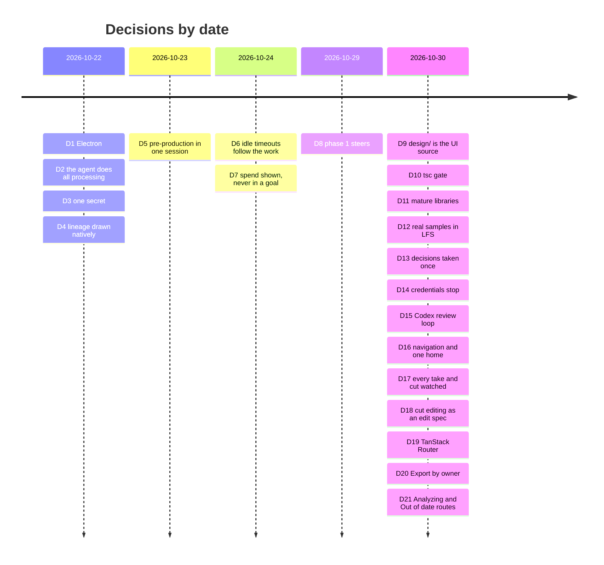

# Decisions

The studio's decisions, logged once, by date (arc42, section 9: an architecture decision record
captures one decision and its rationale, and a project's records together are its decision log
[1](#ref-1), [2](#ref-2)). Each entry gives the context, the decision, the alternatives
the record names, its grounds, its consequences, the words it rests on, and where it is recorded.
Nothing is added that the record does not contain: "none recorded" says so. Words in quotation
marks are verbatim, and a Chinese quote is followed by our English gloss in italics;
merecdesperez44323-lab is named by that GitHub id. Other documents cite an entry by its number.

The entries up to D7 come from the first proposal and build plan (22–24 October 2026); D8 onward
from the redesign. Those plans, `PROPOSAL.md`, `IMPLEMENTATION_PLAN.md` and `REDESIGN_PLAN.md`, were
folded into these documents on 30 October 2026; an entry that cites them cites their text in Git
history, in `docs/` at commit 07ea708.

## D1. 2026-10-22 · A desktop app on Electron
- **Context.** The studio needs Pine's server SDK, local video that plays and seeks the same on
  every system, and a local web mode.
- **Decision.** Electron, with the engine in a utility process and one React UI that also runs as
  a local web app on 127.0.0.1.
- **Alternatives.** Tauri 2.12, the runner-up: its three system webviews had open local-video bugs
  on Linux and macOS, and the SDK would need a separate 58–112 MB sidecar. Electrobun 2 (too
  young), Flutter and React Native desktop (no DOM).
- **Grounds.** Pine's SDK names Electron's main process as a supported runtime; one bundled
  Chromium plays video the same way on every system.
- **Consequences.** Built on 23 October 2026 on Electron 44 (`package.json`), the engine in a
  `utilityProcess`, signed and notarized macOS builds with self-update.
- **Words.** None recorded.
- **Recorded in.** `PROPOSAL.md`, section 7 and its appendix; `IMPLEMENTATION_PLAN.md`, "Desktop
  app, 23 October 2026"; `desktop/`.

## D2. 2026-10-22 · Pine's agent does all processing; the studio never runs drama-cli
- **Context.** Who reads the screenplay and makes the bible, cast, storyboards, takes and cut.
- **Decision.** Pine's agent, with Pine's drama skill (drama-cli) on the Computer, does all
  processing. The studio is UI, UX and flow: it never runs drama-cli and never generates or
  encodes anything itself.
- **Alternatives.** None recorded.
- **Grounds.** drama-cli's own design rule 1: an agent drives, drama-cli provides, the skill
  teaches (short_drama `AGENTS.md`).
- **Consequences.** Every item the studio shows is a file a turn returned; the maker's decisions
  go back to the agent as answers. Cut editing keeps this boundary (D18).
- **Words.** None recorded.
- **Recorded in.** `IMPLEMENTATION_PLAN.md`, "Decisions carried in".

## D3. 2026-10-22 · One secret: the maker's Pine project key
- **Context.** What the studio must hold to drive Computers.
- **Decision.** The only secret is the Pine project API key. The engine keeps it sealed, with the
  sealing key in the system's credential store; the interface never receives anything that can
  drive a Computer.
- **Alternatives.** None recorded.
- **Grounds.** Pine's starter keeps the project key and Computer credentials on the server and
  gives the page only a short-lived desktop token (`PROPOSAL.md`, section 3.5).
- **Consequences.** No `.env` for the maker to edit; Settings changes or forgets the key, and
  forgetting it first stops the project's running Computers (README, "Run it").
- **Words.** None recorded.
- **Recorded in.** `PROPOSAL.md`, section 5.5; `IMPLEMENTATION_PLAN.md`, "Decisions carried in"
  and "Onboarding and look"; `src/engine/seal.ts`, `src/engine/keychain.ts`.

## D4. 2026-10-22 · The lineage is drawn natively; ComfyUI runs nowhere
- **Context.** drama-cli exports a drama's lineage as a ComfyUI workflow; its live preview installs
  a local ComfyUI of about 1.6 GB, with PyTorch, only to show that graph.
- **Decision.** The agent exports the workflow and returns the file; the studio draws the graph
  itself and offers the file as a download.
- **Alternatives.** The ComfyUI preview on the maker's machine; ComfyUI in the Computer, viewed
  over the remote desktop.
- **Grounds.** A 1.6 GB PyTorch app is the wrong tool to draw a read-only graph on a laptop, and
  the remote desktop is slow and outside the app.
- **Consequences.** The Canvas and Lineage read `drama-cli export comfyui` (`src/engine/lineage.ts`);
  Export offers the workflow file (D20).
- **Words.** None recorded.
- **Recorded in.** `PROPOSAL.md`, section 6.

## D5. 2026-10-23 · Pre-production in one session; episodes on copies of its project
- **Context.** drama-cli keeps a drama in one project whose acceptances are bound to their exact
  files; Pine's sessions share no files.
- **Decision.** The setup session does everything episodes share, in one project: the bible, the
  leads, every breakdown and every shared reference, which the maker approves. It packs the project
  in parts; each episode session restores the parts and works only inside its own episode folder,
  never making a new version of anything shared.
- **Alternatives.** Episodes drawn in parallel from loose copies, which drama-cli would refuse or
  which would draw the same look twice.
- **Grounds.** drama-cli's records hold project-relative paths and hashes, so a copy keeps its
  acceptances.
- **Consequences.** The engine accepts a session's results by owner (an episode's files from its
  own session, shared assets by version and hash), so a late snapshot never overwrites a newer one
  (D16).
- **Words.** None recorded.
- **Recorded in.** `IMPLEMENTATION_PLAN.md`, "Where episodes run" and "Pre-production, 23 October
  2026"; `src/engine/runs.ts`.

## D6. 2026-10-24 · Idle timeouts follow the work: 1 h working, 3 h waiting on the maker
- **Context.** A question waiting for an answer does not keep a Pine Computer running; a Computer
  that stops loses its session's working files.
- **Decision.** Each Computer's idle timeout is 1 hour while it works and 3 hours while any of its
  sessions waits on the maker; on a project whose timeout can't change while running, its
  Computers start with 3 hours.
- **Alternatives.** None recorded.
- **Grounds.** The 1 h base matters because a question can arrive while the app is closed, when
  nothing can raise the timeout.
- **Consequences.** `IDLE_WORKING_S` and `IDLE_WAITING_S` in `src/engine/config.ts:39-40`.
- **Words.** None recorded.
- **Recorded in.** `PROPOSAL.md`, section 5.3; `IMPLEMENTATION_PLAN.md`, "Where episodes run" and
  "With lifecycle control".

## D7. 2026-10-24 · Spend is shown, never put in a goal
- **Context.** drama-cli used to require a budget, and the skill asked the maker for one, then to
  confirm each paid take.
- **Decision.** The studio records each turn's highest spend reading and shows what each drama and
  episode spent. Agents are told nothing of cost except that spending is authorized and has no cap.
- **Alternatives.** A budget stated in every goal (`PROPOSAL.md`, section 3.4).
- **Grounds.** Pine bills video on the turn that made it, and the charge can settle after the turn
  ends; a budget in the goal stalled real runs on questions about cost.
- **Consequences.** `NO_CAP` in `src/engine/goals.ts:136`; a budget is never a refusal the studio
  stops for (`src/shared/refusal.ts`).
- **Words.** None recorded.
- **Recorded in.** `IMPLEMENTATION_PLAN.md`, "Rules the flow depends on", rule 6.

## D8. 2026-10-29 · Phase 1 steers
- **Context.** The redesign's scope.
- **Decision.** In phase 1 the maker steers: Accept, Send back with a reason, Note, Lineage, and a
  decision on every take and cut. There is no Generate, no prompt editing and no manual drawing,
  not even disabled. Amended on 30 October 2026: phase 1 also edits the cut's spec (D18).
- **Alternatives.** None recorded.
- **Grounds.** merecdesperez44323-lab's decision.
- **Consequences.** `CONTRIBUTING.md`, "Before you start"; a test that no way to generate exists
  (`TESTING.md`, "Product rules are tests").
- **Words.** "第一期可以只引导" (*phase 1 can just steer*); "就是read only" (*that is, read only*).
- **Recorded in.** `REDESIGN_PLAN.md`, "Direction"; `CONTRIBUTING.md`.

## D9. 2026-10-30 · design/ is the one source of the UI
- **Context.** The lanes had changed the UI directly in code, each against its own reference
  screenshots, and the integrated studio drifted far from the prototype merecdesperez44323-lab had
  approved.
- **Decision.** `design/` (the approved prototype's markup and stylesheets) is the one source of the
  studio's UI. A UI change is made there first, published, approved, then ported with the same DOM
  and class names. No pull request adds UI that `design/` doesn't have; one that only brings a
  screen in line with `design/` needs no design step.
- **Alternatives.** Matching the prototype by eye, screen by screen.
- **Grounds.** merecdesperez44323-lab's decision; the prototype is the one place the UI is reviewed.
- **Consequences.** The app imports `design/`'s three stylesheets as they are; `npm run design`
  serves it; `npm run design:diff` compares the two side by side (`design/SCREENS.md`).
- **Words.** "你如果后边要修改ui， 你先修改设计稿和设计组件啥的啊！！！" (*if you change the UI from
  now on, change the design drafts and design components first!!!*); "要系统性！！" (*be
  systematic!!*); "要专业" (*be professional*).
- **Recorded in.** Commit 715900c; `CONTRIBUTING.md`, "The design comes first";
  [design principles](design-principles.md#11-design-first).

## D10. 2026-10-30 · During the sprint, tsc is the gate and CI is paused on redesign/studio
- **Context.** Every landing took about 8 minutes of CI, with turn queues and full suites, and pull
  requests lost rebase races again and again.
- **Decision.** CI is paused for pull requests into `redesign/studio`; `main` keeps it. A change
  lands by rebasing onto the branch's head, running `npx tsc --noEmit`, and pushing as a fast
  forward. The full suite and e2e run on head about once an hour (box-ci), and a break is fixed
  forward.
- **Alternatives.** The full CI on every pull request.
- **Grounds.** At the start of a product, iteration speed matters more than a gate on every change.
- **Consequences.** `.github/workflows/ci.yml:9` (`branches-ignore`). Full CI and e2e come back
  before release and when the work moves to `main`.
- **Words.** "为什么一次 ci 要8 min， 暂时把 ci停掉可以吗？最多 20秒就应该搞定的" (*why does one CI run
  take 8 min? Can CI be paused for now? It should be done in 20 seconds at most*); "现在刚开始
  为什么要做这么重！！！！！" (*we are only starting, why make it this heavy!!!!!*); for the tsc gate,
  "你就参考那个 drama-cli 最多跑一个 什么 py 的什么语法检查啥的" (*follow drama-cli: at most run some
  syntax check, like its Python one*).
- **Recorded in.** Commit f4c701e; [design principles](design-principles.md#13-light-process-early).

## D11. 2026-10-30 · Mature libraries; hand-writing what one covers needs approval
- **Context.** The Canvas and Graph were being built with hand-written pan, zoom, layout and
  minimap, to avoid new dependencies.
- **Decision.** Every job a mature, widely used library covers uses that library, pinned exactly,
  with a one-line reason; only the glue is ours (drama-cli's data, the steering actions, our
  tokens). Adding such a library needs no approval; hand-writing what one covers needs
  merecdesperez44323-lab's approval first. When a library replaces our code, ours is deleted in
  the same change.
- **Alternatives.** No new dependencies, with the infrastructure written by hand.
- **Grounds.** merecdesperez44323-lab's decision, relayed by master.
- **Consequences.** React Flow for the Canvas (commit fc1f459, which deleted the hand-written
  camera, zoom, minimap and their tests), shadcn/ui on Radix, media-chrome, WaveSurfer and the
  rest of `CONTRIBUTING.md`, "Building blocks"; TanStack Router (D19).
- **Words.** "坚决不要自己 ad hoc！！！坚决不要！！！！必须用业内通用的、标准的、流行的、有权威参考的！！！"
  (*absolutely nothing ad hoc of our own!!! absolutely not!!!! it must be what the industry
  commonly uses: standard, popular, with an authoritative reference!!!*); "不是 新加依赖要我同意，
  是你手写乱七八糟的组件反而是要我同意！！！" (*it is not a new dependency that needs my approval; it
  is your hand-written, messy components that do!!!*); "你要用最少的代码， 用最多的 成熟组件和接口！！！"
  (*use the least code, and the most mature components and interfaces!!!*).
- **Recorded in.** `CONTRIBUTING.md`, "Components to use";
  [design principles](design-principles.md#12-mature-libraries-least-code-of-our-own).

## D12. 2026-10-30 · Replay's samples are real drama-cli runs, in Git LFS
- **Context.** Replay showed hand-made placeholders, so no screen could be judged on real work.
- **Decision.** Replay's sample dramas carry five of our own drama-cli productions, with drama-cli's
  own ids, paths, versions, lineage, asset records and cuts made by `drama-cli edit`. Their pictures
  and clips go through Git LFS; a checkout without LFS reads them as no sample.
- **Alternatives.** None recorded.
- **Grounds.** merecdesperez44323-lab's decision: the samples belong in the repository, so that
  whoever develops the studio sees what it looks like with real work.
- **Consequences.** A generated public sample set replaces them before release
  ([architecture](architecture.md#11-before-release)). No test needs the samples (`TESTING.md`).
- **Words.** "肯定要进仓库， 这样别人开发时候也知道什么样子啊" (*they must go in the repository, so
  others know what it looks like when they develop*); "效果图里的你就直接放在样例数据里啊！！！" (*put
  what is in the mock-ups straight into the sample data!!!*).
- **Recorded in.** Commits 42182d9, a81cee6 to 5edb51d; `REUSED.md`, "Replay's sample media".

## D13. 2026-10-30 · A review decision is taken once, by its submission id
- **Context.** Two bugs had sent one review's decision twice; Codex's re-review asked for
  idempotency in the engine, not only a disabled button.
- **Decision.** Each sending of a draft carries a submission id, made once by the studio and kept
  for a retry. The engine claims it on the review before awaiting anything: the same id again
  returns the review as the first sending left it; another id for a decided review is refused
  (`review-decided`, 409); a failed send clears the claim. An edited draft is a new submission.
- **Alternatives.** The disabled button alone, which stops only the double click.
- **Grounds.** Stripe's idempotent requests are the established pattern
  ([design principles](design-principles.md#9-design-for-failure)); the IA proposal, section 14.6.
- **Consequences.** `src/engine/reviews.ts:138-141`; `flow.test` covers a retry after a failed
  send, the same id after success, two windows racing and a second press in flight. One build per
  Apply follows the same rule (D18).
- **Words.** None recorded.
- **Recorded in.** Commit 71ab3d8.

## D14. 2026-10-30 · Missing credentials are their own stop; a budget refusal is the generic card
- **Context.** The StopCard chooses its kind from drama-cli's refusal code.
- **Decision.** `InvalidParameter.env` (drama-cli's missing credentials, action `fix_input`) has
  its own kind, `env`, drawn as `design/`'s credentials stop. A budget refusal stays the generic
  card, since it has no code of its own. `RedLine` is a red line; `SetLimitExceeded.<key>` is a
  cap.
- **Alternatives.** A budget card of its own.
- **Grounds.** Master's decision; drama-cli's own codes (`drama_cli/errors.py`, `describe`).
- **Consequences.** `stopKind` in `src/shared/refusal.ts`. Under Pine's managed execution the
  credentials live outside the session, so the card must point at Pine's recovery, not a `.env`
  (Codex's re-review, C2).
- **Words.** None recorded.
- **Recorded in.** Commit b9f3c18.

## D15. 2026-10-30 · Codex reviews the IA and interaction; master adopts or argues each finding
- **Context.** The navigation and interaction were redesigned in a day.
- **Decision.** Codex reviews each draft read-only, against the running studio and `design/`;
  master records each finding as adopted or argued, with the reasons, before
  merecdesperez44323-lab decides.
- **Alternatives.** None recorded.
- **Grounds.** None recorded beyond the context.
- **Consequences.** Two reviews and two rounds of the draft; B1–B6 fixed with behaviour tests
  (commits 01193f0, 0d8f75c, 6d07955); the IA proposal's sections 10, 12 and 14.
- **Words.** None recorded.
- **Recorded in.** The IA proposal, sections 10–15 [3](#ref-3); Codex's review and
  re-review [4](#ref-4), [5](#ref-5).

## D16. 2026-10-30 · The navigation: a studio-wide rail, the drama's tree, one home per object
- **Context.** The rail, the sidebar and the top bar each offered the drama's places, and Canvas
  and Graph were peers of the guided flow, so one object had several independent pages (Codex's
  review, sections 3 and 5).
- **Decision.**
  - The rail is studio-wide only: Dramas, Reviews, Settings.
  - The drama's tree is Script · Story · Assets (Characters, Locations, Props) · Episodes ·
    Delivery, with the drama's Reviews and an "Out of date" filter; it stops at episodes.
  - An episode has two views, List and Canvas; any item has Lineage, a view, not a home.
  - Every object has one home, one page and one URL; other places only link to it.
  - A drama is one logical drama-cli project; sessions work on copies of it and return its state,
    accepted by owner (D5).
- **Alternatives.** Codex's "no new router, fix the helpers" (master argued for TanStack Router,
  D19); a drama as several working copies (master argued for one logical project).
- **Grounds.** The IA proposal and Codex's two reviews [3](#ref-3), [4](#ref-4),
  [5](#ref-5); VS Code's activity bar, sidebar and editor
  ([design principles](design-principles.md#1-one-home-per-object)).
- **Consequences.** `design/`'s IA draft (published for review); the port moves routes, e2e specs and
  the samples' links in one change, with no compatibility shims.
- **Words.** "ia & ixa 还是非常重要的" (*IA and IxA are still very important*); "是不是要先把
  IA方案定下来， 然后才是后续？不然可能修bug也白修？" (*shouldn't the IA plan be settled first, and the
  rest after it? Otherwise fixing bugs may be wasted*); "找到一个东西是不是最好就是只能从一个地方找到，
  而且是符合用户心智 的， 否则到处都要能找， 用户晕了？" (*isn't it best that a thing can be found in
  only one place, one that fits the user's mental model? Otherwise it must be findable everywhere,
  and users get lost*), then "可以的" (*that works*); "包括 每个东西只有一个家 啥的这种 都是 design
  principle" (*including "every thing has only one home" and the like: these are all design
  principles*).
- **Recorded in.** The IA proposal, sections 2–5, 10–12 and 16–17 [3](#ref-3);
  [design principles](design-principles.md).

## D17. 2026-10-30 · The maker watches every take and every cut
- **Context.** Upload's "Your reviews" let the engine approve takes and the cut on the maker's
  behalf (`approveUnreviewed`), while the screens promised the maker watches every take (Codex's
  review, B6).
- **Decision.** No setting approves a video version (take) or a cut for the maker, and none
  approves a photoreal storyboard. "Your reviews" may skip only looks, shared references and
  line-art storyboards.
- **Alternatives.** Keep the option as a setting.
- **Grounds.** drama-cli's rule that the person watches every take and cut and alone accepts the
  photoreal storyboard (short_drama D76, D141; `doc/architecture.md`, section 7.1, item 7; `AGENTS.md`,
  design rule 10), and its architecture, section 7.1, item 7: the person approves "every take and
  cut" (`doc/architecture.md:222` at short_drama ade90c55); Codex's review, B6 [4](#ref-4).
  Auto-approval was a bug against that rule, not a setting.
- **Consequences.** `LEFT` in `src/engine/reviews.ts:160-164`; `flow.test` keeps EP001's takes,
  photoreal storyboards and cut open under every setting.
- **Words.** None recorded.
- **Recorded in.** Commits 0d8f75c and 2cceb2b; the IA proposal, sections 11.1, 12.4 and 14.4
  [3](#ref-3).

## D18. 2026-10-30 · Cut editing edits a draft of drama-cli's edit spec
- **Context.** merecdesperez44323-lab asked for cut editing in phase 1; Codex warned against local
  edit state competing with drama-cli (review, section 7.4).
- **Decision.** The studio edits only a draft of drama-cli's own edit spec (each clip's path,
  sha256, in, out and audio). Apply hands it to the agent, which runs `drama-cli edit build` and
  `edit validate`; the result returns as a new cut version for review. A draft is bound to its base
  cut and every clip's sha256; if upstream changed, Apply refuses until the maker compares,
  re-checks or discards. Edits (take, order, in and out, audio) are counted apart from notes.
- **Alternatives.** A read-only timeline (Codex's first review); editing in the studio's own state.
- **Grounds.** drama-cli stays the single producer (D2): nothing is encoded or stored as truth in
  the studio.
- **Consequences.** The phase-1 scope reads "steering, plus editing the cut's spec" (D8). One build
  per Apply, keyed by a submission id (D13).
- **Words.** "你先同步把 cut 放上去？因为这个不涉及到 IA" (*put the cut up first, in parallel? It does
  not involve the IA*), 30 October 2026. merecdesperez44323-lab's approval of the edit-spec design:
  pending.
- **Recorded in.** The IA proposal, sections 12.2, 14.2 and 15 (round 2, D1–D3) [3](#ref-3).

## D19. 2026-10-30 · TanStack Router for typed routes
- **Context.** The studio's hand-written router used one untyped `item` for both an episode and an
  artifact; Graph sent a character's id as an episode and the studio fell back to Home (Codex's
  review, B1).
- **Decision.** The IA port moves to TanStack Router, with distinct typed params: an episode code
  (`EP\d{3}`) and an artifact id are separate validated types, an artifact must belong to its drama
  (and episode, where it is episode-scoped), and there is no untyped `item`. Lineage is a search
  parameter on the item's home (`?item=<drama-cli stage id>&view=lineage`), confirmed by master on
  30 October 2026. The router is pinned at 1.170.44, with a code-based route tree in
  `src/ui/routes.tsx`. B1's interim fix stays small: typed helpers in the current router.
- **Alternatives.** Codex: no new router, fix the helpers.
- **Grounds.** D11 (mature libraries over hand-written infrastructure), and type-safe routes are
  what prevents B1. The first proposal had already chosen TanStack Router (`PROPOSAL.md`,
  section 7).
- **Consequences.** `src/ui/router.tsx` and its importers are replaced in the port, with the e2e
  specs and the samples' links in the same change.
- **Words.** None recorded.
- **Recorded in.** The IA proposal, sections 12.1 and 14.1 [3](#ref-3); commit 01193f0
  (the interim fix).

## D20. 2026-10-30 · Export belongs to its owner
- **Context.** Export offered the drama's workflow on every page, the global Reviews included, so
  on a Cut it read as a video download (Codex's review, section 6; re-review, A).
- **Decision.** Export is scoped to the object it exports: on an episode's List, Canvas, Cut and
  Lineage from an item, that episode's session; elsewhere the shared project. It is labelled with
  the session and its stop time. The global Reviews has none.
- **Alternatives.** One drama-wide Export everywhere.
- **Grounds.** One home per object ([design principles](design-principles.md#1-one-home-per-object)).
- **Consequences.** The menu offers the ComfyUI workflow and the infinite-canvas project, downloaded
  under the drama's name (commits d64f5dc, c246944).
- **Words.** None recorded.
- **Recorded in.** `design/` commits c18443e and 721ab7f.

## D21. 2026-10-30 · Analyzing and Out of date have drama-level routes of their own
- **Context.** The route tree gives each object one home (D16); two drama-level pages are not
  views of an object's home.
- **Decision.**
  - `/d/$dramaId/analyzing` stays a top-level drama route. Analyzing and the Fountain review are
    setup steps, a process like the review room, not views of Script, the accepted screenplay's
    home.
  - Out of date is `/d/$dramaId/out-of-date`: a drama-level filter beside Reviews whose rows link
    to each item's home. Until work-02's list replaces it, today's drama-wide Graph is its content.
- **Alternatives.** Analyzing as a view of Script; Out of date as a filter on the Episodes board
  (the IA proposal, section 8.4).
- **Grounds.** work-02's calls, agreed by master on 30 October 2026; Codex's re-review, G6 (Script
  is not the setup review) [5](#ref-5).
- **Consequences.** The router port (D19) carries both routes.
- **Words.** None recorded.
- **Recorded in.** work-05's routing brief, relayed to the docs on 30 October 2026.

## References

[1] G. Starke, P. Hruschka. *arc42*, section 9, "Architecture decisions".
https://docs.arc42.org/section-9/

[2] M. Nygard. *Documenting Architecture Decisions*, 2011.
https://cognitect.com/blog/2011/11/15/documenting-architecture-decisions

[3] master. *Studio information architecture: master's proposal*, 30 October 2026.
Internal working note, not in the repository; its content moves into `docs/studio/` as those
documents land.

[4] Codex. *Pine Drama Studio: information architecture and interaction review*,
30 October 2026. Internal, not in the repository.

[5] Codex. *Pine Drama Studio: IA and interaction draft re-review*, 30 October
2026. Internal, not in the repository.
