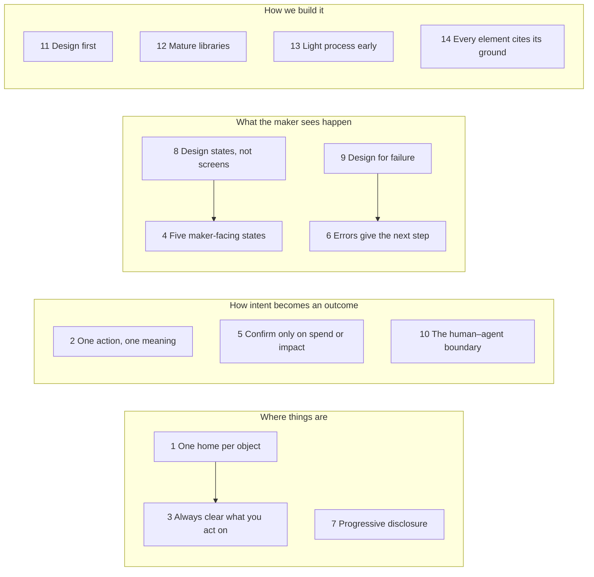
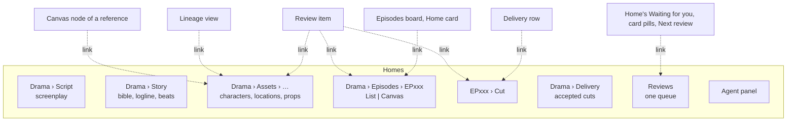
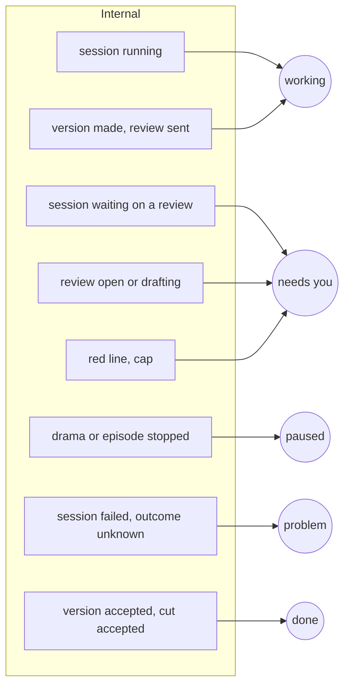
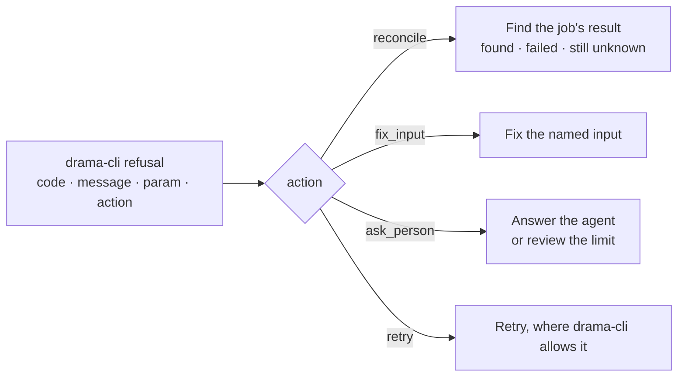
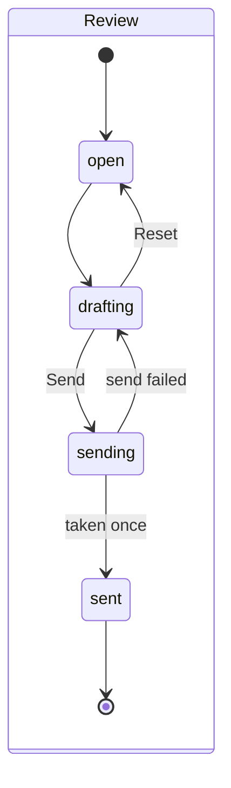
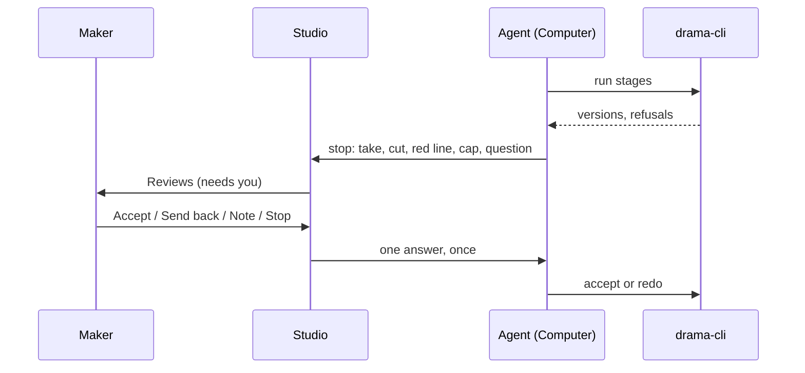
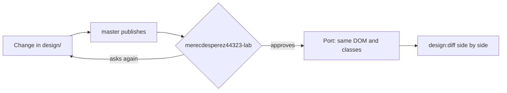

# Design principles

The principles every screen and flow of the studio follows, for anyone who designs a screen in
`design/`, ports one, or reviews either. Each principle states the rule, where it comes from, how
established tools apply it, and what it means here. Decisions that apply a principle are in
[decisions.md](decisions.md); the terms are those of the IA proposal [1](#ref-1).

## The problem

The studio steers agents that make dramas of 24 to 80 episodes, many at once, on several Pine
Computers. The maker is not a developer and does not run the work; they decide. Three things make
this hard:

- **Many objects, several levels.** A drama has a screenplay, a bible, characters, locations and
  props, episodes, scenes, segments, storyboards, takes and cuts, each in versions. Early screens
  offered the same object from the rail, the sidebar and a top switch, each page working out "the
  current object" on its own, and they disagreed: a character's id was read as an episode
  (Codex's review, B1) and the agent panel showed another episode than the canvas (B3)
  [2](#ref-2).
- **Work happens elsewhere, later, and can fail.** A decision goes to an agent on a Computer; the
  result comes back minutes or hours later, or the Computer stops, or a paid request's outcome is
  unknown. A screen that shows only the happy path misleads.
- **Money and done work are at stake.** A send-back redraws; a changed look makes storyboards and
  takes out of date. A wrong click costs money or throws away accepted work.

merecdesperez44323-lab's standard for the result, in a message in Codex's session: "而且不能太复杂，
要非常 straightforward 符合 intuitive" (*and it must not be too complex: very straightforward,
intuitive*).

## How others solve it

- **Code editors** separate global places from the current project and the object being edited:
  VS Code's activity bar, primary sidebar, editor and panel [3](#ref-3). Every file has
  one editor; other views link to it.
- **Usability heuristics** name most of what follows: visibility of system status, a match with
  the user's words, user control and freedom, error prevention, and helping users recognise and
  recover from errors [4](#ref-4).
- **Human–AI interaction guidelines** ask that a system make clear what it can do, show its
  status, support efficient correction and dismissal, and let people control it globally
  [5](#ref-5).
- **Payment and cloud APIs** treat failure and repetition as normal: idempotency keys make a
  retried request safe [6](#ref-6), and reliable systems are designed for the failure of
  any part [7](#ref-7).
- **AI production tools** we studied (Reveric, LibTV on liblib, Astorie) show the work itself as
  the card, with clear status and a contextual inspector. In them the person presses generate on
  every node; in ours the agent generates and the maker reviews and steers (Codex's review,
  section 5) [2](#ref-2).

We take these as they are, and add what agents running on remote Computers need: drama-cli's own
states, codes and recovery actions, shown as they are.

## 1. One home per object

**Rule.** Every object lives in exactly one place, its home: one page, one URL. Other places only
link to that home, and the link lands on it with the object selected; Back returns. No other
place shows a second copy with its own behaviour or state. Lineage is a view of an item's
relations, not another home for it.

**Source.** merecdesperez44323-lab: "找到一个东西是不是最好就是只能从一个地方找到， 而且是符合用户心智
的， 否则到处都要能找， 用户晕了？" (*isn't it best that a thing can be found in only one place, one
that fits the user's mental model? Otherwise it must be findable everywhere, and users get lost*),
then "可以的" (*that works*), and "包括 每个东西只有一个家 啥的这种 都是 design principle" (*including
"every thing has only one home" and the like: these are all design principles*) (the IA proposal,
sections 16 and 17) [1](#ref-1); [D16](decisions.md#d16-2026-10-30--the-navigation-a-studio-wide-rail-the-dramas-tree-one-home-per-object).

**How others do it.** VS Code opens a file in one editor, whichever view you found it from
[3](#ref-3). Object-oriented UX starts from the objects and gives each one a home
[8](#ref-8). The web's canonical URL names the one page that stands for duplicates
[9](#ref-9).

**In the studio.**

A drama's Reviews is a filter of the one queue, not a second queue. The old rail Canvas beside the
drama's own Canvas is the anti-pattern this rule removes. Search (⌘K, later) is the one universal
finder and lands on homes.

## 2. One action, one meaning

**Rule.** Each control does one thing, and the same word means the same thing everywhere:

- **Note** records a remark only;
- **Send back** asks for a redo, with a reason;
- **Accept** accepts this version;
- **Apply** submits a cut edit;
- **Reset** discards the draft; **Undo** reverts the last step.

They are never mixed.

**Source.** The IA proposal, sections 14.7 and 15 [1](#ref-1); Codex's re-review, G3: a
"Note" that accepted with a remark read as a neutral comment [10](#ref-10).

**How others do it.** "Consistency and standards": users should not have to wonder whether
different words, situations or actions mean the same thing [4](#ref-4). Git keeps
`reset` and `revert` apart for the same reason.

**In the studio.** A button's name says its effect, and its accessible name starts with what it
shows (`CONTRIBUTING.md`, "Rules the tests keep"). A cut edit and a note are counted apart
([D18](decisions.md#d18-2026-10-30--cut-editing-edits-a-draft-of-drama-clis-edit-spec)).

## 3. Always clear what you act on

**Rule.** The maker always sees which drama, episode, item and version an action applies to, and
it stays the same across views. The agent's composer names its recipient: "Following EP006" by
default, "Pinned to EP007" when chosen.

**Source.** The IA proposal, sections 10, 13 and 15 (one current-object contract feeding routes,
crumbs, the agent panel and the inspector) [1](#ref-1); Codex's review, B1 and B3
[2](#ref-2); re-review, E [10](#ref-10).

**How others do it.** "Visibility of system status" and "recognition rather than recall"
[4](#ref-4); VS Code's editor title and breadcrumbs name the file and symbol in focus
[3](#ref-3).

**In the studio.** One current object (drama, episode?, artifact and version?, the session
followed or pinned) is the route's typed parameters
([D19](decisions.md#d19-2026-10-30--tanstack-router-for-typed-routes)). The crumb, the inspector
and the agent panel read it; none works it out on its own. A pinned session moves its activity,
messages and composer together.

## 4. Five maker-facing states

**Rule.** By default the maker sees five states: **working · needs you · paused · problem (with the
next step) · done**. Internal states map onto them; the detail is one step away.

**Source.** The IA proposal, section 15 [1](#ref-1).

**How others do it.** Linear groups any number of custom statuses into a few fixed categories
[11](#ref-11); GitHub shows a check as queued, in progress, or completed with a
conclusion.

**In the studio.** The mapping below is ours, from the state machines of section 8:

Two axes stay separate under them: review (accepted, sent back, waiting) and freshness (up to date,
out of date, with drama-cli's reason). Current is not accepted: "current v3 · accepted v2" says so
(the IA proposal, section 10).

## 5. Confirm only when spend grows or done work is affected

**Rule.** Ask for confirmation only when an action spends more or changes done work, with a
one-line summary of the impact. Otherwise act at once, and show the result as state that persists,
not only a toast.

**Source.** The IA proposal, section 15 [1](#ref-1).

**How others do it.** Confirmation dialogs prevent errors only when they are rare and specific; used
for routine actions they are clicked through by habit [12](#ref-12).

**In the studio.** Sending back a look that 61 segments use shows what would be redone before it
goes; accepting a take does not ask. Stopping a drama names the drama.

## 6. Errors give the next step

**Rule.** An error says in plain words what happens next ("Finding the job's result — nothing will
be generated again"). drama-cli's code, message and records are in the details. Recovery follows
drama-cli's own action; there is no blanket Retry.

**Source.** The IA proposal, sections 14.5 and 15 [1](#ref-1); Codex's re-review, C1–C3
[10](#ref-10); drama-cli's actions (`drama_cli/errors.py`, `ACTIONS`;
`src/shared/refusal.ts`).

**How others do it.** Error messages should be visible, say what went wrong in human words, and
offer a constructive way to fix it [13](#ref-13); "help users recognize, diagnose, and
recover from errors" [4](#ref-4).

**In the studio.** A cap shows `ask_person`, never an invented "one more"; a managed Pine refusal
points to Pine's recovery, never to a `.env`; Reconcile shows its three outcomes. A failed session
does not mean its submitted jobs failed, and nothing is paid for twice.

## 7. Progressive disclosure

**Rule.** By default the maker sees the work and what needs them. Lineage, prompts, hashes, specs
and logs appear on demand.

**Source.** The IA proposal, section 15 [1](#ref-1).

**How others do it.** Progressive disclosure defers advanced or rarely used features to a
secondary screen, so the first is easier to learn [14](#ref-14).

**In the studio.** The picture or take fills the card; the version's spec, request, asset record
and lineage sit in the inspector's details. A record a version does not have is shown as missing,
never invented (the IA proposal, section 10).

## 8. Design states, not screens

**Rule.** Every object has one state machine, drawn in `design/` and enforced by the engine. A
screen shows the state; it adds no state of its own.

**Source.** The IA proposal, section 9 [1](#ref-1); merecdesperez44323-lab: "ia & ixa
还是非常重要的" (*IA and IxA are still very important*) [1](#ref-1).

**How others do it.** Statecharts describe reactive systems as states and transitions
[15](#ref-15), and libraries such as XState run them in the UI [16](#ref-16).

**In the studio.** The machines for the drama, episode, session, review, version and cut are in the
IA proposal, section 9 [1](#ref-1). A sent review is frozen and says "Sent · waiting for
the agent"; a new remark is a new submission (Codex's re-review, B2) [10](#ref-10).

## 9. Design for failure

**Rule.** Every action has a failed, interrupted and repeated path, and each is designed: a send
that times out, a window refreshed mid-send, two windows, a Computer that stops, an unknown paid
outcome. Repeating a submission never repeats its effect.

**Source.** The IA proposal, sections 14.5–14.6 and 15 (the interrupt and conflict flows)
[1](#ref-1); [D13](decisions.md#d13-2026-10-30--a-review-decision-is-taken-once-by-its-submission-id).

**How others do it.** Stripe's idempotency keys let a client retry a request safely
[6](#ref-6); AWS's reliability pillar designs for the failure of any component and
automatic recovery [7](#ref-7).

**In the studio.** Each decision and each Apply carries a submission id, so timeouts, refreshes and
two windows collapse to one; a disabled button only stops the double click. Drafts survive leaving
the page. A draft whose base changed is kept, compared and decided on, never applied silently to the
latest.

## 10. The human–agent boundary

**Rule.** The agent runs drama-cli between stops. It stops for every take, every cut, the photoreal
storyboard, any red line, a cap, the screenplay rewrite, and questions. The maker steers by
verdicts, notes, messages, Stop and Resume, and the cut's edit spec, and never generates by hand in
phase 1. Every outcome is a version with its records, reviewable before it is used.

**Source.** The IA proposal, section 9 [1](#ref-1);
[D8](decisions.md#d8-2026-10-29--phase-1-steers),
[D17](decisions.md#d17-2026-10-30--the-maker-watches-every-take-and-every-cut); drama-cli's design
rule 10 (short_drama `AGENTS.md`).

**How others do it.** Microsoft's guidelines for human–AI interaction: make clear what the system
can do, support efficient correction, and provide global controls [5](#ref-5).

## 11. Design first

**Rule.** A UI change is made in `design/` first, published, approved, and then ported with the same
DOM and class names. Code adds no UI the design lacks.

**Source.** [D9](decisions.md#d9-2026-10-30--design-is-the-one-source-of-the-ui); Codex's review,
section 7.1: the IA's problems came partly from the design, so the design is changed before the
React [2](#ref-2).

**How others do it.** Design-to-code handoff from one approved source, as Figma's Dev Mode serves it
[17](#ref-17).

## 12. Mature libraries, least code of our own

**Rule.** Use a mature, widely used library for every job one covers, pinned exactly; write only the
glue. Hand-writing what a library covers needs approval; adding a library doesn't.

**Source.** [D11](decisions.md#d11-2026-10-30--mature-libraries-hand-writing-what-one-covers-needs-approval);
the IA proposal, section 12.1 [1](#ref-1).

**How others do it.** "Choose boring technology": proven tools whose failure modes are known
[18](#ref-18).

**In the studio.** React Flow, shadcn/ui on Radix, media-chrome, WaveSurfer and TanStack Router; the
list with each pick's reason is in `CONTRIBUTING.md`, "Building blocks".

## 13. Light process early

**Rule.** Size the process to the stage. Early on, a gate of seconds and fixes forward; the full CI
and e2e come back before release.

**Source.** [D10](decisions.md#d10-2026-10-30--during-the-sprint-tsc-is-the-gate-and-ci-is-paused-on-redesignstudio).

**How others do it.** Shape Up fixes the time and varies the scope, with little process inside a
cycle [19](#ref-19).

**In the studio.** `npx tsc --noEmit` before a fast-forward push; box-ci runs the full suite and e2e
on head every hour.

## 14. Every element cites its ground

**Rule.** Every UI element and behaviour cites its ground, in this order of strength:

1. A platform or standards guideline, by section: Apple's Human Interface Guidelines for macOS (this
   is a desktop app) [20](#ref-20); the WAI-ARIA Authoring Practices for each widget
   pattern (tabs, radio group, menu, dialog, tree, slider) [21](#ref-21); WCAG 2.2 for
   contrast, names and focus [22](#ref-22); Nielsen's ten heuristics
   [4](#ref-4).
2. An established tool doing the same job, by its documentation or a screenshot in `references/`:
   Figma or React Flow for canvas zoom and selection; Premiere, DaVinci Resolve or Frame.io for player
   controls, timelines and review; VS Code for the activity bar, sidebar, editor and panel; Linear for
   queues; the AI drama tools in `references/`.
3. One of the principles above, by name.
4. Only when none fits: "ours, untested", with the reason; it is checked in the next Codex
   walkthrough.

Never: a one-off style, colour, spacing or control outside `design/`'s tokens and kit; a button
without a defined action and state; a second way to do something that already has one.

**Source.** merecdesperez44323-lab, 30 October 2026: "never ad-hoc, randomly puting things here and there, randomly add some elements ,some buttons, some styles on the fly  i think , we need to be professiona", and "it's way much better to find some reference to do someting. just like drama-cli."
([D35](decisions.md#d35-2026-10-30--every-ui-element-and-behaviour-cites-its-ground)).

**How others do it.** drama-cli cites an official document, an established tool or its own design
for every name, format and rule (short_drama `AGENTS.md`, design rule 8 and coding rule 3); design
systems such as Apple's and Material state each component's use and behaviour before it is built
[20](#ref-20).

**In the studio.** Every design change carries the checklist in `CONTRIBUTING.md`, "The design
comes first"; `design/SPEC.md` gives each component its ground.

## References

[1] master. *Studio information architecture: master's proposal*, 30 October 2026,
sections 9–17. Internal working note, not in the repository; its content moves into `docs/studio/`.
merecdesperez44323-lab's words quoted here are recorded there.

[2] Codex. *Pine Drama Studio: information architecture and interaction review*,
30 October 2026. Internal, not in the repository.

[3] Microsoft. *Visual Studio Code UX Guidelines*, "Overview" (activity bar,
primary sidebar, editor, panel). https://code.visualstudio.com/api/ux-guidelines/overview

[4] J. Nielsen. *10 Usability Heuristics for User Interface Design*, Nielsen
Norman Group. https://www.nngroup.com/articles/ten-usability-heuristics/

[5] S. Amershi et al. *Guidelines for Human-AI Interaction*, CHI 2019.
https://www.microsoft.com/en-us/research/publication/guidelines-for-human-ai-interaction/

[6] Stripe. *Idempotent requests*, API reference.
https://docs.stripe.com/api/idempotent_requests

[7] Amazon Web Services. *AWS Well-Architected Framework, Reliability Pillar*.
https://docs.aws.amazon.com/wellarchitected/latest/reliability-pillar/welcome.html

[8] S. Prater. *Object-Oriented UX (OOUX)*. https://ooux.com

[9] Google Search Central. *How to specify a canonical URL*.
https://developers.google.com/search/docs/crawling-indexing/consolidate-duplicate-urls

[10] Codex. *Pine Drama Studio: IA and interaction draft re-review*, 30 October
2026. Internal, not in the repository.

[11] Linear. *Issue status*, workflow categories.
https://linear.app/docs/configuring-workflows

[12] J. Nielsen. *Confirmation Dialogs Can Prevent User Errors (If Not Overused)*,
Nielsen Norman Group. https://www.nngroup.com/articles/confirmation-dialog/

[13] Nielsen Norman Group. *Error-Message Guidelines*.
https://www.nngroup.com/articles/error-message-guidelines/

[14] J. Nielsen. *Progressive Disclosure*, Nielsen Norman Group.
https://www.nngroup.com/articles/progressive-disclosure/

[15] D. Harel. *Statecharts: a visual formalism for complex systems*, Science of
Computer Programming 8(3), 1987.

[16] Stately. *State machines and statecharts*, XState documentation.
https://stately.ai/docs/state-machines-and-statecharts

[17] Figma. *Dev Mode*. https://www.figma.com/dev-mode/

[18] D. McKinley. *Choose Boring Technology*, 2015. https://boringtechnology.club/

[19] R. Singer. *Shape Up*, Basecamp, 2019. https://basecamp.com/shapeup

[20] Apple. *Human Interface Guidelines*. https://developer.apple.com/design/human-interface-guidelines

[21] W3C. *ARIA Authoring Practices Guide*, "Patterns". https://www.w3.org/WAI/ARIA/apg/patterns/

[22] W3C. *Web Content Accessibility Guidelines (WCAG) 2.2*. https://www.w3.org/TR/WCAG22/
