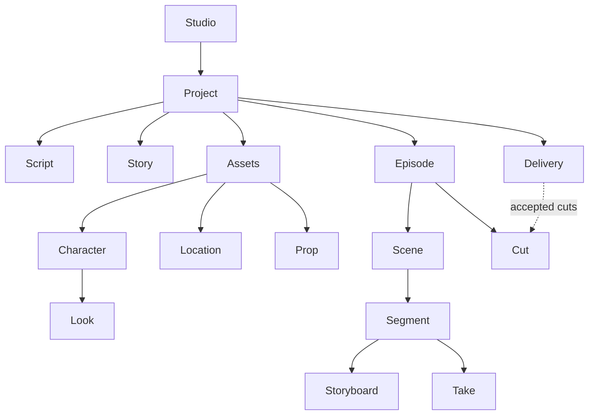

# Glossary

Every term the studio's documents and screens use, defined once (arc42, section 12: the domain and
technical terms the stakeholders use, to avoid synonyms and homonyms [1](#ref-1)). Other
documents link a term here instead of defining it again. drama-cli's own terms (bible, breakdown,
look, plate, segment, version, accepted, stale and the rest) are defined in drama-cli's glossary
[2](#ref-2); a row here says what the studio calls them and where they live.

The English terms are the ones the IA proposal adopted after Codex's review (section 10)
[3](#ref-3). The Chinese terms are Codex's (review, section 4) [4](#ref-4);
merecdesperez44323-lab's decision on them is pending (the IA proposal, section 11.3), and today's
`src/ui/i18n.ts` moves to them in the IA port. "Ours" marks a term of our own, with the reason.

## The studio and Pine

| Term | 中文 | Definition | Source |
|---|---|---|---|
| **studio** | 工作室 | The app, Pine Drama: a workspace of projects on one Pine project. The word names nothing else, never a view. | the IA proposal, sections 1 and 4 [3](#ref-3) |
| **maker** | | The app's user: uploads a screenplay, reviews and steers; never runs drama-cli. | ours: the role the studio serves ([D2](decisions.md#d2-2026-10-22--pines-agent-does-all-processing-the-studio-never-runs-drama-cli)) |
| **agent** | 智能体 | Pine's agent with Pine's drama skill (drama-cli), which does all processing on a Computer. | [D2](decisions.md#d2-2026-10-22--pines-agent-does-all-processing-the-studio-never-runs-drama-cli) |
| **Computer** | 云端电脑 | A Pine sandbox that runs up to three sessions; started, stopped or paused, with an idle timeout ([D6](decisions.md#d6-2026-10-24--idle-timeouts-follow-the-work-1-h-working-3-h-waiting-on-the-maker)). How many run at once is a setting, the concurrency. | Pine Computer ([architecture](architecture.md#2-constraints)) |
| **session** | 会话 | One agent with its own working directory on a Computer, for one project: one setup session, then one per episode at work. Sessions share no files. | Pine Computer ([architecture](architecture.md#2-constraints)); [D5](decisions.md#d5-2026-10-23--pre-production-in-one-session-episodes-on-copies-of-its-project) |
| **turn**, **goal** | | One agent run, started with a goal (the instructions) and ended at a stop; its returned files are the turn's results. | Pine Computer (`run`, `wait`, `answer`, `steer`) |
| **stop** | | Where a turn ends and waits on the maker: a review, a question, a red line or a cap. The agent stops for every take, every cut, the photoreal storyboard, any red line, a cap, the screenplay rewrite and questions. | the IA proposal, section 9 [3](#ref-3) |
| **activity** | 执行记录 | A session's progress messages, shown in the agent panel; not a production object. | Codex's review, section 4 [4](#ref-4) |
| **engine** | | The studio's local process that holds the project key, drives Computers and serves the UI's API. | ours ([D1](decisions.md#d1-2026-10-22--a-desktop-app-on-electron), [D3](decisions.md#d3-2026-10-22--one-secret-the-makers-pine-project-key)) |
| **replay** | | A mode that plays recorded sample projects without Pine, for trying the studio and for tests. | ours ([D12](decisions.md#d12-2026-10-30--replays-samples-are-real-drama-cli-runs-in-git-lfs)) |
| **Spent** | 已花费 | Agent turns and video, as Pine prices them when each turn ends; drama-cli's text and image calls are included at no charge. Shown per drama and episode, never put in a goal. Reserved and Budget are proposed beside it, not yet shown. | [D7](decisions.md#d7-2026-10-24--spend-is-shown-never-put-in-a-goal); the IA proposal, sections 10 and 13 [3](#ref-3) |

## The project

| Term | 中文 | Definition | Source |
|---|---|---|---|
| **project** | 项目 | The UI's container: one logical drama-cli project, with its screenplay, config and bible, and the drama it makes. Sessions work on copies of it and return its state, accepted by owner. "drama" stays the internal name in routes (`/d/`), the API and the engine's types until a rename after release. | [D46](decisions.md#d46-2026-10-30--the-uis-container-is-a-project) (reverses Codex's Drama / 剧目); [D16](decisions.md#d16-2026-10-30--the-navigation-a-studio-wide-rail-the-dramas-tree-one-home-per-object); the IA proposal, sections 12.3 and 14.3 [3](#ref-3) |
| **project type** | | What a project makes, which sets its workflow and presets. Drama is the only type; ads, films and launch videos are future types, not built. | [D49](decisions.md#d49-2026-10-30--a-project-has-a-type-drama-is-the-only-one) |
| **Script** | 剧本 | The project's page for its screenplay: the original, the Fountain rewrite and their difference. Fountain is the format, not a page. | Codex's review, section 4 [4](#ref-4); [D21](decisions.md#d21-2026-10-30--analyzing-and-out-of-date-have-drama-level-routes-of-their-own) |
| **Bible** | 设定集 | The project's page for the bible, drama-cli's versioned document: its logline, beats and episodes. Formerly Story ([D61](decisions.md#d61-2026-10-30--story-is-renamed-bible-as-drama-cli-calls-it)). | Codex's review, section 4 [4](#ref-4); drama-cli's bible [2](#ref-2) |
| **Assets** | 素材 | The shared references every episode uses: Characters, Locations, Props. | the IA proposal, section 10 [3](#ref-3) |
| **character**, **look** | 角色，造型 | A character of the bible; a look is one of its outfits (S0, S1…), shown by its readable name with the key kept. | drama-cli's look [2](#ref-2); Codex's review, section 4 [4](#ref-4) |
| **location** | 地点 | A place of the bible, with its location references (drama-cli's plates: views, Day and Night). Not a scene: one location holds many scenes. | the IA proposal, section 10 [3](#ref-3) |
| **prop** | 道具 | A key prop of the bible, with its reference images. | drama-cli's prop [2](#ref-2) |
| **episode** | 集 | One episode of the project's drama (EP001…), with its breakdown; the main unit of navigation. Its home is its Canvas. | [D16](decisions.md#d16-2026-10-30--the-navigation-a-studio-wide-rail-the-dramas-tree-one-home-per-object) |
| **scene** | 场戏 | The screenplay's scene, inside an episode. | Codex's review, section 4 [4](#ref-4) |
| **segment** | 片段 | One video request (seg01…), inside a scene; it holds shots (镜头). | drama-cli's segment and shot [2](#ref-2) |
| **blocking**, **first-frame reference**, **storyboard** | 走位图，首帧参考图，分镜 | A segment's pictures before video. Line-art and photoreal storyboards are different items with different uses; the maker alone accepts the photoreal one. | Codex's review, section 4 [4](#ref-4); [D17](decisions.md#d17-2026-10-30--the-maker-watches-every-take-and-every-cut) |
| **take** | 视频版本 | One video version of a segment (t01, t02…). Not a shot and not a segment. The maker watches every take. | the IA proposal, section 10 [3](#ref-3); [D17](decisions.md#d17-2026-10-30--the-maker-watches-every-take-and-every-cut) |
| **cut** | 剪辑成片 | An episode's film, in versions (v1, v2…), built by `drama-cli edit` from its edit spec. The maker watches every cut. | the IA proposal, section 10 [3](#ref-3); [D18](decisions.md#d18-2026-10-30--cut-editing-edits-a-draft-of-drama-clis-edit-spec) |
| **edit spec** | | drama-cli's plan of a cut: each clip's path, sha256, in, out and audio. The studio edits only a draft of it. | [D18](decisions.md#d18-2026-10-30--cut-editing-edits-a-draft-of-drama-clis-edit-spec) |
| **Delivery** | 交付 | The project's page of accepted cuts and their downloads. | the IA proposal, section 10 [3](#ref-3) |

## Versions and their state

| Term | 中文 | Definition | Source |
|---|---|---|---|
| **version** | 版本 | One output of an item (v1, t01…), never overwritten, with the records it has: spec, request, asset record, lineage. A missing record is shown as missing. | drama-cli's version [2](#ref-2); the IA proposal, section 10 [3](#ref-3) |
| **current**, **accepted** | 当前，已接受 | Two facts, shown apart: the version in use and the one accepted ("current v3 · accepted v2"). Accepted comes from drama-cli's status, never from "the one before". | the IA proposal, section 10 [3](#ref-3); Codex's re-review, B1 [5](#ref-5) |
| **review state** | | Accepted, sent back or waiting: one of a version's two axes. | the IA proposal, section 10 [3](#ref-3) |
| **Up to date**, **Out of date** | 有效，已过期 | The other axis: drama-cli's fresh and stale, with drama-cli's reason (`problems`). The UI says Up to date and Out of date; stale and fresh stay in the details. | Codex's re-review, G2 [5](#ref-5); drama-cli's stale [2](#ref-2) |
| **lineage** | 来源与依赖 | What a version was made from and what was made from it, read from `drama-cli export comfyui`. A view of an item, not a home. | [D4](decisions.md#d4-2026-10-22--the-lineage-is-drawn-natively-comfyui-runs-nowhere); [D16](decisions.md#d16-2026-10-30--the-navigation-a-studio-wide-rail-the-dramas-tree-one-home-per-object) |
| **maker-facing states** | | The five states the maker sees by default: working, needs you, paused, problem (with the next step), done. Internal states map onto them. | the IA proposal, section 15 [3](#ref-3); [design principles](design-principles.md#4-five-maker-facing-states) |

## Review and steering

| Term | 中文 | Definition | Source |
|---|---|---|---|
| **Reviews** | 待审 | The one queue of decisions waiting across projects; a project's Reviews is a filter of it. | the IA proposal, sections 4 and 16 [3](#ref-3) |
| **review**, **review room** | 审阅室 | One decision a session waits on (a question, pictures, takes, a cut or a red line), and the page where the maker takes it. | the IA proposal, sections 1 and 4 [3](#ref-3) |
| **Accept**, **Send back**, **Note** | 接受 | Accept accepts this version; Send back asks for a redo, with a reason; Note records a remark only. | [design principles](design-principles.md#2-one-action-one-meaning) |
| **draft** | | A review's verdicts and notes, or a cut's edit spec, before Send or Apply; it survives leaving the page. | the IA proposal, section 13 [3](#ref-3) |
| **Apply** | | Submits a cut's edit-spec draft to the agent, which builds a new cut version. | [D18](decisions.md#d18-2026-10-30--cut-editing-edits-a-draft-of-drama-clis-edit-spec) |
| **Reset**, **Undo** | | Reset discards the draft; Undo reverts its last step. | the IA proposal, section 14.7 [3](#ref-3) |
| **submission id** | | The id one sending of a draft carries, so a retry, a refresh or a second window takes effect once. | [D13](decisions.md#d13-2026-10-30--a-review-decision-is-taken-once-by-its-submission-id); Stripe's idempotency key |
| **steer** | | A message to a running agent; with Stop and Resume, how the maker directs work between reviews. | Pine Computer (`steer`) |
| **Following**, **Pinned** | | The agent panel's recipient: "Following EP006" (the episode in view) by default, "Pinned to EP007" when chosen. | the IA proposal, section 13 [3](#ref-3) |

## Stops and recovery

| Term | 中文 | Definition | Source |
|---|---|---|---|
| **refusal** | | drama-cli's failure, as it prints it: code, message, param and action (`reconcile`, `fix_input`, `ask_person`, `retry`). Recovery follows the action; there is no blanket Retry. | drama-cli's errors (`drama_cli/errors.py`); [design principles](design-principles.md#6-errors-give-the-next-step) |
| **StopCard**, **stop kind** | | The card that lays out a refusal's facts; its kind (red line, cap, credentials, generic) comes from the code. | [D14](decisions.md#d14-2026-10-30--missing-credentials-are-their-own-stop-a-budget-refusal-is-the-generic-card) |
| **red line** | | Content no preset allows, as drama-cli lists it. One from the screenplay stops work for the maker; one drama-cli introduces always goes back. | drama-cli's red line [2](#ref-2) |
| **cap** | | A limit in the project's config (`SetLimitExceeded.<key>`); the card names the key and drama-cli's action, `ask_person`. | Codex's re-review, C1 [5](#ref-5) |
| **reconcile** | | Finding a paid job's result when its outcome is unknown: found, failed or still unknown. Nothing is generated again. | drama-cli's unknown and lost [2](#ref-2); Codex's re-review, C3 [5](#ref-5) |

## Navigation

| Term | 中文 | Definition | Source |
|---|---|---|---|
| **rail** | | The studio-wide column: Projects, Reviews, Settings. No project's places. | [D16](decisions.md#d16-2026-10-30--the-navigation-a-studio-wide-rail-the-dramas-tree-one-home-per-object); VS Code's activity bar |
| **project tree** | | The sidebar inside a project: Script · Story · Assets · Episodes · Delivery, with the project's Reviews and Out of date. It stops at episodes. | [D16](decisions.md#d16-2026-10-30--the-navigation-a-studio-wide-rail-the-dramas-tree-one-home-per-object); VS Code's explorer |
| **home** | | An object's one page and URL; other places only link to it. | [design principles](design-principles.md#1-one-home-per-object) |
| **Canvas** | | An episode's page: its segments as groups on one board, in drama-cli's export layout. | [D66](decisions.md#d66-2026-10-30--an-episode-is-its-canvas-laid-out-as-drama-clis-export) |
| **agent panel**, **ball** | | The agent beside whatever is open: sessions, decisions, activity, composer. One form: a right sidebar, open or collapsed to the ball (D32 as amended). | the IA proposal, sections 2 and 7.5 [3](#ref-3) |
| **current object** | | The project, episode, item, version and session an action applies to, carried by the route's typed parameters. | [D19](decisions.md#d19-2026-10-30--tanstack-router-for-typed-routes); [design principles](design-principles.md#3-always-clear-what-you-act-on) |
| **Analyzing**, **Fountain review** | | The setup steps that read the screenplay and review its Fountain rewrite; a process, not a view of Script. | [D21](decisions.md#d21-2026-10-30--analyzing-and-out-of-date-have-drama-level-routes-of-their-own) |

## Words retired

| Retired | Use | Why |
|---|---|---|
| Studio / Canvas / Graph as a switch | an episode's Canvas; Lineage on an item | "Studio" names the app only (the IA proposal, section 3) |
| Graph | Lineage | a view of an item, not a place ([D16](decisions.md#d16-2026-10-30--the-navigation-a-studio-wide-rail-the-dramas-tree-one-home-per-object)) |
| To review, Inbox | Reviews | one queue, one name (the IA proposal, section 4) |
| Crew, Production line | Computers; concurrency is a setting | Crew meant both machines and people (Codex's review, section 4) |
| World, Cast, Scenes (as asset sections) | Assets: Characters, Locations, Props | a scene is the screenplay's (the IA proposal, section 10) |
| Drama, 剧目 (in the UI) | Project, 项目 | the studio makes nothing but dramas, so the word names no container ([D46](decisions.md#d46-2026-10-30--the-uis-container-is-a-project)) |
| 镜头, 片段, 成片 for a take | 视频版本 | they are a shot, a segment and a film (Codex's review, section 4) |
| Story | Bible | drama-cli's name ([D61](decisions.md#d61-2026-10-30--story-is-renamed-bible-as-drama-cli-calls-it)) |
| List, Segments (an episode's views) | Canvas | the Canvas in drama-cli's layout holds what they showed ([D66](decisions.md#d66-2026-10-30--an-episode-is-its-canvas-laid-out-as-drama-clis-export)) |
| Fresh, Stale (in the UI) | Up to date, Out of date | one pair for the maker (Codex's re-review, G2) |

## References

[1] G. Starke, P. Hruschka. *arc42*, section 12, "Glossary".
https://docs.arc42.org/section-12/

[2] drama-cli. *Glossary*, short_drama `doc/glossary.md`.

[3] master. *Studio information architecture: master's proposal*, 30 October 2026.
Internal working note, not in the repository; its content moves into `docs/studio/`.

[4] Codex. *Pine Drama Studio: information architecture and interaction review*,
30 October 2026, section 4, the table of terms. Internal, not in the repository.

[5] Codex. *Pine Drama Studio: IA and interaction draft re-review*, 30 October
2026. Internal, not in the repository.
