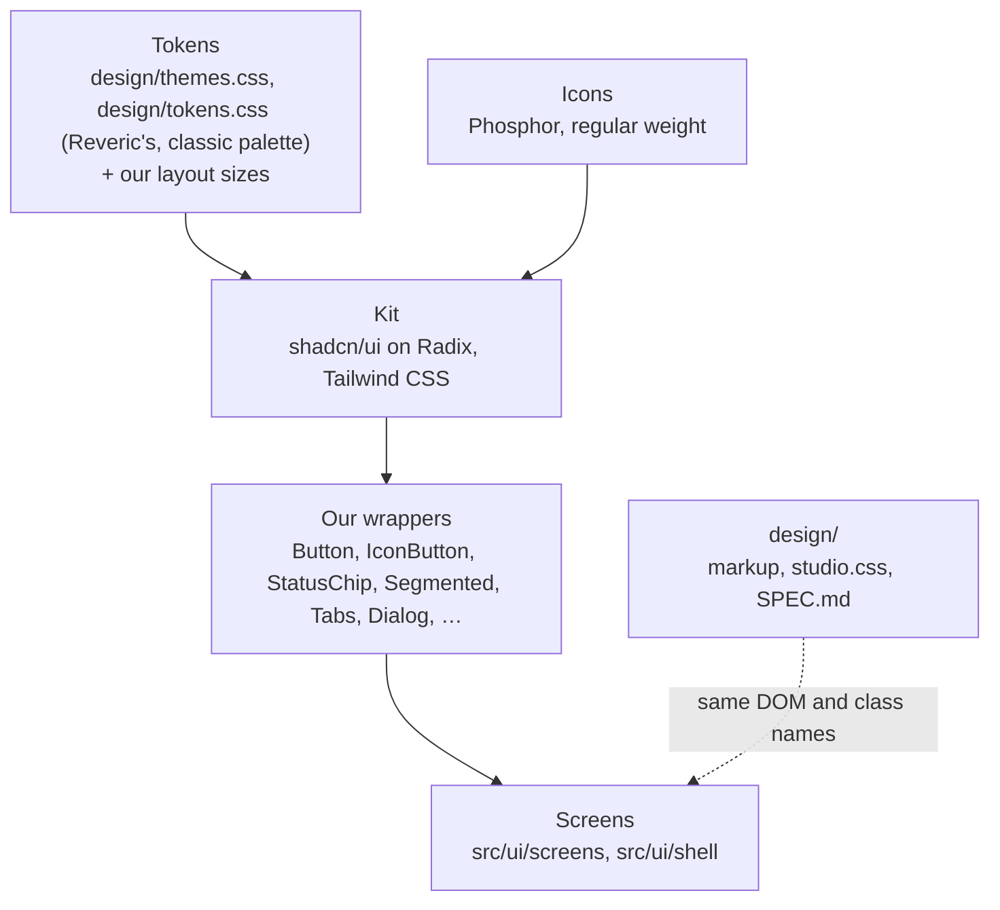
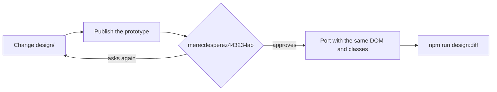

# Design system

What the studio's screens are made of, for anyone who designs a screen in `design/`, ports one, or
adds a component: where the tokens, icons and components come from, the rules every screen keeps,
and where each value is stated. Per-component values (sizes, variants, states) are in
[`design/SPEC.md`](../../design/SPEC.md), the one source of them; the libraries and their reasons
are in [CONTRIBUTING.md](../CONTRIBUTING.md#building-blocks).

## The problem

The first screens were built lane by lane, each against its own reference screenshots, with
hand-written buttons, menus, dialogs, a canvas camera and a minimap. The integrated studio drifted
far from the prototype merecdesperez44323-lab had approved
([D9](../decisions.md#d9-2026-10-30--design-is-the-one-source-of-the-ui)), and every hand-written
component was code the studio had to own
([D11](../decisions.md#d11-2026-10-30--mature-libraries-hand-writing-what-one-covers-needs-approval)).
merecdesperez44323-lab's words: "你如果后边要修改ui， 你先修改设计稿和设计组件啥的啊！！！" (*if you
change the UI from now on, change the design drafts and design components first!!!*), and "要系统性！！"
(*be systematic!!*).

## How others solve it

- **Design tokens** name every colour, size and type style once, and components use the names, not
  the values; the W3C Design Tokens Community Group defines the format tools exchange
  [1](#ref-1).
- **Headless primitives with a styled kit:** Radix provides accessible behaviour (focus, keyboard,
  ARIA) [2](#ref-2), and shadcn/ui copies styled components built on it into the
  project, themed by its tokens [3](#ref-3).
- **One approved source handed to code,** as Figma's Dev Mode serves it [4](#ref-4);
  ours is `design/`'s markup and stylesheets, which the app imports as they are.

## The layers

| Layer | Where | Rule |
|---|---|---|
| Colour, type, space, radii, shadows | `design/themes.css`, `design/tokens.css`, imported as they are | every colour is a token; Reveric's two files are never edited (`CONTRIBUTING.md`, "Licence") |
| Our layout sizes and motion | `src/ui/theme/base.css` | the rail 52 px, the sidebar 248, the agent panel 360, the inspector 380, the top bar 52 (`design/SPEC.md`, "Theme") |
| Theme | `src/ui/theme/theme.ts` | `data-palette="classic"` and `data-theme` (`light` or `dark`) on `<html>`; System follows `prefers-color-scheme`; dark is the default look |
| Icons | `src/ui/icons.tsx` | Phosphor by the studio's names; add one by adding its component there |
| Components | `src/ui/components/ui/` (shadcn/ui), `src/ui/components/` (ours) | a wrapper adds only what the studio needs; a component a library covers is not hand-written without approval |
| Screens | `src/ui/screens/`, `src/ui/shell/` | ported from `design/` with the same DOM and class names; no UI that `design/` lacks |

## Rules every screen keeps

- **Contrast.** Text takes `--text-primary` or `--text-secondary` on any ground; `--text-muted`
  only on the canvas, surface, surface-dim and surface-container; `--text-subtle` and `--success`
  only for marks and icons. The allowed pairs are listed in `src/ui/theme/contrast.test.ts` and
  checked against every rule in our stylesheets; axe checks every page the end-to-end tests visit.
- **Names.** A control's accessible name starts with what it shows (WCAG 2.5.3); tests find
  elements by role and name, as a screen reader does.
- **Words.** The interface is in English and Chinese, every key in both (`src/ui/i18n.ts`), in
  sentence case, without emoji or exclamation marks; the terms are the
  [glossary](../glossary.md)'s. Labels ship as `design/SPEC.md`, "Labels", writes them.
- **Type.** System sans for the UI; system mono for ids, codes, money and times; Courier Prime only
  for Fountain text.
- **The work is the card.** A picture or take fills its card at its own aspect ratio; players are
  9:16 phone frames; the facts sit in the inspector, on demand
  ([design principles](../design-principles.md#7-progressive-disclosure)).
- **Status.** A StatusChip per state, from the [interaction](interaction.md#states)'s machines; a
  version shows review and freshness as two chips.
- **Light and dark.** Every component is checked in both, with the gallery's pictures
  (`/dev/gallery`).

## Changing the design

`npm run design` serves `design/` on 127.0.0.1:5180; `npm run design:diff` compares each screen with
the product side by side, and `design/SCREENS.md` records the result per screen. A pull request that
only brings a screen in line with `design/` needs no design step
([D9](../decisions.md#d9-2026-10-30--design-is-the-one-source-of-the-ui);
[design principles](../design-principles.md#11-design-first)).

## References

[1] W3C Design Tokens Community Group. *Design Tokens Format Module*.
https://www.designtokens.org/tr/drafts/format/

[2] WorkOS. *Radix Primitives*, "Introduction".
https://www.radix-ui.com/primitives/docs/overview/introduction

[3] shadcn. *shadcn/ui*, "Introduction". https://ui.shadcn.com/docs

[4] Figma. *Dev Mode*. https://www.figma.com/dev-mode/
