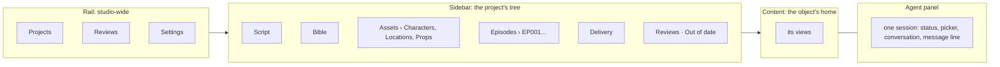

# Information architecture

Where everything in the studio lives and how the maker gets to it: the navigation's levels, each
object's one home, the views each scope has, and the routes. For anyone who designs a screen in
`design/`, ports one, or adds a link. The terms are the [glossary](../glossary.md)'s; the rules
behind this are the [design principles](../design-principles.md), above all
[one home per object](../design-principles.md#1-one-home-per-object).

## The problem

A project holds a screenplay, a bible, characters, locations and props, 24 to 80 episodes, their
scenes, segments, storyboards, takes and cuts, each in versions, and several projects run at once.
The first screens offered the same places three ways: the rail held a project's Script, Story,
Episodes, Canvas, Graph and Cut; the sidebar held them again; a top switch chose Studio, Canvas or
Graph. Each page worked out "the current object" on its own, so a character's id was read as an
episode and the studio fell back to Home (Codex's review, B1), and the agent panel showed another
episode than the canvas (B3) [2](#ref-2). merecdesperez44323-lab asked for the IA to be
settled before anything else: "是不是要先把 IA方案定下来， 然后才是后续？不然可能修bug也白修？"
(*shouldn't the IA plan be settled first, and the rest after it? Otherwise fixing bugs may be
wasted*) ([D16](../decisions.md#d16-2026-10-30--the-navigation-a-studio-wide-rail-the-dramas-tree-one-home-per-object)).

## How others solve it

- **Code editors** keep three levels apart: VS Code's activity bar holds global places, the
  primary sidebar the current project's tree, the editor the object open, and a panel the tools
  beside it [3](#ref-3).
- **Object-oriented UX** starts from the objects the user names and gives each one a home, with
  its relations as links [4](#ref-4).
- **AI drama tools** each solve one part well, and in all of them the person presses generate on
  every item; in ours the agent generates and the maker reviews:

  | Tool | What it does well | Screenshot |
  |---|---|---|
  | BigBanana AI Director | a phase rail always on the left; the shooting script, scene by scene with shot rows; a workbench grid of shot cards; an export sequence map coloured by state | [script](../references/bigbanana-script-manifest.png), [cast](../references/bigbanana-cast.png), [nine panels](../references/bigbanana-nine-grid.png), [workbench](../references/bigbanana-director-workbench.png), [export](../references/bigbanana-export.png) |
  | LocalMiniDrama | project cards; character cards that say which shots they affect; take history under a shot; a canvas of characters, scenes and shots | [projects](../references/localminidrama-projects.png), [cast](../references/localminidrama-cast-affected-shots.png), [shot rows](../references/localminidrama-shot-rows.png), [canvas](../references/localminidrama-canvas.png) |
  | FastMovieAI | a per-episode workspace: a large preview, a history column, a filmstrip of every shot, an inspector with timed lines | [editor](../references/fastmovieai-editor.png) |

  None has a view of every episode by stage; ours has the Episodes board and one queue of reviews.
- **AI production tools** we studied for the redesign make the work itself the card, with a clear status and a
  contextual inspector (Reveric), show a node's inputs and outputs (LibTV on liblib), or put the
  whole project on one canvas (Astorie). One canvas per project does not scale to dozens of
  episodes, so ours adds a level: the episode (Codex's review, section 5) [2](#ref-2).

## The studio's levels

| Level | VS Code's | Holds |
|---|---|---|
| Rail | activity bar | Studio-wide places only: Projects (home), Reviews (every project's queue), Settings. No project's places. Computers and Usage are hidden until they work. |
| Sidebar | explorer | On Home, projects and shelves. In a project, its tree: Script · Bible · Assets (Characters, Locations, Props) · Episodes · Delivery, with the project's Reviews and Out of date. It stops at episodes; segments are in the episode's List. |
| Content | editor | The selected object's home, in the views it has. |
| Agent panel | panel | The conversation with one session: its status line, a picker of the open sessions with Watch and Stop, the conversation, and the line to it (9579a5a). Decisions live in Reviews. |

Sources: [D16](../decisions.md#d16-2026-10-30--the-navigation-a-studio-wide-rail-the-dramas-tree-one-home-per-object);
the IA proposal, sections 2, 8.3 and 12 [1](#ref-1).

## One home per object

| Object | Its home | Places that link to it |
|---|---|---|
| Screenplay and its Fountain versions | Project › Script | — |
| Bible: logline, tone, episodes | Project › Bible ([D61](../decisions.md#d61-2026-10-30--story-is-renamed-bible-as-drama-cli-calls-it)) | — |
| Character, location, prop, and their versions | Project › Assets › … | an episode canvas's reference node, Lineage, review items |
| Episode | Project › Episodes › EPxxx, its Canvas ([D66](../decisions.md#d66-2026-10-30--an-episode-is-its-canvas-laid-out-as-drama-clis-export)) | the Episodes board, Home's cards |
| Segment and its takes | inside its episode: a group on its Canvas | review items, Lineage |
| Cut | EPxxx › Cut | Delivery's rows, review items |
| Accepted cuts | Project › Delivery | — |
| A decision waiting | Reviews, one queue; a project's Reviews is its filter | Home's "Waiting for you" (the newest four and "See all N"), a card's "N need you", Next review |
| What the agent is doing | the agent panel | — |

A link says where it goes and lands on the home with the object selected; Back returns. Search
(⌘K, later) is the one universal finder and lands on homes. Source: the IA proposal, sections 7.2
and 16 [1](#ref-1).

## Views belong to a scope

| Scope | Views |
|---|---|
| Project | Script, Bible, Assets, Episodes (a board of episode cards), Delivery |
| Episode | **Canvas** alone, in drama-cli's export layout: each segment's group holds its shot list, blocking, storyboards and take, with the shared references it reads, read-only, linking to Assets; its **Cut**. No view switch ([D66](../decisions.md#d66-2026-10-30--an-episode-is-its-canvas-laid-out-as-drama-clis-export); the product keeps List \| Canvas until the port) |
| An item or version | its detail, with **Lineage** (what it was made from, what was made from it) as a view of the same home, not a peer page |

Script holds the whole screenplay process, from the upload and the agent's Fountain rewrite to the
maker's acceptance; there is no separate Analyzing step or Fountain review ([D62](../decisions.md#d62-2026-10-30--script-is-the-home-of-the-whole-screenplay-process),
retiring [D21](../decisions.md#d21-2026-10-30--analyzing-and-out-of-date-have-drama-level-routes-of-their-own)'s
Analyzing route).
**Out of date** is a project-level filter beside Reviews, whose rows link to each item's home. Source:
the IA proposal, sections 3, 8.4–8.5 and 10 [1](#ref-1).

## Routes

Each home has one URL; the route's typed parameters are the current object
([D19](../decisions.md#d19-2026-10-30--tanstack-router-for-typed-routes)). The route tree is TanStack
Router's, in `src/ui/routes.tsx`; one reader, `usePlace`, and one builder, `placeLink`
(`src/ui/place.ts`), carry the current object:

| Route | Home |
|---|---|
| `/` | Projects |
| `/new` | a new project: upload and preset |
| `/reviews`, `/reviews?drama=<id>` | the queue, and a project's filter of it |
| `/r/$reviewId` | one review room |
| `/settings` | Settings |
| `/d/$dramaId/script`, `/bible`, `/episodes`, `/delivery` | the project's places |
| `/d/$dramaId/assets/{characters,locations,props}/$assetId?` | Assets, with one selected |
| `/d/$dramaId/e/$episodeCode/{list,canvas,cut}` | an episode's views and its cut |
| `/d/$dramaId/out-of-date` | the Out of date filter |
| `?item=<drama-cli stage id>&view=lineage` | an item selected on its home, and its Lineage |

Two project routes remain from before the IA: `/d/$dramaId/crew` and `/d/$dramaId/canvas`, which
opens the episode it picks on that episode's Canvas.

An episode code is drama-cli's (`EP` and three digits); an item must belong to its project, and to
its episode where it is episode-scoped; anything else is "not found", never a fall back to Home.
The port moved the e2e specs and the design comparison's URLs in the same change, with no
compatibility routes (the IA proposal, sections 8.7 and 14.1) [1](#ref-1).

## The agent's scope

The agent panel follows the episode in view by default, "Following EP006"; the maker can pin it,
"Pinned to EP007", and the status line, the conversation and the line move together. The line
always names its recipient. It has one form on every drama page, a right sidebar like
VS Code's Secondary Side Bar: open beside the page, which narrows (Canvas and the rooms included),
or collapsed to the ball; the maker's choice is kept, and ⌥⌘B / Ctrl+Alt+B toggles it (D32 as
amended; merecdesperez44323-lab asked for one form). Source: the IA proposal, sections
7.5, 11.4 and 13 [1](#ref-1);
[design principles](../design-principles.md#3-always-clear-what-you-act-on).

## Narrow windows

Below about 1100 px the sidebar is hidden: the same tree opens as a drawer. At 1280 px and below
the agent starts collapsed to the ball; opened where there is no room, the same sidebar lays over
the page from the right edge, never a popover (the IA proposal, sections 8.2 and 15, round 2, F;
D32 as amended) [1](#ref-1).
Codex recommends 1024 × 800 as the smallest window in which navigation, review and the agent all
work (re-review, H) [5](#ref-5); merecdesperez44323-lab's decision: pending.

## References

[1] master. *Studio information architecture: master's proposal*, 30 October 2026.
Internal working note, not in the repository; this document carries its content.

[2] Codex. *Pine Drama Studio: information architecture and interaction review*,
30 October 2026. Internal, not in the repository.

[3] Microsoft. *Visual Studio Code UX Guidelines*, "Overview".
https://code.visualstudio.com/api/ux-guidelines/overview

[4] S. Prater. *Object-Oriented UX (OOUX)*. https://ooux.com

[5] Codex. *Pine Drama Studio: IA and interaction draft re-review*, 30 October
2026. Internal, not in the repository.
