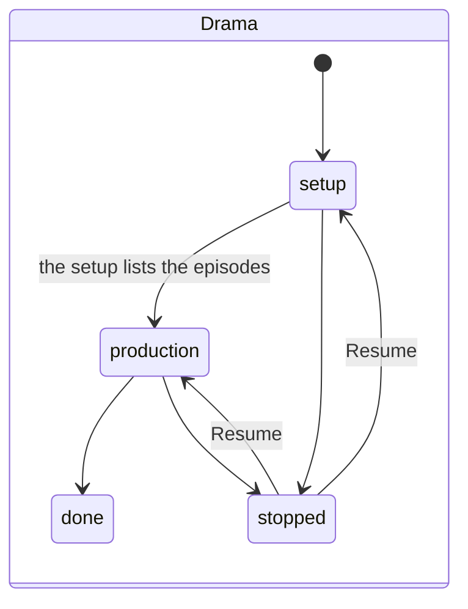
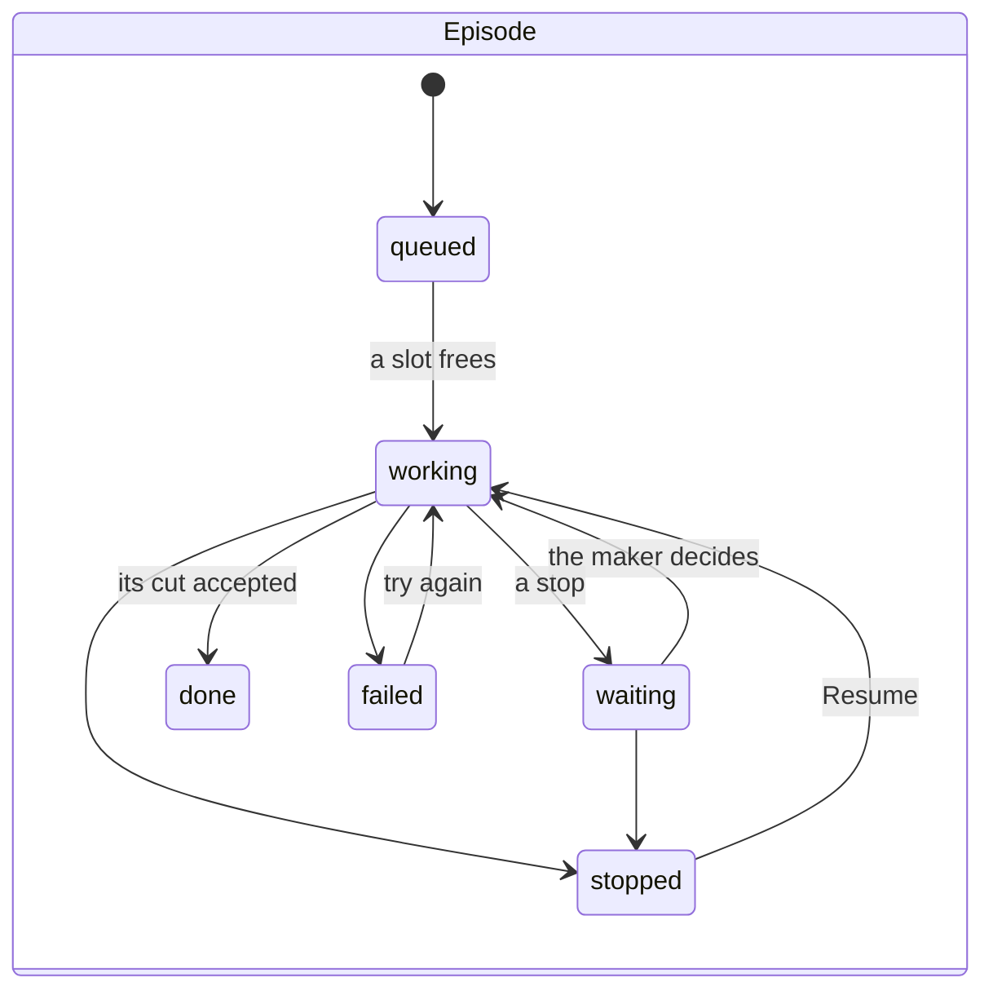
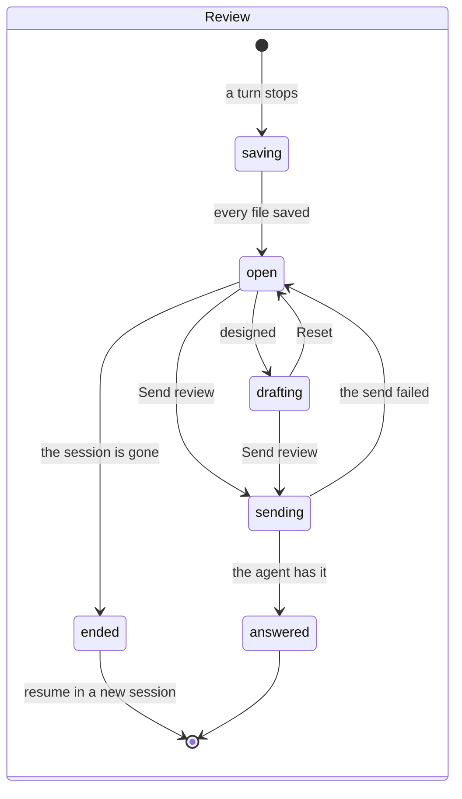
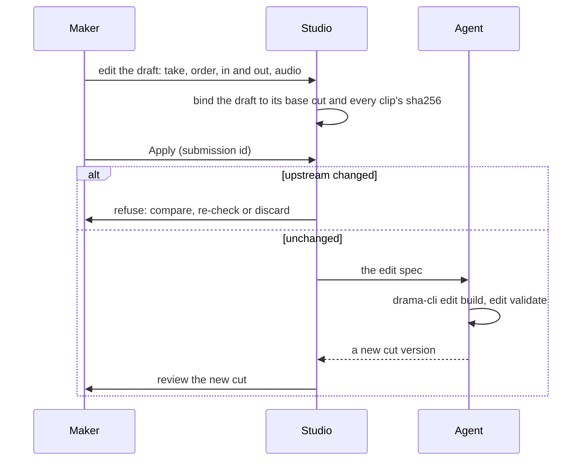

# Interaction

How the maker's intent becomes a reliable outcome: each object's states, the review and cut-editing
flows, stops and recovery, and the three cross-page flows the studio is accepted on. For anyone who
designs or ports a screen that changes something. Where things are is in
[information architecture](information-architecture.md); the rules this applies are the
[design principles](../design-principles.md), sections 2–10.

## The problem

The maker's decision goes to an agent on a remote Computer; the result comes back minutes or hours
later, or the Computer stops, or a paid request's outcome is unknown. Two windows may be open; the
network may drop mid-send. Two bugs had already sent one review's decision twice (Codex's
re-review) [2](#ref-2). merecdesperez44323-lab put the interaction on a par with the
navigation: "ia & ixa 还是非常重要的" (*IA and IxA are still very important*), and asked for it to be
simple: "而且不能太复杂， 要非常 straightforward 符合 intuitive" (*and it must not be too complex:
very straightforward, intuitive*) [1](#ref-1).

## How others solve it

- **Code review** collects remarks as a pending draft and submits them once, as one review with
  one verdict: GitHub's "Start a review", then "Submit review" with Comment, Approve or Request
  changes [3](#ref-3). The studio's review works the same way: verdicts and notes are a
  draft until Send review.
- **Payment APIs** make a repeated request safe with an idempotency key [4](#ref-4).
- **Statecharts** describe a reactive system as states and transitions, drawn once and enforced
  by the code [5](#ref-5).

Ours adds what remote agents need: the agent stops on drama-cli's terms, and recovery follows
drama-cli's own action.

## States

Each object has one state machine, enforced by the engine
([design principles](../design-principles.md#8-design-states-not-screens)). The states below are
the engine's today (`src/shared/types.ts`, `src/engine/records.ts`); a state the design adds and the
engine does not have yet is marked *designed*.

| Object | States | Source |
|---|---|---|
| Drama | setup, production, done, stopped (held: no drama skill, by the maker, or choosing inputs) | `DramaStatus`, `HoldReason` |
| Episode | queued, working, waiting, done, stopped, failed | `EpisodeState` |
| Computer | starting, running, stopping, stopped, failed | `records.ts:60` |
| Session | open, closed, lost | `records.ts:78` |
| Review | saving, open, sending, answered, ended | `ReviewState` |
| Version | made, then accepted, sent back or waiting; and, apart from that, up to date or out of date, with drama-cli's reason | drama-cli's status and lineage ([glossary](../glossary.md#versions-and-their-state)) |
| Cut | v(N) accepted or sent back; an edit spec applied makes v(N+1) | [D18](../decisions.md#d18-2026-10-30--cut-editing-edits-a-draft-of-drama-clis-edit-spec) |

The maker sees five states by default, and the detail one step away:

| Maker-facing | Drama | Episode | Review |
|---|---|---|---|
| working | setup, production | queued, working | saving, sending, answered |
| needs you | — | waiting | open |
| paused | stopped | stopped | — |
| problem, with the next step | a held drama, with its reason | failed | ended |
| done | done | done | — |

The mapping is ours, from the IA proposal, section 15 [1](#ref-1).

## A review

1. A turn stops. Its review is **saving** until every returned file is in the library; only then
   can it be answered ([architecture](../architecture.md#62-a-stop-saved-before-it-is-answerable)).
2. The maker decides each item: **Accept**, **Send back** with a reason, or a **Note**. A take's
   Accept stays disabled until it has been watched to the end. The verdicts and notes are a draft;
   it survives leaving the page; **Reset** discards it and **Undo** reverts its last step.
3. **Send review** shows a summary of the verdicts and notes, then sends them as one answer, with a
   submission id made once and kept for a retry
   ([D13](../decisions.md#d13-2026-10-30--a-review-decision-is-taken-once-by-its-submission-id)).
4. While it sends, the review says so; once sent it is frozen: "Sent · waiting for the agent". A new
   remark is a new submission (Codex's re-review, B2) [2](#ref-2).
5. If the session ended before the answer, the decision is never resent on its own; the review
   offers to resume the episode in a new session, with the saved files and the decision quoted.

The maker decides every take, every cut and the photoreal storyboard; no setting approves them
([D17](../decisions.md#d17-2026-10-30--the-maker-watches-every-take-and-every-cut)).

## Editing a cut

The studio edits only a draft of drama-cli's edit spec; nothing is encoded in the studio. Edits
(take, order, in and out, audio) are counted apart from notes; one build per Apply
([D18](../decisions.md#d18-2026-10-30--cut-editing-edits-a-draft-of-drama-clis-edit-spec)). Phase 1
opens a take of each segment that the episode returned (the design offers accepted takes only), the order, in and out, and source sound or silence; the engine
refuses an Apply whose base cut or clips changed, and a newer cut is edited in its own review
([D24](../decisions.md#d24-2026-10-30--a-cut-edit-is-built-by-drama-cli-after-the-engine-checks-its-base)).

## Stops and recovery

A stop that comes from a drama-cli refusal is drawn as a StopCard, its kind read from the code
([D14](../decisions.md#d14-2026-10-30--missing-credentials-are-their-own-stop-a-budget-refusal-is-the-generic-card)).
Recovery follows drama-cli's action; there is no blanket Retry
([design principles](../design-principles.md#6-errors-give-the-next-step)):

| Stop | What the maker sees | Next step |
|---|---|---|
| A red line in the screenplay (`RedLine`) | the stop in that episode; a compact notice in the others | the maker decides; regenerating cannot fix an input |
| A cap (`SetLimitExceeded.<key>`) | the key and drama-cli's action, `ask_person` | answer the agent, or review the limit; never an invented "one more" |
| Missing credentials (`InvalidParameter.env`) | the credentials stop | under Pine's managed execution, Pine's recovery, never a `.env` |
| An unknown paid outcome | "Finding the job's result — nothing will be generated again" | Reconcile: found, failed or still unknown |
| Any other refusal | drama-cli's words, verbatim | the action drama-cli names |

**Pause production and Resume** work per project, and a session's own Stop and Resume per episode
([D74](../decisions.md#d74-2026-10-31--stop-project-is-pause-production-a-pause-that-says-what-it-does)):
Pause confirms with what it stops, that nothing new starts, nothing more is billed and nothing is deleted;
paused is one state, a Paused chip with Resume; Resume carries on from where each episode stopped. A failed session does not mean
its submitted jobs failed, and nothing is paid for twice.

## Confirmation and feedback

Only an action that spends more or changes done work asks first, with a one-line impact: sending
back a look that 61 segments use shows what would be redone before it goes. Every Send, Apply,
Pause, Stop or Resume confirms in place, as a state that persists, not only a toast, or shows drama-cli's
refusal ([design principles](../design-principles.md#5-confirm-only-when-spend-grows-or-done-work-is-affected)).

## Acceptance: three flows

A first-time maker completes each without help (the IA proposal, section 15) [1](#ref-1):

1. **Change.** Dislike something → name the object → say the change → see the impact → the agent
   works → compare old and new → accept.
2. **Interrupt.** Submit → lose the network or quit → reopen → find the same submission →
   continue, without a second submission.
3. **Conflict.** Editing → the agent returns a new version → the draft is kept → a clear comparison
   → the maker decides.

## References

[1] master. *Studio information architecture: master's proposal*, 30 October 2026,
sections 9, 13–15. Internal working note, not in the repository; this document carries its content.

[2] Codex. *Pine Drama Studio: IA and interaction draft re-review*, 30 October
2026. Internal, not in the repository.

[3] GitHub Docs. *Reviewing proposed changes in a pull request*, "Submitting your
review".
https://docs.github.com/en/pull-requests/collaborating-with-pull-requests/reviewing-changes-in-pull-requests/reviewing-proposed-changes-in-a-pull-request

[4] Stripe. *Idempotent requests*, API reference.
https://docs.stripe.com/api/idempotent_requests

[5] D. Harel. *Statecharts: a visual formalism for complex systems*, Science of
Computer Programming 8(3), 1987.
